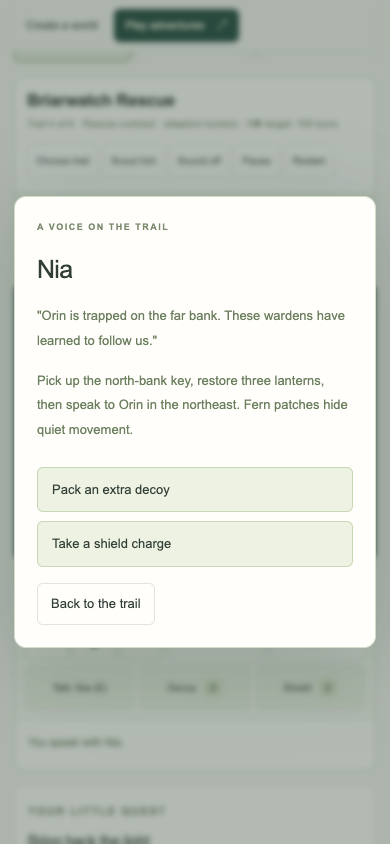
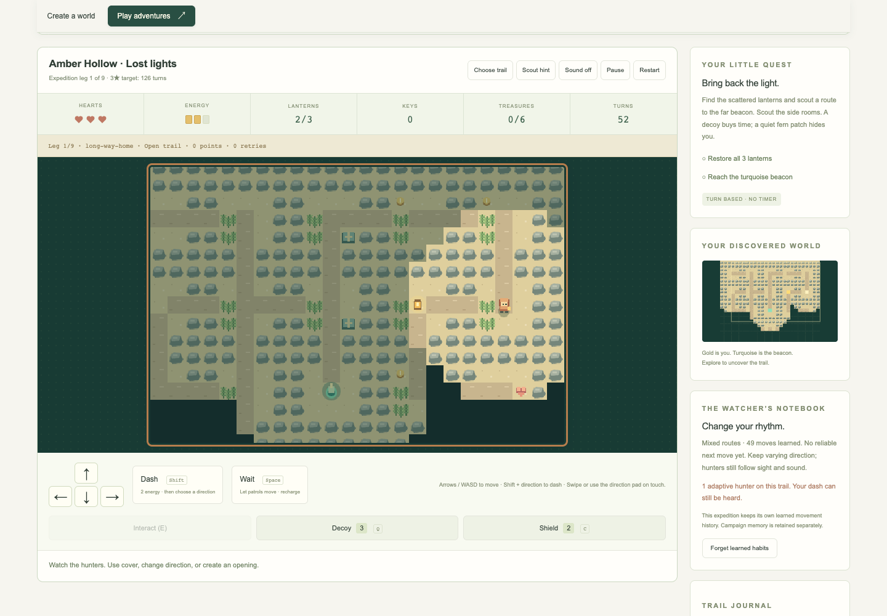
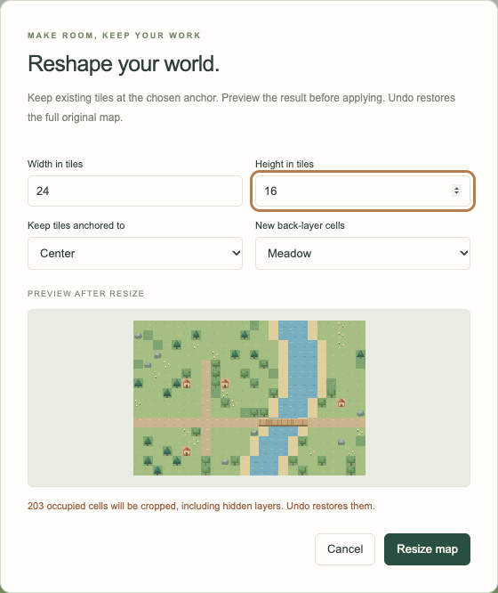

# Tilewright

**Make a little world. Then go on an adventure.** Tilewright combines a local
tile map editor with **Lantern Trails**, an original turn-based puzzle game.
Explore eighteen handcrafted missions across six illustrated chapters or start a branching expedition of three, six,
or nine legs. Try daily trails, build a camp toolkit, rescue keepers, deliver
noisy relics, and outsmart hunters that learn your movement habits. You can also
explore a world you paint.
It uses JavaScript ES modules, HTML, CSS, and Canvas, with no runtime packages,
accounts, or backend.


## Run locally

Install **Node.js 22 or newer**, then run from the repository root:

```sh
npm --prefix Tilewright start
```

Open [http://127.0.0.1:4174](http://127.0.0.1:4174). No `npm install`, API key,
or build step is needed. Stop the server with Ctrl+C. The server binds only to
the loopback interface. To choose another port, run `PORT=4180 npm start` from
this directory (in PowerShell, set `$env:PORT=4180` first).

Use an HTTP server; opening `index.html` with `file://` does not support the
module setup. The editor works without an internet connection while the local
server is running. Installation as an offline web app is future work.

## Play Lantern Trails

Choose **Play adventures**, or open [the game directly](http://127.0.0.1:4174/#play).
Restore every golden lantern, then reach the turquoise beacon. The world advances after a valid move, wait, or tactical interaction; there is no timer.
Dialogue and the Plan forecast pause the turn rules. Blocked moves cost nothing.

| Quest | Challenge | Three-star turn target |
| --- | --- | ---: |
| Candlebrook | Find the brass key, open the forest gate, and avoid a trail warden. | 70 |
| Copper Crossing | Push a crate onto a copper plate to hold a river bridge open. | 85 |
| The Ember Vault | Hold two plates, cross the river, and unlock a guarded lantern vault. | 110 |
| Briarwatch Rescue | Evade adaptive hunters, restore the lights, and return to rescue Orin. | 105 |
| Bellforge Heist | Ring the bells in order, open a signal gate, and cross pulsing embers. | 110 |
| The Watcher’s Crown | Rescue Sola and silence a three-phase Watcher behind crate, key, and relay locks. | 135 |
| Rainmoss Sluice | Choose Luma’s route or supplies, restore two pumps, and change river crossings for the return. | 95 |
| Glasshouse Concord | Reconfigure three arches, cool the ember beds, ring Dew then Sun, and optionally trade coins. | 110 |
| The Last Ferry | Rescue Jun and Sola, deliver the songstone, change the ferry route, and escape a Watcher. | 185 |
| Whispering Stacks | Reverse the archive doors and carry a whispering folio home. | 90 |
| The Ink Market | Walk the entire treasure circuit and ring Quill, Seal, Letter. Dashing is disabled. | 175 |
| Archivist’s Observatory | Change bridges across a star river, rescue Tess, and return the ledger. | 175 |
| Cinder Caravan | Set the wagon brake and choose an oasis route or supplies. | 80 |
| The Sunken Bazaar | Recover six heirlooms using cover and decoys; shields are disabled. | 115 |
| The Furnace Choir | Ring four bells, cool the forge, and rescue two singers from a Watcher. | 175 |
| Frostline Post | Deliver a singing message through a frozen listening post without dashing. | 140 |
| Mirror Reservoir | Align two mirrors, cross three logic bridges, and collect every fragment. | 135 |
| The Aurora Engine | Restore four lights and notes, rescue two keepers, and bring the aurora heart home. | 220 |

The **field atlas** groups missions into six illustrated chapters with region
artwork, mechanic tags, individual bests, and chapter stars for each rule set.
Use the chapter shortcuts or **Begin chapter** to start any region immediately;
its later missions unlock in order. The archives have violet stone, the Amber
Road has warm dunes, and the northern trails have snow and blue pines. Keeper
portraits accompany conversations. Discovered wheels and bells appear on the
minimap, and mission-specific restrictions stay visible above the board.
Optional field goals invite you to find every treasure, hear every keeper, or
finish cleanly; these are current-run goals, while stars and bests are saved.

**Begin hard missions** opens the second act immediately. **Play the sluice saga**
opens the third act at Rainmoss. Each act’s other missions unlock in order. Choose **Nemesis** under Rules to start with two hearts, one
decoy, and one shield, shorten recovery windows, extend hunter vision, add a
reinforcement, and make ember pulses more frequent. Introductory patrols become
adaptive hunters in this mode. Nemesis has separate bests and 85% turn targets.
Changing rules restarts the mission; each act finale offers a replay on Nemesis.

**E / Interact** talks to a keeper, rings a nearby bell, turns a valve, or opens
supplies. When several objects are nearby, choose **Nearby action**, then E or
Interact. All spoken advice is recorded in the journal, including conversations
without a choice. Choices can grant supplies, open a route, or trade unspent
coins once; trades are optional and retain collected treasure credit.
Rescue missions require returning to the stranded keeper after lighting every
lantern; rescued characters follow safely to the beacon. Wrong relay notes reset
the sequence and raise a six-turn alarm. Completed relays open signal gates
and briefly stun hunters. Supplies restore a heart, decoy, and shield charge.

**Plan / V** lists nearby enemy steps, marked sweeps, and next-turn ember
cells without spending a turn. Valve previews explain which crossing cells open
or close and which embers switch off. Occupied crossings cannot close. Player-operated
sluice controls are reversible; required final settings appear in the checklist.

Wardens on the introductory Trail missions follow predictable patrols. Red outlined cells show their next step.
Touching a warden costs a heart, followed by two protected turns to escape.
Trail rules start with three hearts; trail potions restore one. **Dash** travels up to two
cells before patrols move once, spending two energy. Walking and waiting
restore one energy, up to three. Crates can be pushed but not pulled, so plan
the side you approach from. Restart is always available.

Hunters learn from successful moves, waits, and dashes using bounded local
movement counts and action transitions. With a reliable pattern, they anticipate
the next direction or dash and try to intercept it. They need sight, sound, or
a recent lead to locate you. **Their next step is committed before your input**.
The Watcher gains phases as lanterns are restored and marks sweep cells before
striking. Walls block sight and sweeps. Orange outlines mark next-turn ember
danger; crossing a burning cell during a dash still hurts.

**Q / Decoy** throws a false light ahead to distract enemies for five following
turns. **C / Shield** protects this turn and the next two. Both consume a charge
and a turn. Fern patches hide quiet movement from distant hunters, while a dash
stays audible for three turns. The notebook explains observed patterns. Learning
persists in this browser across missions and retries; **Forget learned habits**
clears it while retaining your maps and bests. No remote AI service is used.

Fog reveals the world as you explore. The discovered-map overview, quest
checklist, and **Scout hint** help with navigation and each puzzle. Optional
coins add points. Finish without taking damage within the displayed target for
three stars; two stars need at least two remaining hearts and at most 1.5 times
the target. Other wins earn one star. Points are 250 for finishing, 100 per
lantern, 25 per coin, 50 per remaining heart, and 5 per turn below the target.

Completing a quest unlocks the next one. Best results prioritize stars, then
score, then fewer turns. Progress stays in this browser, separately from the
editor save. If storage is unavailable, unlocks still work for the session.
**Sound** is optional, off by default, and synthesized locally.

| Game action | Control |
| --- | --- |
| Move | Arrow keys / WASD, direction pad, or swipe on the board |
| Dash | Shift + direction, or Dash followed by a direction |
| Wait and recharge | Space with the board focused, or Wait |
| Pause / resume | P / Escape, or Pause |
| Restart current quest | R, or Restart |
| Talk / ring relay / open supplies | E, or Interact |
| Throw a decoy / raise a shield | Q / C, or the tactical buttons |
| Toggle scout hint | H, or Scout hint |
| Read next-turn threats without moving | V, or Plan |
| Choose a quest | Choose trail, then a quest card |

**Play your current map** creates a quiet expedition on a snapshot of visible
layers, with three reachable lanterns, coins, and a beacon. It uses the largest
connected area of at least six walkable cells. Land and bridges are walkable;
water, empty space, trees, rocks, and cabins block movement. Flowers preserve
the terrain beneath them. The turn target comes from the shortest lantern tour
plus 20% room for exploration. Custom expeditions have no wardens or authored
gate puzzles. Editing or renaming a map creates a new expedition identity.
Playing never changes map tiles, autosave, or undo history.



See the [atlas chapter guide](docs/ATLAS.md) and [mission guide, sluice walkthrough, and future ideas](docs/MISSIONS.md) for
walkthrough goals, counterplay, and proposed interactions.

## Play longer expeditions

Choose **Start an expedition** in Play adventures. Pick a seed, three/six/nine
legs, Trail or Nemesis, and an optional oath. Each leg changes the region,
layout, objective, and hunter encounters. Complete lost-light, relay, rescue,
relic-courier, treasure, and final Watcher missions across four regions.

At camp, choose an upgrade and a sheltered/perilous route. Eight upgrades
change stealth, energy, shields, healing, supplies, vision, protection, and
decoys. Four oath choices include collecting every coin, walking without
dashes, and surviving without shields. A single-contract mode and a five-leg
UTC daily trail offer shorter or regularly changing goals. Twelve logbook
badges and separate personal bests track exploration.

Checkpoints retain the current leg, dialogue, supplies, learning, and camp
choices. Resume after reloading, retry a lost leg without losing earlier wins,
or export/import an expedition backup. Maps and campaign saves are retained.
**X / Set relic down** drops carried cargo as a distraction; **E** retrieves it.



See the [expedition guide](docs/EXPEDITIONS.md) for every mode, mission, upgrade,
oath, score rule, checkpoint limit, and ideas for your next run.

## Make your first map

1. Explore **Willowbend**, the bundled fictional map, or select **New map**.
2. Select **Ground** for terrain or **Details** for trees, flowers, and cabins.
   Tiles always affect the selected layer; object tiles do not switch it for you.
3. Choose a tile and paint. Drag the brush for a continuous stroke; try fill,
   rectangle, eraser, or eyedropper from the toolbar.
4. Use the layer eye buttons to hide or show a layer. The uppermost layer in
   the list appears in front. **+** adds a layer, up to six. Open **Layer
   settings** to rename, duplicate, reorder, or delete the selected layer.
5. **Export JSON** saves all layers, including hidden ones, in an editable file.
   **Export PNG** saves visible layers at 24 pixels per tile without the grid.
   Empty cells are transparent in the PNG.

Maps can be 1–64 tiles wide and high. The zoom control changes the editor view,
not export resolution. **Fit map** is the default and shows the whole map,
including after a window resize. Zoom in and select **Pan (H)** to drag the
workspace with a mouse or touch. With Pan selected, arrow keys also scroll.
Normal page scrolling remains available over a fitted map. Each drawing or
structural operation is one undo step, including renames, layer management,
visibility changes, and map resizing.
The current session keeps the last 60 changes; reloading starts a fresh history.

## Change a map without starting over

Choose **Resize map…** under Map details to expand or crop an existing map.
Select dimensions, an anchor for existing content, and the tile used for new
cells on the backmost layer. New cells on other layers remain empty. The live
preview shows the resulting map and reports occupied cells that would be lost,
including hidden layers. **Cancel** leaves the map untouched; **Resize map**
applies one undoable change and resets the view to Fit map.



Layer settings apply to the selected layer. Duplicating makes an independent
copy immediately in front of the source; moving a layer changes compositing
order. Moving an opaque terrain layer in front of objects can cover them.
Deleting requires confirmation and can be undone; the final layer is retained.
Names, ordering, and resized content remain compatible with version-1 JSON maps.

## Your work and backups

The editor automatically saves one map in this browser's `localStorage` after
each committed change and undo/redo. The untouched sample is not saved until
you edit it. Reloading restores the last successfully saved map.

Browser storage is specific to the origin, including its port. Clearing browser
data, private browsing, quota limits, or changing the server's port can make
that save unavailable. A failed save displays **Export to keep changes**;
editing and exports remain available. **Export JSON regularly for a durable
backup**, and import it to resume elsewhere. Starting, importing, or reopening
a sample replaces the single local map after confirmation when work exists.
Undo does not cross document replacement.

The app makes no external requests automatically. The Source code link opens
GitHub only when selected. Bundled data is fictional artwork; the editor has
no accounts, analytics, cloud sync, imported personal datasets, or remote AI services.
Use your own non-sensitive creative material.

## Controls

| Action | Control |
| --- | --- |
| Brush / eraser / flood fill | B / E / F |
| Rectangle / eyedropper | R / I |
| Pan the map | H, then drag or use arrow keys |
| See the entire map | Choose Fit map in the zoom control |
| Show or hide grid | G |
| Undo | Ctrl/Command + Z |
| Redo | Ctrl/Command + Shift + Z, or Ctrl/Command + Y |
| Export JSON | Ctrl/Command + S |
| Move the map cursor | Arrow keys while the canvas has focus |
| Apply the selected tool | Space or Enter on the canvas |
| Keyboard rectangle | Space at the first corner, arrows, Space at the second |
| Cancel an in-progress stroke | Escape |

Tab reaches tiles, tools, layers, settings, and the canvas. Screen-reader status
messages announce keyboard cursor positions and changes. Touch users can tap
or drag to paint, and use Pan to move around a zoomed map. The keyboard drawing
cursor automatically scrolls into view. Full
screen-reader and real-device validation remains on the roadmap.

## Develop and verify

```sh
npm --prefix Tilewright run verify
```

This checks every JavaScript module, runs 158 focused editor/game/storage/server/build
tests with Node's built-in test runner, and builds `Tilewright/dist/`. No package
installation is required. To run individual checks, use `npm run check`,
`npm test`, or `npm run build` inside this folder. CI verifies Node 22, 24, and
26 on Linux, plus Node 24 on macOS and Windows.

An optional browser regression suite lives in `scripts/browser-checks.mjs`.
With Playwright separately installed in the development environment and Google
Chrome available, keep the local server running and use `npm run test:browser`
inside this folder. It uses a separate headless browser and disposable contexts;
it does not modify existing browser maps. It completes all eighteen missions, all 28 new atlas difficulty/choice variants, both difficulty/choice routes in the sluice act,
no-trade Glasshouse runs, and the Nemesis finales
and five complete multi-leg expeditions through real keyboard input. It checks
all 33 expedition form configurations, camps/upgrades, checkpoint recovery,
backup import/export, actual loss/retry, unlocks, touch/swipe controls, responsive
rendering, dialogue choices, rescue/relay objectives, local learning, memory
reset, storage failures, old-save migration, modal navigation, and preserved
editor history. The six suites include `scripts/sluice-browser-checks.mjs` and `scripts/atlas-browser-checks.mjs`. Playwright is not
needed to run the app or the default checks, and browser tests are not currently run in CI.

The distributable contains only browser assets, an MIT license, and release
metadata. Serve `dist/` over HTTP with a static server; development tooling and
tests are excluded. Generated builds and browser-test output are ignored by Git.

If the editor cannot load its modules, the map area displays startup guidance.
For a local copy, use the server command above; GitHub's source-file view and
`file://` are not running copies of the application.

See the [architecture and JSON format](docs/ARCHITECTURE.md),
[verification record](docs/QA.md), [changelog](CHANGELOG.md), and
[23–33 hour roadmap](ROADMAP.md). The [feature ideas](docs/IDEAS.md) explain
future priorities and completion criteria beyond the current release.

## Project status

This is a new, AI-assisted personal-project starting point, first implemented on
October 18, 2026. There is no claim of established usage, prior releases,
long-running development, or eligibility approval. The
[submission notes](docs/SUBMISSION.md) map the provided program requirements to
the current repository and identify facts the owner must personally confirm.

## License

[MIT](LICENSE), matching the repository's root license. Code, palette artwork,
fictional maps, adventure sprites, and synthesized sounds are original to this
project. No third-party assets, fonts, datasets, or runtime packages are bundled. See the repository's
[asset notices](../THIRD_PARTY_NOTICES.md).
