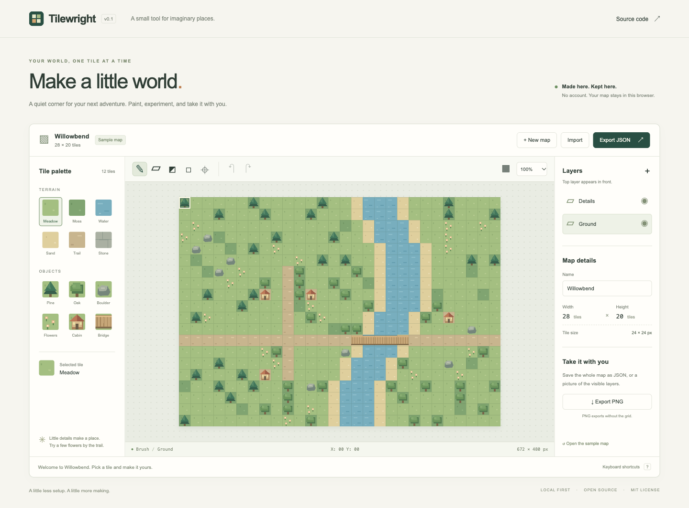

# Tilewright

**Make a little world.** Tilewright is a local-first tile map editor for people
sketching small game worlds, tabletop settings, or imaginary places. Paint with
an original pixel-art palette, separate terrain from details, and export your
work as a portable map file or image. It is built with JavaScript ES modules,
HTML, CSS, and Canvas, with no runtime packages, accounts, or backend.



## Run locally

Install **Node.js 22 or newer**, then run from the repository root:

```sh
npm --prefix Tilewright start
```

Open [http://127.0.0.1:4174](http://127.0.0.1:4174). No `npm install`, API key,
or build step is needed. Stop the server with Ctrl+C. The server binds only to
the loopback interface. To choose another port, run `PORT=4180 npm start` from
this directory (in PowerShell, set `$env:PORT=4180` first).

Use an HTTP server; opening `index.html` with `file://` does not support the
module setup. The editor works without an internet connection while the local
server is running. Installation as an offline web app is future work.

## Make your first map

1. Explore **Willowbend**, the bundled fictional map, or select **New map**.
2. Select **Ground** for terrain or **Details** for trees, flowers, and cabins.
   Tiles always affect the selected layer; object tiles do not switch it for you.
3. Choose a tile and paint. Drag the brush for a continuous stroke; try fill,
   rectangle, eraser, or eyedropper from the toolbar.
4. Use the layer eye buttons to hide or show a layer. The uppermost layer in
   the list appears in front. **+** adds a layer, up to six.
5. **Export JSON** saves all layers, including hidden ones, in an editable file.
   **Export PNG** saves visible layers at 24 pixels per tile without the grid.
   Empty cells are transparent in the PNG.

Maps can be 1–64 tiles wide and high. The zoom control changes the editor view,
not export resolution. Large maps scroll inside the workspace. One stroke,
rectangle, fill, rename, layer addition, or visibility change is one undo step.
The current session keeps the last 60 changes; reloading starts a fresh history.

## Your work and backups

The editor automatically saves one map in this browser's `localStorage` after
each committed change and undo/redo. The untouched sample is not saved until
you edit it. Reloading restores the last successfully saved map.

Browser storage is specific to the origin, including its port. Clearing browser
data, private browsing, quota limits, or changing the server's port can make
that save unavailable. A failed save displays **Export to keep changes**;
editing and exports remain available. **Export JSON regularly for a durable
backup**, and import it to resume elsewhere. Starting, importing, or reopening
a sample replaces the single local map after confirmation when work exists.
Undo does not cross document replacement.

The app makes no external requests automatically. The Source code link opens
GitHub only when selected. Bundled data is fictional artwork; the editor has
no accounts, analytics, cloud sync, imported personal datasets, or AI features.
Use your own non-sensitive creative material.

## Controls

| Action | Control |
| --- | --- |
| Brush / eraser / flood fill | B / E / F |
| Rectangle / eyedropper | R / I |
| Show or hide grid | G |
| Undo | Ctrl/Command + Z |
| Redo | Ctrl/Command + Shift + Z, or Ctrl/Command + Y |
| Export JSON | Ctrl/Command + S |
| Move the map cursor | Arrow keys while the canvas has focus |
| Apply the selected tool | Space or Enter on the canvas |
| Keyboard rectangle | Space at the first corner, arrows, Space at the second |
| Cancel an in-progress stroke | Escape |

Tab reaches tiles, tools, layers, settings, and the canvas. Screen-reader status
messages announce keyboard cursor positions and changes. Touch users can tap
or drag to paint and scroll the workspace using its surrounding area. Full
screen-reader and real-device validation remains on the roadmap.

## Develop and verify

```sh
npm --prefix Tilewright run verify
```

This checks every JavaScript module, runs 16 focused model/storage/server/build
tests with Node's built-in test runner, and builds `Tilewright/dist/`. No package
installation is required. To run individual checks, use `npm run check`,
`npm test`, or `npm run build` inside this folder. CI verifies Node 22, 24, and
26 on Linux, plus Node 24 on macOS and Windows.

The distributable contains only browser assets, an MIT license, and release
metadata. Serve `dist/` over HTTP with a static server; development tooling and
tests are excluded. Generated builds and browser-test output are ignored by Git.

See the [architecture and JSON format](docs/ARCHITECTURE.md),
[verification record](docs/QA.md), [changelog](CHANGELOG.md), and
[28–40 hour roadmap](ROADMAP.md).

## Project status

This is a new, AI-assisted personal-project starting point, first implemented on
October 18, 2026. There is no claim of established usage, prior releases,
long-running development, or eligibility approval. The
[submission notes](docs/SUBMISSION.md) map the provided program requirements to
the current repository and identify facts the owner must personally confirm.

## License

[MIT](LICENSE), matching the repository's root license. Code, palette artwork,
and the fictional sample map are original to this project. No third-party
assets, fonts, datasets, or runtime packages are bundled. See the repository's
[asset notices](../THIRD_PARTY_NOTICES.md).
