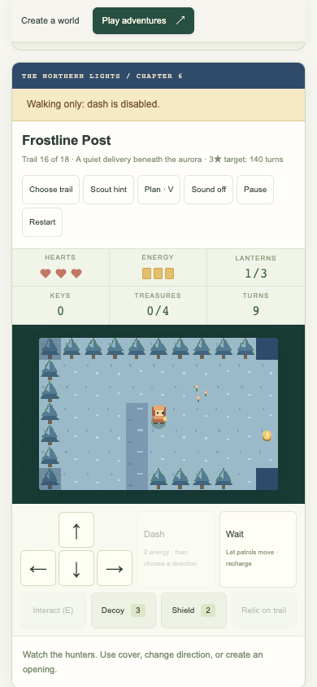

# The field atlas

Twenty-four handcrafted missions span eight chapters. Open **Trails → Story missions**,
then choose a chapter button. Only that chapter’s three missions are shown.
Start any chapter with **Begin chapter**, then finish its missions in order.
Either rule set unlocks the next mission. Chapter selection keeps keyboard focus
on its title. Stars, score, and turns are separate for Trail and Nemesis.

The First Light introduces keys and crate bridges. The Watching Forest adds
rescues, relays, embers, and adaptive hunters. The Sluice Saga changes crossings
and offers consequential route choices. Their walkthroughs remain in the
[mission guide](MISSIONS.md). The new chapters follow below.

## Chapter 4: The Unwritten Sky

**10 — Whispering Stacks.** Ves offers paper decoys or a protective binding.
Restore the west lamp and ring Ink. Index opens the north archive door. After
crossing, collect the eastern lamps, ring Echo, and turn Return: the north door
closes and the south door opens. Bring the whispering folio through the south
door to the west beacon. Carrying it makes you audible. Neither choice replaces
the required door puzzle. Drop/retrieve the folio if you need a false trail.

**11 — The Ink Market.** A walking-only circuit with eight required coins.
Explore the south, ring Quill, then collect the east stalls and ring Seal.
Search the north, ring Letter, and return to the southeast beacon. The Quiet
press cools the central ember lane. It is optional; the three-note sequence and
every coin are mandatory. Use cover and decoys when a collector blocks a lane.

**12 — Archivist’s Observatory.** Gather both northern lamps and the north-bank
key. Ring Orbit and turn the Orbit wheel. The west bridge leads south to Dusk,
the two remaining lamps, Tess, and the star ledger. Dawn opens the east bridge
and closes the west bridge. Ring Star after Dusk. Return for Tess after all four
lamps are lit, recover the ledger from the locked observatory, and take the
east bridge home. Every lamp advances the Watcher toward its strongest phase.

## Chapter 5: The Amber Road

**13 — Cinder Caravan.** Stand immediately west of the wagon and push it east
once onto the copper brake. The central bridge stays open while the weight
remains. Saff can cool the oasis remotely or offer supplies. The hand-operated
Oasis pump remains available with either choice. Light both western lamps
before crossing, then the eastern lamp, and reach the southeast beacon.

**14 — The Sunken Bazaar.** Shields are disabled; all six heirloom coins are
required. Saff can open Sun or offer two decoys. Open Moon before leaving the
west bank; Moon must remain on at the finish. Sun and Moon independently open
the upper and lower arches, so both can stay open. Search each bank thoroughly,
restore three lamps, and finish at the southeast beacon. Check the free forecast
before crossing a collector’s path, and use cover to break distant sight.

**15 — The Furnace Choir.** Ring Ash, Brass, Coal, Song. Restore both western
lamps, take the key, and open Draft to cross north. Coal and the brass vault are
on the east bank. Cooling choir opens the lower arch and suppresses the hot
floor. Restore both eastern lamps, ring Song, then return for Rami and Odo.
Both required regulators must be on. The Watcher’s crossed cells are its next
sweep, not a safe opening; wait or change lanes before entering them.

## Chapter 6: The Long Dawn

**16 — Frostline Post.** A walking-only delivery through blue pines and snow.
Elu offers echoes or a ward. Restore the west lamp, open Postern, and collect
the two east lamps. Take the northern message and bring it through the gate to
the southwest beacon. Carry noise matters even when walking. Supplies on each
bank replenish resources; putting the message down can draw a nearby hunter.

**17 — Mirror Reservoir.** Six coins, four bells, and a bridge truth table:

| Silver | Blue | Open crossing |
| --- | --- | --- |
| Off | Off | None |
| On | Off | North |
| Off | On | South |
| On | On | Middle |

Both mirrors must be on at the finish. Gather western treasure, ring Snow then
Moon, align both mirrors, and cross the middle bridge. Search the east, ring
Sky then Lake, and reach the southeast beacon with every coin and lamp. All
controls are on the west bank. An occupied bridge cannot close under an actor.

**18 — The Aurora Engine.** Four lamps, four bells, two rescued keepers, a
singing heart, and three required prisms. Ring Root then Frost on the west;
take the key and raise North. Elu can activate Storm remotely or offer supplies;
the eastern Storm prism can always be operated manually. Cross, ring Star then
Dawn, and restore the eastern lamps. Rescue Tess and Rami, retrieve the heart,
turn Home, and return by the south bridge to the western signal chamber.

An optional permanent middle bridge uses both western weights: each needs one
push east onto its plate. It offers another outward or return route. Home still
needs to be on for the final goal, and both Root/Frost must precede Star/Dawn.
The northern route is viable without moving either weight. Both approaches
have clean three-star witnesses on Trail and Nemesis.

## Make another run different

- Try the other keeper choice; route effects and supply plans differ.
- Find every optional treasure and hear every keeper in one run. The field
  goals track the current attempt; they do not introduce extra saved badges.
- Finish cleanly within the displayed target, then try Nemesis. It has separate
  bests, fewer starting resources, longer enemy sight, and shorter turn targets.
- Try a different crossing, preserve a cache for the return, or drop a relic to
  lure a hunter away. Restart retains learned campaign habits; Forget resets them.
- Start a seeded expedition for branching camps, persistent upgrades, oaths,
  and three/six/nine-leg routes. Daily trails and custom editor maps remain available.

The intended variety comes from routes, resource decisions, and changing goals.
Automated wins establish that the tested routes work; actual enjoyment and
long-term difficulty balance still need feedback from players.

## Chapters 7 and 8: new horizons

The Tideglass Coast adds changing sea crossings, a three-island treasure
regatta, and a lighthouse convoy finale. The Clockwork Orchard adds cart-held
hedge doors, a walking midnight market with four changing lanes, and a living
clock rescue with an optional northern crossing. See the [new chapter guide](HORIZONS.md)
for all six missions, dialogue choices, and route advice. Both chapters are
open immediately through their chapter entry missions.
