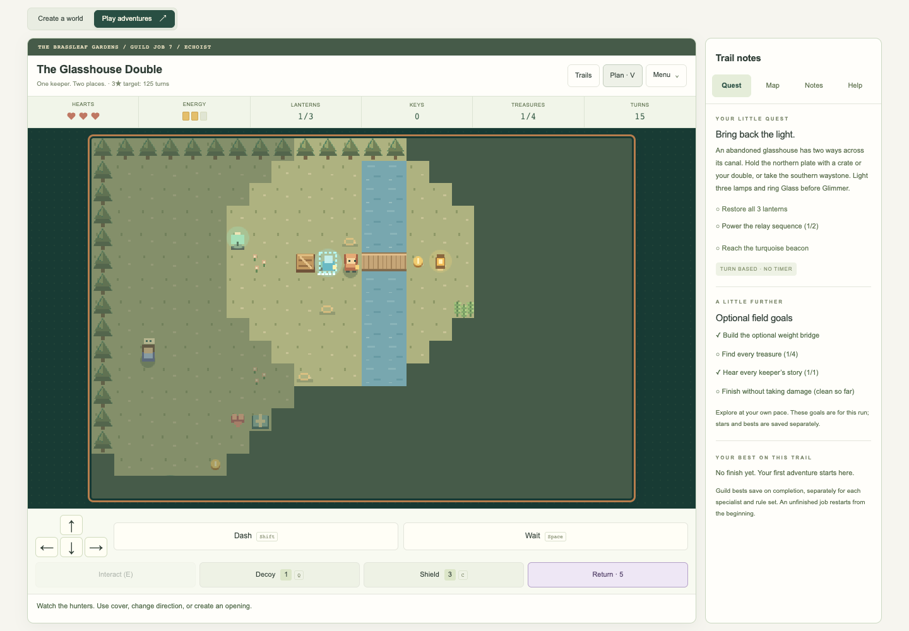
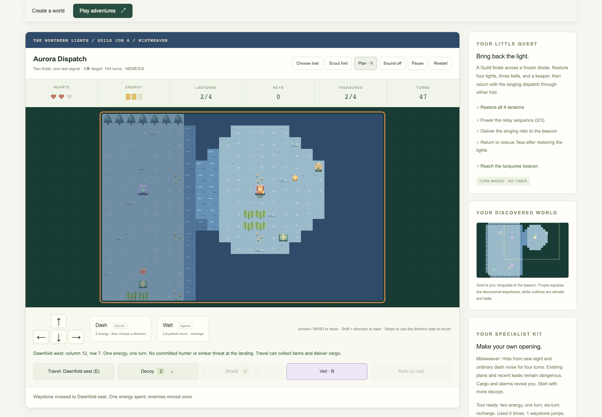

# The Wayfarers’ Guild

Choose **Play adventures → Trails → Guild jobs & specialists**. All eight jobs are open.
The two new double routes appear first, with Echoist selected for your next job.
Choose a specialist for the next job, then a job card. The Rules selector offers
Trail or Nemesis; changing rules restarts the current mission. Changing the
Guild specialist prepares your next job and leaves the active job’s kit intact.

## Three different tools

| Kit | Active tool: B or its button | Trail loadout | Nemesis loadout |
| --- | --- | --- | --- |
| Bellrunner | Resonance pulse: halt hunters within four reachable steps for the activation turn and the next. Walls and crates block its reach. | 3 hearts, 1 decoy, 2 shields | 2 hearts, 1 decoy, 1 shield |
| Mistweaver | Mist veil: conceal new sight and ordinary dash noise for four turns including activation. Committed moves and recent leads remain dangerous; cargo and alarms reveal you. | 3 hearts, 3 decoys, 1 shield | 2 hearts, 2 decoys, 0 shields |
| Echoist | Lantern double: leave a luminous double on your cell for six more turns. It holds a plate and lures adaptive hunters within twelve cells. B again returns to it for one energy and consumes it. | 3 hearts, 1 decoy, 2 shields | 2 hearts, 1 decoy, 1 shield |

Casting any tool spends **two energy and one turn**. A tool can be cast again six turns
after activation; the button shows the remaining recharge. Walking/waiting
restore energy. Blocked moves, conversations, forecasts, and paused time do not
recharge a tool. Pulse cancels affected hunters’ current movement and sweeps,
but does not prevent contact damage or burning. Hunters outside its reach still
move. Veil does not erase a hunter’s last lead; move away from the place it last
saw you. Supplies still replenish a heart, decoy, and shield, capped at three.

## Play two positions with a lantern double

Press **B / Double** to leave a pale blue double, then move away. Its six white
lights and the **Return** button count down the remaining turns. Return costs
**one energy and one turn**, works during the casting cooldown, and consumes the
double. Return does not reset the original cooldown. There is only one double;
it cannot collect items, speak, rescue, or carry the lens for you. The player
collects landing items and delivers carried cargo on return, just as on a jump.

Hunters follow the double as a false lead; a thrown decoy takes priority.
Their already marked next move still resolves on the casting turn. A hunter
that reaches the double extinguishes it. Fixed patrols keep their route. The
double also fades after six further valid turns. Reading, dialogue, library
browsing, and rejected actions leave its lifetime unchanged.

**Plan / V** gives the return location, lifetime, energy cost, and threats from
enemy movement or embers. Returning grants no protection against a sweep,
enemy movement, or fire. A blocked, hunter-occupied, or powerless return spends
nothing. A crate can block a return even while it keeps the plate held.
The two new jobs’ pressure bridges keep an occupied cell open until the player,
crate, companion, or enemy leaves it, so a fading double cannot remove the floor
under someone. Empty cells still close; plan the remaining crossing carefully.

## Fold a path with waystones

Stand on or beside a waystone and use **E / Interact**. When several interactions
are nearby, select the stone under **Nearby action**. Travel costs **one energy
and one turn**, then enemies resolve their committed plans. It does not grant
invulnerability. The preview lists the destination and warns of a threatened
or burning landing. **Plan / V** repeats nearby stone information without time
passing. A blocked, hunter-occupied, or powerless jump spends nothing.

Waystones can collect a landing’s items and deliver carried cargo. Rescued
keepers follow your previous positions safely through the route. Purple minimap
squares mark discovered stones; white outlines mark wheels and bells. Explore
to reveal them. The two ends are paired: Sunfold west leads to Sunfold east,
not to a different named pair.

A tool and a jump compete with dash for energy. With three energy, a tool leaves
one for a jump. With two, you must recharge before traveling. Sometimes walking
away from a hunter is safer than waiting on the stone.

## Eight dispatches

| Job | Required mission | Optional commendations |
| --- | --- | --- |
| The Folded Orchard | Restore one west and two east lamps; cross the orchard divide and return home. | Clean, every treasure, use the tool |
| The Borrowed Minute | Restore lamps and ring Tick then Tock. Choose a key door or either of two waystone pairs. | Clean, every treasure, at least two jumps |
| Reedglass Evacuation | Restore every lamp, return for Jun and Sen, and lead them home past a Watcher. | Clean, use the tool, finish within the star target |
| The Hushed Folio | Ring Ink then Echo; restore the lamps and deliver a singing folio through a sealed archive. | Clean, every treasure, use the tool |
| The Sandfold Exchange | Restore the lamps and activate Oasis before reaching the east beacon. Two stone pairs offer alternate routes. | Clean, at least two jumps, finish within the star target |
| Aurora Dispatch | Restore four lamps, ring Root/Snow/Star, rescue Tess, and return with the dispatch prism. | Clean, every treasure, use the tool |
| The Glasshouse Double | Ring Glass then Glimmer and restore three lights. Choose a lasting crate bridge, a timed double shortcut, or southern waystones. Ivo offers a shield or two decoys. | Clean, every treasure, use the tool |
| The Borrowed Horizon | Find the west key, unlock the lighthouse, ring Mirror/Tide/Home, restore four lamps, rescue Neri, and deliver the memory lens. Ask Ivo for remote rain or supplies and operate Rain yourself. | Clean, use the tool, at least two jumps |

For Orchard, gather western treasure before jumping, then sweep the east bank
and take the same pair home. For Borrowed Minute, ring Tick before crossing;
Hour is a useful outward route and Minute is a northern return. Take another
jump east to finish if you return for the Traveler commendation.

For Reedglass, both rescues unlock only after all lamps. For Hushed Folio,
Veil helps before taking the folio, or after dropping it as a lure; the carried
song exposes you. Pulse can interrupt a nearby listener while you carry.

For Sandfold, one jump can finish the mission. Extra return travel earns a
commendation, but Oasis must still be on. For Aurora, gather both west lamps
and ring Root then Snow before crossing. Restore the east lamps, ring Star,
rescue Tess, and take the prism. Either pair can bring you home.

For Glasshouse, cast on the plate at column 11, row 6. Walk east once, dash
across the canal, then walk to the nearby lamp and return before the double
fades. Walking recharges enough energy for the dash and return. A crate can
hold the same plate indefinitely; approach it from the west, then walk around
the parked crate. Southern waystones provide another route for every kit.
For Borrowed Horizon, the west key opens the lighthouse door at column 25,
row 6. Restore all four lights before returning to Neri. Cool Rain before the
southern ember lane if you chose supplies, and bring the lens to the west beacon.

## Keep another reason to return

Each job offers three optional commendations. They never lock the exit. The
board previews them; the specialist panel tracks them during the run. A missed
clean/turn goal is marked with ×. You can still finish the job. Commendations
are recorded only on completion and add 150 points each to its Guild result.
They are separate from the current run’s normal three-star score.

Each job keeps an independent best for three kits and both rule sets: **48 bests
and up to 144 commendations**. Best results prioritize more commendations, then
score, then fewer turns. There is no cumulative farming counter: replaying the
same result does not create extra progress. Your bests use a separate bounded
browser save. Unfinished jobs restart from the beginning; there is no Guild
checkpoint or export in this release. Expedition checkpoints remain separate.
If storage is unavailable, play and Guild bests remain available for the session
with a warning. Keep the tab open if you want to retain that session.

Try another specialist, recover every coin, use the key route instead of a
fold, save a cache for the return, or attempt Nemesis. These are authored jobs;
seeded branching journeys remain available in the expedition hub.
