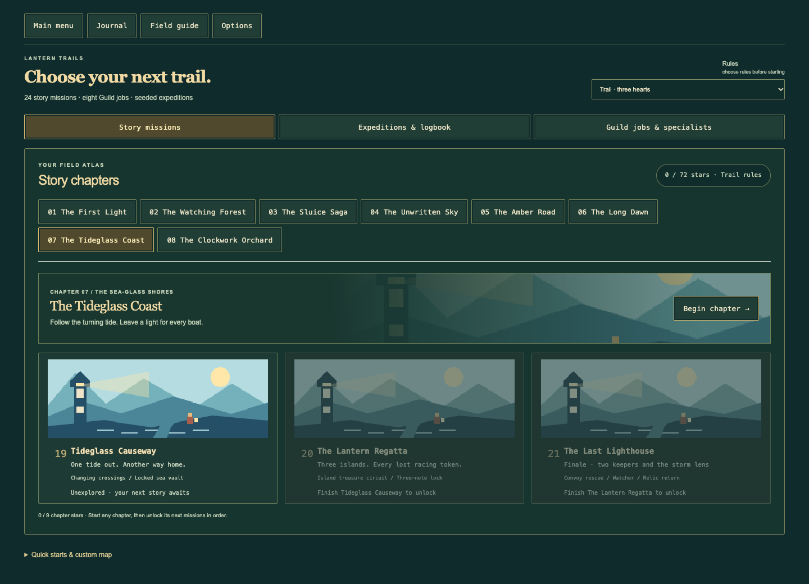

# New horizons: the coast and the clockwork gardens

Open **Play adventures → Trails → Story missions**, then choose **07 The
Tideglass Coast** or **08 The Clockwork Orchard**. Both chapter entries are
open immediately. Finish their missions in order to unlock the next one.
Each rule set keeps its own stars, score, and turn best. The campaign now has
**24 story missions across eight chapters**, plus the eight separate Guild jobs.

## Chapter 7: The Tideglass Coast

| Mission | Your task | Trail three-star target |
| --- | --- | ---: |
| 19 — Tideglass Causeway | Take the north-bank key, relight the sea vault, and change crossings for the return. | 115 turns |
| 20 — The Lantern Regatta | Find all six racing tokens on three islands and ring Shell, Wake, Gale. | 120 turns |
| 21 — The Last Lighthouse | Restore four lamps, rescue Kelp and Mara, and bring the storm lens to the haven. | 165 turns |

**Tideglass Causeway:** Ebb raises the western crossing. Home closes it and
raises the eastern crossing. The vault needs the north-bank key. You can leave
the northeastern lamp until your return; the eastern crossing brings you close
to it. Tala offers either two shell echoes or a shield charge.

**The Lantern Regatta:** Search the first island before turning Port and using
the northern pier. Ring Wake on the middle island and use Starboard to reach
the last island by its southern pier. Gale opens the finish enclosure only
after Shell and Wake. Every token is required, including those north of the
lamps. The token checklist remains in Quest; the HUD tracks the count.

**The Last Lighthouse:** Collect the northern key and ring Fog before using
Beam to cross south. Ring Gull, restore the south lamps, and enter the locked
lantern room for Dawn, Kelp, and the lens. Harbour opens the eastern return
route to Mara and the signal-locked haven. Tala can cool Breakwater remotely,
or give you a larger kit while you find the southern pump. Both keepers need
all four lamps before they will follow. The carried lens attracts hunters.

## Chapter 8: The Clockwork Orchard

| Mission | Your task | Trail three-star target |
| --- | --- | ---: |
| 22 — Clockvine Gardens | Park two carts on their copper stops and restore lamps beyond two hedge walls. | 105 turns |
| 23 — The Midnight Market | Walk an eight-coin circuit, change two pairs of doors, and ring Wind, Leaf, Chime. | 205 turns |
| 24 — The Orchard That Woke | Bring Nell, Orr, and the living clock home through a four-bell Watcher finale. | 190 turns |

**Clockvine Gardens:** Push each western cart one tile east onto its stop.
Both stops must remain held at the finish. Uma can open Root remotely, or
provide decoys and a ward while you visit the Root wheel yourself. Each cart
opens its own hedge door; Root opens the eastern door.

**The Midnight Market:** Dash is disabled. Minute changes which upper door is
open; Hour changes which lower door is open. Begin through the upper west
door, ring Leaf after Wind, and return to the middle before turning Minute.
The lower east door is initially open. Search the southern stalls, turn Hour,
and ring Chime to enter the finish enclosure. Both wheels must be on and every
coin collected.

**The Orchard That Woke:** Ring Seed and Spring on the west side and collect
the key. Spring opens the middle orchard door. The key opens the eastern
vault, which holds Leaf, a lamp, and the living clock. Restore the southeast
lamp, ring Dawn, rescue Orr, and use Dusk to open the lower route back to Nell
and the haven. Rain cools the hot clockwork lane; Uma can activate it, or you
can take her kit and find its wheel. Two western carts can also open an
optional northern crossing. This crossing is an alternate approach, not a
required exit goal. Read the next-step markers before pushing near a hunter.

Nemesis starts with fewer supplies, adds a hunter, and uses 85% of the Trail
turn targets. The new finales offer a Nemesis replay from their own chapter
entry. There are no new key bindings: movement, E, Q, C, V, and the existing
touch controls operate every new mission. Their goals and hints remain in
the compact Quest/Map/Notes/Help panels.
