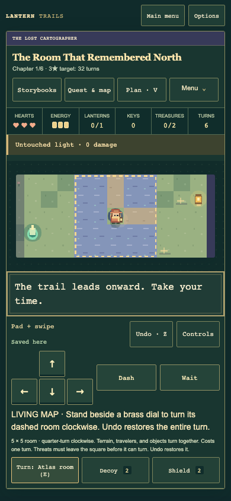
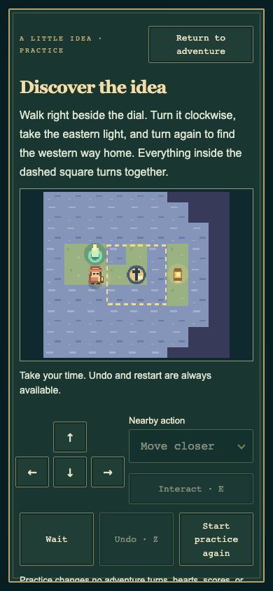
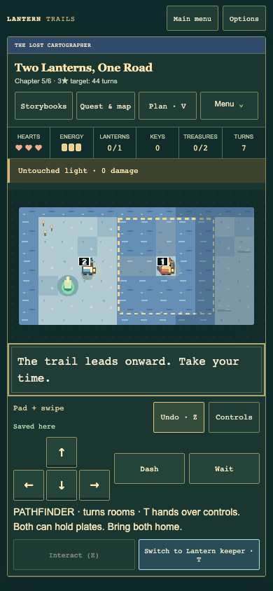
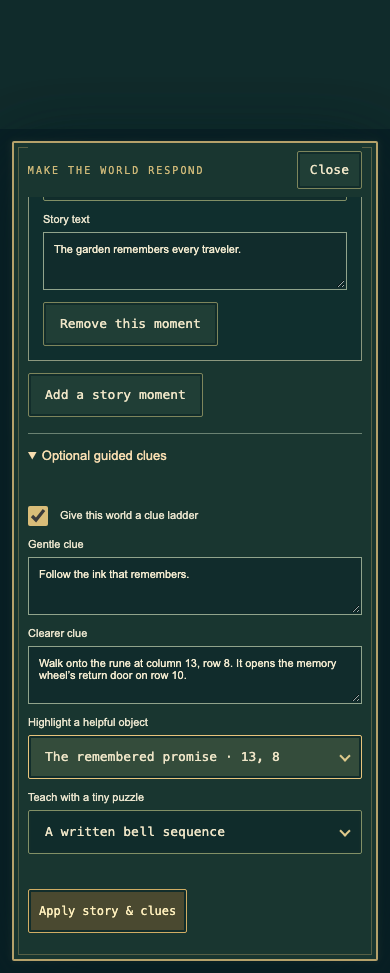

# The Lost Cartographer

Six original chapters explore an atlas whose roads can change. Open
[Lantern Trails](https://youknowjp.github.io/Personal-Project/), choose
**Adventure Workshop → Storybooks → The Lost Cartographer**, and read the book.
Each chapter also appears on the Workshop shelf to play, watch, remix, and share.

| Chapter | A new idea |
| --- | --- |
| The Room That Remembered North | Turn a room to connect another shore, then find a western road home. |
| A Weight on the Horizon | Combine a rotating road with a crate that keeps a bridge open. |
| The Ink Remembers | Walk onto a rune to open a return route and change a keeper’s dialogue. |
| The Brass Bargain | Choose whether to open optional treasure vaults and wake their security rings. |
| Two Lanterns, One Road | Coordinate Lantern keeper and Pathfinder, solo or with a friend sharing the device. |
| An Atlas for Everyone | Combine both travelers, a lasting bridge, a bell song, a reactive return route, and Orin’s rescue. |

## Turn a room

Stand on or beside the brass dial and use **Interact / E**. A dashed square marks
the entire 3 × 3, 5 × 5, or 7 × 7 area that turns clockwise. Terrain, objects,
crates, travelers, discoveries, and linked mechanisms turn together. Turning
costs one turn; Undo restores the entire operation. The dial stays at the center.
Restart restores the original map, rather than keeping its latest orientation.

Creators can use up to four rooms. Keep every room inside the map and prevent
room overlap. Keep patrol routes and hunter waypoints outside moving areas. If a
hunter follows someone into a room, the dial waits until the threat leaves.
Security rings stay centered on their vault when it turns.
Checks describes these constraints, but a creator clear still proves only its
recorded route. Test all useful orientations and the return journey.

## Decide how much treasure to risk

Every vault is optional. The nearby-action text declares the next reward and
security before opening it. The three successive rewards are 75, 150, and 225
points. Opening adds a marked four-cell ember ring around that vault; security
raises all opened rings to one, two, then three active phases per four turns.
The rhythm is the same on Trail and Nemesis. A brief ward protects you during the opening
turn. **Plan** explains the next burn without spending a turn.

The ordinary exit and goals stay available without any vault. Undo can close a
vault; Restart closes all of them. Maps may contain up to three vaults. Authors
should leave a safe walking route around security, and verify a clean escape
for every escalation they recommend. The Brass Bargain has a clean executable
route through all three tiers on both rule sets.

## Share the road

A Two-Lantern partner creates a peaceful cooperative world:

- **Lantern keeper** wears your chosen outfit and restores lights.
- **Pathfinder** wears a blue cap and turns room dials.
- Both can walk, push crates, hold plates, ring bells, talk, and carry supplies.
- Use **Switch traveler / T** to hand over the controls without spending a turn.
  With the standard toolkit, controller X also hands over the controls.
- Both travelers must come home: one can wait at the beacon or beside it.
- Set down a carried relic before switching. Hearts, energy, and supplies are shared.

Play both roles yourself, or let a friend take the other role on the same device.
This is shared-device cooperation, with no network connection or matchmaking.
Cooperative worlds have no enemies, cycling embers, or security vaults.

## Learn an idea without losing your place

**Menu → Scout hint** opens a gentle clue. Choose **Show a clearer clue** for a
more specific suggestion and, when authored, a focus marker. **Try a tiny puzzle**
opens a separate miniature lesson about turning rooms, weighing a bridge, a
written bell sequence, or coordinating two travelers.

The miniature has direction buttons, keyboard controls, touch/swipe input, and
controller support. Use its own Undo or Restart, or simply return. It spends no
adventure turns or supplies and grants no rewards. The parent adventure and its
saved checkpoint stay unchanged. Larger reading and contrast settings apply.

## Make a world respond

Paint a rune or add the puzzle objects first. Open **Adventure notes → Story
moments & playable clues**. Each of up to six cards connects one event to one
outcome. For example:

1. **When:** Story rune visited → choose the rune.
2. **Then:** Open a linked lever → choose its lever.
3. Write the story moment players should read.
4. Apply, playtest the whole route, and share a fresh creator clear.

Other events include restoring every lantern, completing the bell song,
rescuing a particular keeper, activating a lever, and opening a vault. Outcomes
can reveal a place, change a keeper’s dialogue, or tell a story moment. Cards
fire once per attempt and can chain; Undo restores them together.

The same editor lets creators author two clue texts, choose a helpful object,
and select a tiny practice lesson. All settings travel in files, codes, play
links, and Storybooks. New-rule worlds use adventure version 2; current Lantern
Trails still reads existing version-1 worlds and saves. Downloaded backups remain
useful when changing browsers or devices.

## From the running game

