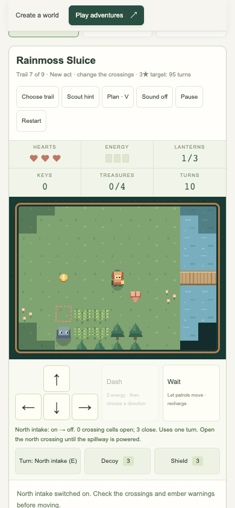

# Mission design and counterplay

## Play now: the sluice saga

Choose **Play the sluice saga** to start Rainmoss without replaying earlier acts.
Finish it to unlock Glasshouse Concord, then The Last Ferry. Normal and Nemesis
bests are separate. The finale offers **Replay this act on Nemesis**.

| Mission | Decisions and objectives | Trail / Nemesis targets |
| --- | --- | --- |
| Rainmoss Sluice | Ask Luma for a middle ferry route or a decoy/shield. Light three lamps, activate North intake, cross the river, activate South spillway, and return home. Spillway closes the north crossing and cools eastern embers; the south crossing opens. | 95 / 80 |
| Glasshouse Concord | Glass alone opens the north arch; Moss alone opens the south arch; both open the middle arch. Ring Dew then Sun, activate Cooling vent, restore the lamps, and enter the signal chamber. Rook offers an optional trade. | 110 / 93 |
| The Last Ferry | Ask Iona for cooled storm lanes or health/a decoy. Take the key, ring Root, cross south, activate Mooring wheel, and ring Tide. Light all lamps, return for Jun and Sola, retrieve the songstone, and deliver it home by the raised north ferry. | 185 / 157 |

Tree groves and stone beds create routes to break sight. Valve previews list
which crossing cells open/close and which embers change. Player-operated valves can be
reversed; Luma alone operates the optional reed ferry. A crossing refuses to close if occupied by the player, a companion,
a crate, or an enemy; no turn is spent on the rejected change. Let the patrol
clear it before trying again. Required settings appear in the quest checklist.

**Plan / V** explains visible enemy steps, sweeps, and next-turn ember cells
without advancing time. When several objects are adjacent, select **Nearby
action** before E/Interact. This matters when a rescued keeper stands beside
the relic or another keeper. Advice remains in the journal even if no choice
is made. Dialogue choices also change each mission’s epilogue.

Rook sells two decoys for two coins or one shield for one coin, once. Only
unspent coins pay for a trade; collected treasure still counts toward goals
and score. You can decline both trades and finish. A parcel is unavailable
when its resource is already full. Supplies remain capped at three.

Story missions store unlocks and best results. Mid-mission reload recovery is
available in seeded expeditions, not authored story missions. The story’s
Restart/R retries the current mission; normal learning is retained until reset.

Fourteen clean public-action fixtures verify both dialogue branches on both
difficulties, plus Glasshouse without trading. See [QA](QA.md) for routes and
limits, and [design notes](DESIGN_NOTES.md) for the research behind the refinement.

## Play now: the second act

Open **Play adventures → Choose your adventure → Story chapters**, then choose
**02 The Watching Forest → Begin chapter** to start Briarwatch
without replaying the introductory act. Finishing it unlocks Bellforge, followed
by the Watcher finale. **Rules** changes restart the current mission. Nemesis
bests are separate; either rule set can unlock the next mission.

| Mission | Interactive objective | What makes it harder |
| --- | --- | --- |
| Briarwatch Rescue | Ask Nia for a decoy or shield, recover the key, restore three lanterns, return to Orin, and lead him to the beacon. | Two adaptive hunters, a gated bottleneck, return travel, and fern cover that requires quiet movement. |
| Bellforge Heist | Speak to Pip, ring Copper → Glass → Iron, restore the lanterns, and reach the exit. | A wrong bell resets the sequence and broadcasts your location for six turns. Ember tiles pulse; completing the network briefly stuns hunters. |
| The Watcher’s Crown | Push both crates east onto plates, collect the key, ring Moon → Root → Sun, restore the lights, rescue Sola, and escape through the signal gate. | The Watcher gains phases with the first two lanterns, then uses longer marked sweeps. A second hunter guards the west bank. |

Dialogue freezes turns. A keeper's choice grants one resource once per mission,
and their advice remains in the journal. Supplies heal one heart and replenish
one decoy and shield, each capped at three charges. Rescued keepers follow the
player safely; they can be spoken to again. Scout advice follows remaining
relay and rescue requirements as well as lanterns.

## Learn, mislead, counter

Hunters observe movement patterns and use the previous action to anticipate the
next one. They need sight, a recent lead, or audible movement to locate the
player. Their next cell is committed and marked before the next player action.
Repeated movement can be intercepted; changing direction can make that guess
wrong. Recent behavior gradually replaces older patterns.

- **Break sight:** use walls and fern cover. A quiet player in ferns is hidden
  from hunters farther than two cells away. A dash stays audible for three turns.
- **Create a false lead:** Q throws a decoy up to three clear cells ahead,
  attracting nearby hunters for five following turns. Patrols also follow the
  closest point on their route to the light. Turn toward the route you want to
  misdirect before throwing it.
- **Choose an escape window:** hunters periodically recover. A dash covers two
  cells for one enemy turn; walking/waiting restore energy.
- **Read the pulse:** ember flames show current danger; orange outlines show
  where the next turn burns. Dashing through an active pulse still hurts.
- **Leave the sweep:** crossed cells mark the Watcher's next strike. Move out
  of the lane or use C for a shield before committing to a dangerous crossing.
- **Protect a necessary crossing:** a shield protects its activation turn and
  two more turns. It consumes a charge and a turn. A supply cache can replenish it.

The notebook reports observed movement frequencies only when a useful pattern
exists. **Forget learned habits** clears those learned counts without changing
mission progress or map files. It does not move enemies or erase their current
awareness. There is no remote service or claim to know a player's thoughts.

## Nemesis rules

Start with two hearts, one decoy, and one shield. Introductory patrols become
adaptive hunters; second-act missions add a third hunter. Recovery windows are
shorter, vision extends by two cells, damage protection lasts one subsequent
turn, and the authored ember fields burn on three phases out of four. Turn
budgets are 85% of Trail targets, rounded down. Healing can restore three hearts.
The finale's result screen offers this mode directly.

All authored missions have verified winning input routes. This is evidence of
solvability, not a claim that difficulty has been balanced through a user study.

## Play now: expeditions

[Seeded expeditions](EXPEDITIONS.md) add longer journeys, six generated mission
families, four regions, camp choices, upgrades, oaths, daily trails, and portable
checkpoints. The Singing relic family implements carry noise, deliberate drops,
retrieval, and delivery. Seeded contracts implement shuffled bells, cover and
hunter layouts, and optional no-shield/all-coin/no-dash rules. Current-leg retry
retains upgrades and opponent learning; it is free and has no keeper bargain.

## Further mission ideas — not implemented

| Idea | Player interaction and tension | Evidence needed before shipping |
| --- | --- | --- |
| The borrowed voice | Negotiate with two keepers for different passwords. One opens a safer route; the other grants supplies for a guarded shortcut. | Both branches must lead to distinct, completable routes; dialogue must reflect the chosen promise. |
| Flooded archive expansion | Extend the shipped reversible sluices with multiple water levels and movable waterways while recovering pages in a chosen order. | A clear flood preview and solvability checks across the larger water-state graph; the shipped controls use fixed crossings and ember switches. |
| The false trail duel | A rival reads repeated route choices. Place false footprints and switch exits to bait an interception, then cross behind it. | Show exactly what the rival observed; compare trained and untrained behavior; ensure every interception has a response window. |
| Evacuation under the bells | Choose which group to lead first. Each rescue changes available shelters and the next conversation; no one is silently lost to an unseen timer. | Persistent branch consequences, explicit deadlines if used, and accessible warnings before irreversible choices. |
| Checkpoint bargains | Ask a keeper to create one recovery point at a resource cost; restarting restores puzzle state while the Watcher remembers observed movement. | Clearly distinguish restored mission state from retained learning; test crate/gate restoration and repeated recovery. |

Prefer missions that add a decision, relationship, or consequence. More enemies
and larger maps alone do not create a new kind of play. Continue physical-device,
assistive-technology, and actual player testing before calling the difficulty
balanced or the interface fully accessible.

## Atlas chapters 4–6

The campaign now continues through nine additional missions in The Unwritten
Sky, The Amber Road, and The Long Dawn. See the [atlas walkthrough](ATLAS.md)
for each route, keeper choice, constraint, bridge truth table, and finale.
These are playable content, separate from the future proposals above.
