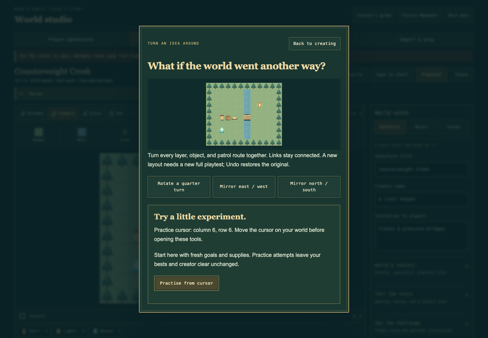

# Play with an idea

Open [Lantern Trails](https://youknowjp.github.io/Personal-Project/), choose
**Adventure Workshop**, then **Puzzle Lab**. Choose The first bench or After hours (a room picker on phones), preview it, pick
Trail or Nemesis, and play. Each original includes a verified creator-clear
replay; watching is optional. Bests stay separate for each world and rule set.

| Room | An idea to experiment with |
| --- | --- |
| Counterweight Creek | Push a crate onto a plate, then find a route around it. |
| The Two-Key Detour | Spend a key to cross the river; discover a second key for the vault. |
| Three Bells at Dusk | Ring Dew, Dusk, Moon, then bring every garden token home. |
| The Borrowed Footstep | Hold a bridge with a temporary lantern double or a lasting crate. |
| Parcel for the Tidekeeper | Accept a shortcut or supplies, then rescue a keeper and deliver a singing parcel. |
| The Emberclock Orchard | Use two channels to open doors and cool embers; recover the brass fruit. |

## After hours

| New adventure | What you can do |
| --- | --- |
| The Locksmith’s Last Delivery | Deliver a roof lamp, collect three lost treasures, and spend a spare key on a different return route. |
| The Doublelight Foundry | Make a brief double crossing or leave a lasting road with the northern crate. |
| The Glass Ferry | Travel between three islands, carry singing glass through two waystone pairs, and bring Fen home. |
| A Song for the Floodgates | Open a far-bank return crossing and ring Root, Road, Rain, Rest around a changing circuit. |
| The Keeper’s Night Shift | Choose a safe fern route or enter the adaptive sentinel’s yard for optional treasure. |
| The Last Caravan Home | Hold two bridges, ring three bells, cool a crossing, restore three lamps, and rescue two travelers with their parcel. |

Every original includes a real winning route. Use **Watch the creator’s route**
from its preview for a hint; you can still explore your own answer. Reading
notes, Plan, previews, and the Lab never spends a gameplay turn.

## A journal of different answers

Open **Room seals** to see three optional goals for the selected rules. Each
room offers **First light** for a completed clear, **Unbroken light** for a
no-damage finish, and its own signature challenge. Signatures include timed
crossings, a lasting crate answer, choosing supplies instead of a shortcut,
and recovering optional treasures. Gameplay keeps the goals in **Quest & map**
and shows a compact seal count above the board.

Seals accumulate across finished runs: earn a clean finish with a double, then
come back for the permanent crate answer. You never lose an earned seal by
trying another route. Trail and Nemesis have separate sets, totaling **72**.
A missed optional seal never blocks the beacon or removes an ordinary best.
**Find a missing seal** selects a room and rule set with something left to earn.

Discover the Copper spark at 6 seals, Glass compass at 18, Doublelight prism at
36, and The tinkerer’s sky at 72. Their original pixel artifacts and stories
appear in **Your discoveries & journal backup**. These are collection rewards;
they do not change powers or make another mode easier.

The seal journal stays in this browser independently of worlds, drafts, other
modes, and Workshop bests. **Download seal journal** makes a portable
`.seals.json` backup. **Restore journal** previews the incoming count before
replacing this journal; cancel retains your current progress. Corrupt or
unavailable storage still permits earning for the current visit. Download
before leaving if saving is unavailable. Lab attempts restart after a reload.
A shared world, remix, custom Storybook, or cursor practice cannot award Lab
seals; enter the original from Puzzle Lab for those goals. Existing bests remain
available, while the new seal collection begins with your next Lab wins.

**Remix this room** creates an independent draft with its original credit.
Replacing an existing draft still asks you first. Change its terrain, object
positions, story, linked channels, specialist kit, or rules. A remix needs its
own full playtest; it cannot inherit the original room's verified route.

## Turn the world around

In **Build an adventure**, choose **Remix tools**. Rotate a quarter turn or
mirror east/west or north/south. Every terrain/detail layer, hidden layer,
object, and patrol waypoint moves together. Rectangular worlds swap dimensions
when rotated. Object IDs, links, channels, bell orders, and story stay intact.

The operation is one undoable change. It removes an old creator clear; Undo
restores the previous world and clear. Read any north/south/east/west directions
in your hints afterwards and rewrite them for the new layout. Playtest your
outward and return routes before sharing the changed world.

## Test a small part

Choose Inspect, then point at open ground or move the map cursor with arrows.
Open **Remix tools → Practise from cursor**. The selected spot becomes the
starting position for that attempt. Goals, supplies, companions, doors, and
local opponent learning start fresh. It does not restore the state from an
earlier playtest, bypass puzzles, or open doors automatically.

A practice win, retry, or difficulty change cannot replace a best or a creator
clear. Practice is marked in the HUD and results, without awarded stars.
**Designer** returns to your unchanged draft. The usual full **Playtest** starts
at the original starting point and can record a valid creator clear.

If the cursor is on water, a wall, a crate, a keeper, or a closed gate, the tools
dialog explains what to change. Move it to open land and try again.

## Deal a design spark

Open **Need a new idea?** in the Lab. Use an idea seed to find the same prompt
again, or choose **Another spark**. Six creative goals and six twists make 36
possible pairings. A spark can ask for a two-solution crossing, a conversation
that changes the return route, or a quiet route that rewards observation.

Sparks are invitations, not automatic world edits or solvability certificates.
Browsing rooms and dealing ideas leave your saves unchanged. Build an answer,
finish a full playtest, and share a file/code or public play link using the
existing Workshop sharing controls. No account or remote generation is needed.
