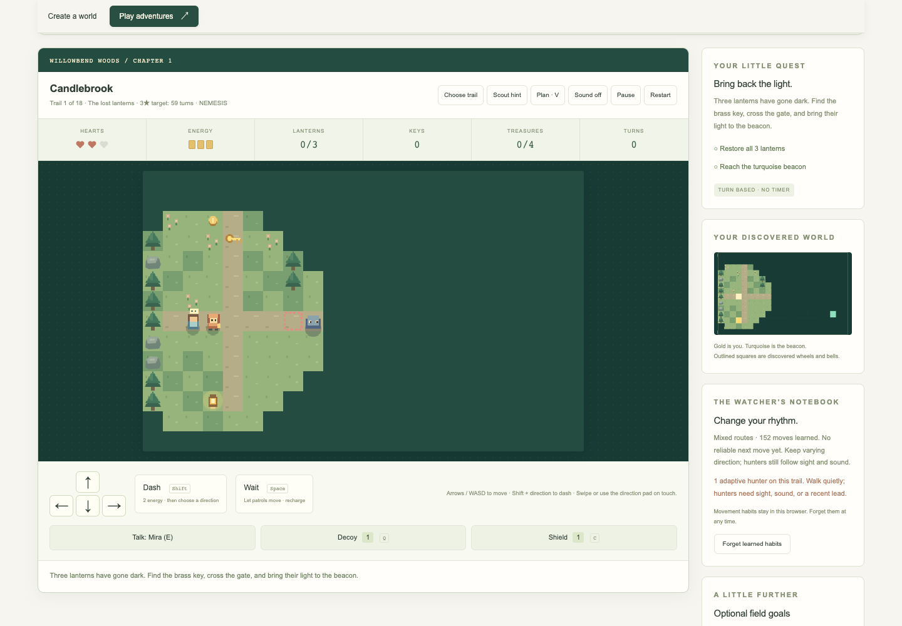
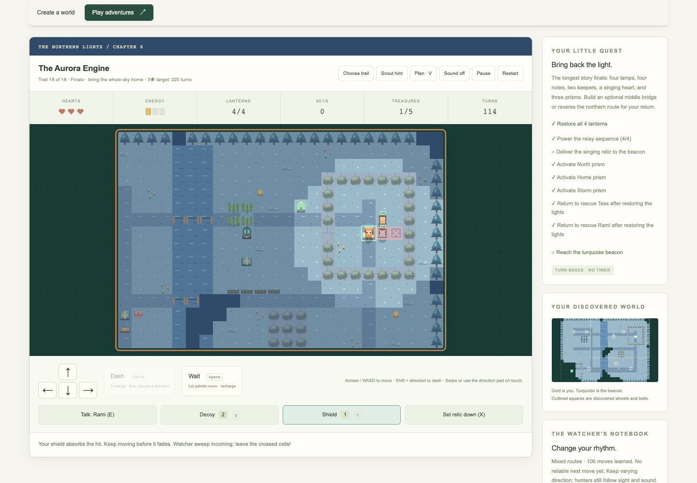

# Verification record

## Atlas expansion — v0.7.0

**158 Node tests pass**, JavaScript syntax checks pass, and the static build
contains **34 files** including release metadata. Switchback’s independent
42-test verification and build also pass. The new atlas soak adds 36,000
inputs to the retained 42,000: **78,000 deterministic exploratory inputs** in
all, alongside 2,304 generated-map connectivity variants and all 256 upgrade
combinations.

The nine new authored maps have **28 clean public-action playthroughs / 2,795
turns**. Every new keeper choice is covered on Trail and Nemesis. These fixtures
never change positions, inventory, health, puzzle flags, or enemy state to win.
Their independent Node replay verifies all required coins, rescues, switches,
relays, deliveries, restrictions, and three-star results.

| Mission | Trail turns: branch A / B | Nemesis turns: branch A / B |
| --- | --- | --- |
| Whispering Stacks | 64 / 64 | 64 / 64 |
| The Ink Market | 137 | 138 |
| Archivist’s Observatory | 127 | 131 |
| Cinder Caravan | 53 / 54 | 53 / 54 |
| The Sunken Bazaar | 82 / 82 | 84 / 84 |
| The Furnace Choir | 127 | 126 |
| Frostline Post | 101 / 101 | 100 / 101 |
| Mirror Reservoir | 96 | 96 |
| The Aurora Engine | 145 / 162 | 144 / 161 |

All **six optional browser suites pass on Chrome 155.0.8059.82**. The atlas
suite replays all 28 variants through real movement keys, interaction targets,
dialogue buttons, valves, relays, rescue, and cargo actions. It checks open
chapter starts, progression after reload, separate rule-set bests, chapter
stars, rule banners, disabled dash/shield controls, portrait dialogs, retained
editor saves, the final library return, and all three new Nemesis invitations.
The optional weight bridge appears among field goals, rather than the required
quest checklist; both built and unused routes win cleanly.

Each of the nine new missions also finishes with three stars through touch
buttons at **320, 390, 768, and 1024 × 844 CSS pixels**. Checks cover forecast
bounds, visible tactical controls at entry, mission constraints, chapter-jump
focus, reduced motion, and no horizontal overflow. The first 320-pixel run
caught a rule banner pushing action buttons below the screen. Constraint
missions now use a shorter phone board; all four widths pass. A fresh phone
render and the latest desktop finale were visually inspected after adding
worn paths, snow palettes, and optional-bridge labeling.

The retained five browser suites pass editor pan/zoom/scroll/export/history,
all earlier story missions, hard finales, 33 expedition configurations, five
complete multi-leg journeys, camp and loss recovery, quota/blocked storage,
backup import/export, six genuine 0.5 migrations, and modal navigation. Package
v0.7.0 retains expedition rules 0.6.0; generation and simulation are unchanged.
All 36 campaign best identities survive custom-record eviction.

No Safari, Firefox, physical-device, full screen-reader, or human enjoyment
study was performed. The checked routes and invariants pass; this is not a
claim that every possible play history or device is bug-free.

## Gameplay audit and sluice saga — v0.6.0

**127 Node tests pass** (36 additions), syntax checks pass, and the static build
contains 32 public files. The retained 30,000-input expedition soak and a new
12,000-input exploration test total **42,000 deterministic exploratory inputs**.
The 2,304 generated-map connectivity variants and all 256 upgrade combinations
remain green. None of these checks establishes that every possible play history
or device is bug-free.

The new public-action fixtures complete **14 clean runs / 1,222 turns** without
changing positions, health, inventory, flags, or enemy state. Both dialogue
branches are tested on Trail and Nemesis, plus Glasshouse declining both trades.

| New mission | Trail turns: branch A / B | Nemesis turns: branch A / B | Result |
| --- | --- | --- | --- |
| Rainmoss Sluice | 68 / 56 | 72 / 60 | No damage, three stars; both route choices and required pumps |
| Glasshouse Concord | 83 / 67 | 86 / 68 | No damage, three stars; both trades and shutter routes |
| The Last Ferry | 136 / 139 | 137 / 137 | No damage, three stars; both keepers, delivered relic, signal and ferry |

Glasshouse without buying a parcel also finishes cleanly in **55 Trail / 58
Nemesis turns**. Unit checks cover all four shutter combinations, hazard
suppression on the valve’s own turn, reversal, occupied player/crate/companion/
hunter/patrol guards, required final settings, malformed control references,
affordable/unaffordable/full-stock trades, retained treasure credit, one-time
choices, free forecasts, and reachable-control hints. A regression prevents
Luma’s exclusive ferry route being opened manually after choosing supplies.

The audit reproduced a native-modal trap: leaving Play through URL navigation
while speaking left a dialogue above the editor; Escape could not close it.
The fix closes game modals on leave while retaining conversation/camp state.
Five repeated browser leave/return cycles now pass. Additional fixes record
keepers without choices, expose competing adjacent interactions, and stop
expired individual leg tokens being credited again while a finish token remains.
Campaign-record protection now covers all nine normal/Nemesis mission bests.

Six genuine **0.5.0 checkpoints**, captured before rule changes, verify migration
of playing, mid-dialogue, camp, lost, carried-relic, and finished runs. Their old
fingerprints are checked during replay before new 0.6.0 saves are written.
Continued play and new save/reload round trips preserve their state. Existing
maps, campaign bests, and learned profiles remain separate.

The optional **Chrome 155.0.8059.82** sluice suite passes all 14 variants through
actual movement keys, dashes, dialogue buttons, valves, relays, and cargo/rescue
interactions. It checks both Nemesis invitations, unlocks after reload, declined/
unaffordable trades, free Plan dialogs, journal advice without a choice, editor
retention, camp navigation, six legacy file imports, and selecting a relic with
keyboard E while companions are also adjacent. No runtime, console, or asset
errors occur in the desktop flow.

At **320, 390, 768, and 1024 × 844 CSS pixels**, each new mission is completed
with three stars. Emulated touch checks cover dialogue, forecast bounds, reset,
visible controls at entry, competing interactions, reduced motion, and no
horizontal overflow. The phone valve preview and desktop finale were visually
inspected. All earlier editor, introductory, hard-contract, and expedition
browser suites also pass, including full long journeys, backups, actual loss/
retry, blocked/full storage, scrolling, PNG export, and real CDP swipes.

Run `npm run test:browser` for all **five** suites, or
`node scripts/sluice-browser-checks.mjs` for the new act. Playwright and Chrome
are independently installed; default verification still has no npm dependencies.
Contexts are disposable and never clear the user’s actual saves. Browser checks
are not part of the default GitHub Actions matrix.

[Phone valve preview](sluice-mobile.png), [desktop finale](sluice-finale.png),
[mission guide](MISSIONS.md), and [design references](DESIGN_NOTES.md) document
the result. Safari, Firefox, physical devices, screen readers, and extended
human difficulty/enjoyment studies remain untested.

## Replayable expeditions — v0.5.0

**91 Node tests pass**, including 28 new tests. Syntax checks and the static
build pass; the package contains 29 public files. Generated-map prerequisites
and objectives are reachable across **2,304 seed/leg/branch combinations**,
including all six mission families and four regions. All **256 upgrade subsets**
preserve resource bounds and oath restrictions. A deterministic **30,000-input**
soak covers varied seeds, movement, tactics, interactions, retries, both rule
sets, oaths, bounded state, and checkpoint replay.

Thirteen independent ordinary-action fixtures complete **34 legs / 3,534 turns**.
They cover all four oath choices on both rule sets in single contracts, plus:

| Completed expedition | Legs | Turns |
| --- | ---: | ---: |
| Trail long voyage | 9 | 887 |
| Unwarded Nemesis journey | 6 | 474 |
| UTC daily trail (2026-10-18) | 5 | 406 |
| Measured steps Nemesis journey | 3 | 422 |
| Treasure oath Nemesis journey | 3 | 408 |

No health, position, inventory, puzzle, or completion flags are overridden in
these playthroughs. Full runs exercise all eight camp upgrades, both branches,
all mission families, and all twelve attainable badges. Each offered camp
upgrade/restock × route combination is separately replay-checked. Tests verify
courier pickup/drop/distraction/reclaim/delivery, oath exit requirements,
permanent resource caps, exact save/replay, corrupt/oversized/future/tampered
backup rejection, lost-state reload/retry, independent campaign/map saves, and
no duplicate credit after camp/finish resume or a post-win learning reset.
Audio tests cover opt-in/off, unavailable/denied/closed contexts, synthesis
failure, and disconnecting completed oscillators/gains during long play.

The optional **Chrome 155.0.8059.82** expedition suite passes using disposable
contexts. It exercises all **33 form configurations** (24 journey combinations,
eight single contracts, one fixed daily), daily UTC rules and custom-setting
restoration, surprise seeds, invalid input, and canceling replacement. It
completes all five multi-leg runs above through real keyboard movement, dashes,
E interactions, dialogue choice clicks, and camp forms. It verifies camp cancel,
Escape and reload, all upgrade pickups in the nine-leg run, final resume with
unchanged logbook credit, and unchanged editor/campaign/movement saves.

Recovery checks include mid-dialogue resume, actual later-leg death and exact
reload, retry retaining earlier wins/upgrades, pause input suppression, story/
Create switching, downloaded JSON matching the checkpoint, valid import in a
new context, cancellation, and malformed/oversized/future/tampered rejection.
Blocked storage and quota failures still allow a complete contract and backup
export, with a visible warning. No runtime, console, or failed-asset errors are
observed in the desktop options/full-run flows.

At **320, 390, and 768 × 844 CSS pixels**, emulated touch/reduced-motion checks
complete a courier contract, exercise relic drop/reclaim and held-cargo import,
verify visible tactical controls, and choose restock/perilous at a bounded,
scrollable camp. Departure buttons stay visible while choices scroll. Testing
caught and corrected an oversized tablet board. All prior editor, six-story,
Nemesis, scrolling, swipe, resize, layer, export, and failed-startup suites also
pass. Run `npm run test:browser` for all four suites, or
`node scripts/expedition-browser-checks.mjs` for expeditions, with independently
installed Playwright and Chrome. Browser checks remain separate from default CI.

[Generated expedition](expedition.png), [hub/logbook](expedition-hub.png), and
[phone camp](expedition-camp-mobile.png) show real UI after ordinary inputs.
The [expedition guide](EXPEDITIONS.md) documents controls, goals, scores,
checkpoint compatibility and bounds. Coverage is evidence for tested inputs;
it cannot guarantee every possible seed, device, or strategy is bug-free.

## Adaptive missions and Nemesis — v0.4.0

The Node suite has **63 passing tests** (18 additions). New coverage verifies
movement-transition learning, decay, normalization, corrupt/blocked storage,
changed interception routes under different learned patterns, committed enemy
steps, visibility/cover/noise, fading awareness, decoy lifetime, shield lifetime,
ember timing, dialogue/one-time choices, following rescue companions, ordered
relays/alarms/gates, supply limits, required objectives, boss phases/sweeps,
Nemesis reinforcements/hazard windows, separate bests, and objective-aware hints.
Existing editor, map-format, build, and server checks remain green.

Complete input fixtures verify all second-act missions on both rule sets,
starting with fresh learned counts. Ordinary in-game moves then train opponents
throughout each run; no completion flags, inventory, health, puzzle state, or
positions are overridden in these playthroughs.

| Mission | Trail turns | Nemesis turns | Result |
| --- | ---: | ---: | --- |
| Briarwatch Rescue | 78 | 78 | All required lanterns/rescue, no damage, three stars |
| Bellforge Heist | 77 | 78 | Correct relay sequence and gate, no damage, three stars |
| The Watcher’s Crown | 97 | 104 | Crates, key, relays, Sola, signal gate, no damage, three stars |

Fixtures prove solvability for those action histories; adaptation means another
history can change enemy decisions. Different trained profiles are separately
tested to produce different interception routes. No psychological inference,
external model training, remote AI call, or broad difficulty study is claimed.

The optional Chrome 155.0.8059.82 browser checks pass at **390 and 1440 CSS
pixels** through actual keyboard movement, dashes, E interactions, dialogue
choice clicks, and tactical inputs. They finish the three harder contracts,
rescue/following objectives, and the Nemesis finale with three stars; verify
memory across reload, independent reset and bests, the final Nemesis invitation,
retained editor data, and absence of runtime/asset errors. A dialogue visibility
change regression verifies that tab visibility events cannot trap the player
inside a paused conversation.

At **320 × 844** with emulated touch and reduced motion, dialogue stays within
the screen, loadout choices and tactical actions work, controls remain visible,
and the page does not overflow sideways. Prior editor, introductory-adventure,
scrolling, resize/layer, PNG, failed-startup, and storage-failure suites also pass.

At v0.4.0, `npm run test:browser` covered the three existing suites; use
`node scripts/contract-browser-checks.mjs` for the new mission checks, with
Playwright separately installed and Chrome available. Browser tests use isolated
contexts and never clear existing user saves. Default Node verification still
needs no installed packages.

[Desktop Watcher](watcher.png), [phone Watcher](watcher-mobile.png), and
[phone dialogue](dialogue-mobile.png) screenshots are captured after real input,
including the Nemesis shield and incoming marked sweep. Existing fictional
editor and introductory campaign screenshots remain as historical records.

## Lantern Trails — v0.3.0

The Node suite has **45 passing tests**. Seventeen adventure/persistence tests
cover keys and permanent gates, crates and linked pressure plates, closed/open
river crossings, blocked pushes, dash pickup paths and energy, predictable
patrol intent, damage and two-turn recovery, loss, healing, beacon requirements,
scoring, visible-layer collision, exploration, reachable custom objectives,
minimum/disconnected maps, malformed markers, safe storage, bounded records,
and best-result ordering. Existing editor/server/build tests remain green.

Ordinary move fixtures complete Candlebrook in **54 turns**, Copper Crossing in
**50**, and The Ember Vault in **73**, all with three hearts and three stars.
They use real key collection, gate unlocking, crate pushes, bridge crossings,
and patrol timing; no state overrides unlock or complete these quests.

The combined optional browser suite passes in isolated Chrome 155.0.8059.82.
The adventure checks cover:

- All three quests completed through actual keyboard input at **390 and 1440
  CSS pixels**, including wait turns, result screens, and Next adventure.
- Locked/unlocked quest cards, three-star bests, and progression after reload.
- Dash energy, recharge, pause input suppression, restart, and scout hints.
- Custom expeditions using the current editor snapshot, unchanged editor saves,
  and preserved undo history after playing and switching modes.
- Useful rejection of an unplayable 1 × 1 map while the current game survives.
- **320, 768, and 1024 CSS pixel** layouts with reduced motion, touch direction
  buttons, actual CDP touch swipes, and no arrow-key page jump.
- Bounded camera/canvas geometry, no sideways page overflow, and mobile dash/
  wait controls staying on the same row and visible when entering play.
- A win and session unlock with localStorage blocked, plus an expedition on a
  maximum **64 × 64** map without stretching the board or page.
- No runtime errors or failed asset responses in the campaign completion flows.

The existing five-width editor, scrolling, layer/resize, touch, keyboard, PNG,
and startup-failure checks also pass. Run `npm run test:browser` with an
independently installed Playwright and Chrome; game-only checks are available
through `node scripts/adventure-browser-checks.mjs`. The application and Node
checks still require no npm packages. All browser contexts are disposable.

[Desktop adventure](adventure.png) and [phone adventure](adventure-mobile.png)
screenshots show Copper Crossing reached through normal keyboard play.
Synthesized sound is opt-in; audible quality and physical-device audio playback
have not been assessed by automation.

## Structural editing — v0.2.0

The Node suite has **28 passing tests**. Nine new operation tests cover safe
layer names, independent copies and unique IDs, compositing order, layer
limits, every resize anchor, new-cell fill, hidden-layer crop counts, odd center
offsets, extreme sizes, immutable source data, undo/redo, and version-1 JSON
round trips.

The browser suite additionally exercises structural editing at **390 and
1440 CSS pixels** in isolated Chrome 155.0.8059.82 contexts. Rename, duplication,
reordering, cancellation/confirmation of deletion, six-layer and final-layer
limits, and undo/redo pass. Opening settings and adding layers do not stretch
the canvas. Resize checks cover live preview, cancellation without an edit,
centered growth, fill only in new back-layer cells, fitting after resize,
crop warnings/previews, complete undo restoration, and invalid-size rejection.
The previous five-width scrolling, touch, keyboard, PNG, and loading checks
continue to pass. No runtime errors were observed in the added flows.

## Scrolling and rendering corrections — v0.1.1

The original checks confirmed page overflow and editing, but did not verify
that every map edge was initially visible or that touch users could pan a
zoomed map. The initial fixed 100% zoom clipped the map on small screens.
This revision adds Fit mode, bounded scrolling, pan controls, and a full-width
phone canvas, with regression checks for the actual navigation behavior.

The Node suite now has **19 passing tests**, including fit geometry at multiple
document/view sizes and coordinate mapping at every supported zoom. Server
tests verify successful loading of every public asset, including startup modules.

The reusable `scripts/browser-checks.mjs` suite passed in isolated headless
Chrome 155.0.8059.82 at **320, 390, 768, 1024, and 1440 CSS pixels**. It verifies:

- All four map edges are visible on initial load and after resizing.
- Every zoom from 25% to 200% changes only canvas scale, without growing the
  viewport or the page and without sideways page overflow.
- Both scrollbars reach the final row/column, and clicks at the far corner
  paint the correct tile after zooming and scrolling.
- Mouse and touch pan gestures move both axes without changing map data.
- Clicking the canvas does not jump the outer page; wheel gestures over a
  fitted map continue scrolling the document.
- Keyboard navigation scrolls the last cell into view and paints it correctly.
- PNG dimensions stay 672 × 480 when the editor is zoomed to 200%.
- Minimum (1 × 1) and maximum (64 × 64) maps open fully fitted.
- Every tool has its SVG icon, all public assets load, and no browser runtime
  errors occur during the normal navigation flows.
- An intentionally failed application-module request displays startup guidance
  instead of leaving an empty map with no explanation.

Updated [desktop](tilewright.png) and [phone](tilewright-mobile.png) screenshots
show the untouched fictional map. Browser checks remain separate from default
Node verification and CI. They use disposable contexts, not existing user saves.

## Initial implementation — October 18, 2026

Automated verification used Node.js 26.0.0 on macOS. The 16 `node:test` cases
cover immutable edits, unchanged layers, boundary-safe flood fill, maximum-size
fill, continuous brush lines, reversed rectangles, undo/redo branching and
bounds, JSON round trips, maximum export/import compatibility, malformed data,
storage failures, build output/rebuild safety, and HTTP asset restrictions.
Run them with `npm --prefix Tilewright run verify` from the repository root.
The HTTP test needs permission to bind to loopback in restricted sandboxes.

Browser checks used Chrome 155.0.8059.82 through Playwright in a separate
headless browser with disposable contexts, leaving existing browser saves
untouched. The following checks passed:

- A five-cell brush drag fills intermediate cells and is one undo/redo step.
- Rectangle fills all nine cells of a three-by-three region.
- Object painting and erasing affect the selected layer.
- Fill covers a connected empty layer; hidden layers reject painting.
- Layer visibility persists, and eyedropper samples the selected layer.
- Renames and map edits survive a reload.
- Arrow-key cursor drawing with Space and keyboard undo work.
- Downloaded JSON matches every field of the saved document.
- Downloaded PNG has a valid PNG signature and the expected 672 × 480 size.
- Invalid JSON leaves the current map intact; valid JSON imports successfully.
- The new-map dialog creates an 8 × 6 map with two layers.
- Shortcut help opens and closes; no runtime errors or automatic external
  requests were observed during the desktop flow.
- Widths of 390, 768, and 1280 CSS pixels do not overflow the page; large maps
  scroll inside the canvas viewport.
- Emulated touch at 390 pixels paints the selected layer.
- Blocked localStorage still permits editing and displays an export warning.

The desktop screenshot in this folder shows the untouched fictional sample at
a 1440-pixel viewport. Browser checks are separate from the dependency-free
Node suite; CI currently runs the Node suite and build, not browser automation.

## Repeatable manual checklist

1. Start on a disposable browser profile; retain any real work with Export JSON.
2. Drag a terrain tile across the map and undo/redo the whole stroke. Try a
   reversed rectangle, boundary fill, erase, and eyedropper.
3. Add a detail layer, paint objects, hide it, and verify hidden-layer painting
   is rejected. Undo its visibility change and layer addition.
4. Make a keyboard rectangle with Space, arrows, Space. Cancel another stroke
   with Escape and verify the map is unchanged.
5. Rename, reload, and compare the map. Export JSON and PNG; verify JSON can be
   reimported and PNG excludes hidden layers and editor overlays.
6. Import malformed, oversized, and future-version JSON; verify the original
   document survives. Cancel a replacement confirmation and retain the map.
7. Create a maximum-sized map, add six layers, paint, and export/reimport.
8. Test Tab order, visible focus, status announcements, phone-width layout,
   touch painting, zoom scrolling, and unavailable/full browser storage.

## Limits and follow-up

No Safari, Firefox, physical phone/tablet, screen-reader, or extended user
playtest is claimed. Native download/file-picker behavior, maximum-size
interactive performance, and cross-browser pointer cancellation need further
device coverage. New maps currently have a fixed tile size; selections, multiple local projects,
custom tilesets, custom puzzle authoring, richer multi-mission dialogue consequences, and
additional authored campaign content remain unfinished ideas. Nine story missions,
seeded branching journeys, daily trails, camps/upgrades, courier missions, oaths,
checkpoints, reversible sluices, trades, forecasts, adaptive hunters, dialogue/
rescues, and Nemesis are implemented.
No physical-device or extended player difficulty/enjoyment study is claimed.
