# Verification record

## Device and control choices — v0.20.0

**420 Node tests**, syntax checks, and a **73-file static package** pass.
Eleven new pure-policy, browser-adapter, and preference cases cover movement
layouts, deliberate gestures, actual-player tap anchors, standard controller
mapping, held-input edges, connection/visibility/focus latches, unavailable
APIs, and old-save defaults. Pointer regressions cover cancellation, multiple
pointers, lost capture, and capture released before it becomes active.

The eighteenth browser family, `controls-browser-checks.mjs`, passed with
**Chrome 156.0.8078.47**, **Firefox 156.0**, and **WebKit 26.6** on macOS.
All used disposable saves and normal UI input. The matrix for each engine:
320×568, 390×844, 430×932, 768×1024, 820×1180, 1024×768, 1280×720,
844×390, 568×320, and 600×800, with 2× pixel density for smaller layouts.

- Each engine completes Candlebrook with the saved IJKL keyboard layout,
  native direction-pad taps, swipes, and player-relative taps. A separate
  390-pixel phone case completes the mission with swipes after rotation.
- All five movement styles fit all ten sizes without sideways scrolling.
  Switching style, size, and side spends no turns. Large direction targets
  measure at least 52×52; the right-hand pad renders to the right of actions.
- Rotate each viewport and retain the current turn and position. Wait for the
  browser’s resize frame before measuring; canvas and controls remain inside
  the board. Screenshots of phone and tablet play/options were inspected.
- Real captured mouse gestures followed by pointer cancellation or early
  capture release spend no turns. Chrome also checks a native CDP two-finger
  gesture. Chrome phone swipes use CDP touch input; Firefox/WebKit swipes use
  browser mouse-pointer drags, and map/pad taps use touchscreen emulation.
- A simulated standard controller exercises the actual browser polling adapter,
  one action per press, held-button suppression, settings Back without a second
  wait action, and controller pause/menu navigation. Unit tests additionally
  cover hidden tabs, unfocused windows, reconnect, disabled polling, and API errors.
- Preferences persist through reload, old saves receive new defaults, and
  unavailable reads/writes keep in-session movement styles usable. Training
  accepts the chosen keyboard layout and hides its pad for tap/swipe modes.
- Retained Chrome regressions pass: title/settings/Continue, feedback and layout
  at seven sizes; both full training lessons and portable creator clears;
  creator guides, editing, history, terrain handoff, protected drafts, and
  responsive panels; Storybook saves, native/touch chapter wins, authoring,
  imports, and failures; all twelve Trailhouse commissions on Trail, both
  festival rules, village/keepsake progress, passports, and remixes.

These are browser-engine and device-layout simulations. WebKit is not a
branded Safari run; physical iOS/Android devices, physical controllers,
screen readers, and every browser/OS combination have not been tested.
The mode remains playable without controller support. No personal browser
or game save was used for testing.

## The Trailhouse — v0.19.0

**409 Node tests**, syntax checks, and a **70-file static package** pass.
Thirty-five new model cases execute every commission on Trail and Nemesis,
exercise alternate-route failures, verify the original festival on both rules,
and check non-farmable rewards, bests, all six purchases, immutable snapshots,
locked content, mode/world guards, passport bounds and contradictions, corrupt
reads, blocked storage, and quota failures.

The new `trailhouse-browser-checks.mjs` is the seventeenth available browser
family. Chrome 156.0.8078.47 headless used disposable browser contexts and
normal keyboard, pointer, and touch input; no in-game state was forced to win.
Responsive cases use a legitimately earned model passport to inspect the full
village without repeating every purchase at each viewport.

- Desktop: all twelve commissions on both rules, an ordinary world clear that
  misses its favor, replay without extra light, live goal ribbon and Quest
  notes, independent bests, and unchanged unrelated browser saves.
- Restore all six places with the exact earned balance, read all twelve keeper
  topics, collect six keepsakes, unlock and complete both festival rule sets,
  collect the seventh keepsake, and check synchronized challenge selectors.
- Download the actual passport, reload, import in a fresh browser, preview and
  cancel without mutation, then confirm an exact restore. Reject malformed and
  oversized files while preserving progress and unrelated saves.
- Remix a keeper world into the studio, protect an existing draft on cancel,
  accept a festival remix, and return to the main menu.
- Layouts at 320×568, 390×900, 768×900, 1024×900, 1440×900, and 844×390.
  All three hub sections fit without sideways scrolling. Phone village cards
  use compact rows, and gameplay controls stay inside the fitted game layout.
  Both phone widths complete a commission and the festival with native taps.
- Corrupted, blocked, and full Trailhouse storage: the mode starts, remains
  playable, keeps earned progress during the visit, and explains backup needs.
- Retained regressions: title/options/Continue and game feedback/layout across
  seven viewports; Storybook camp reload, native play, authoring, import/export,
  optional-honor failures, touch gameplay, six layouts, and save failures.

Village and phone screenshots were visually inspected. These checks cover the
implemented flows and tested Chrome layouts; they do not establish universal
bug absence, real-device coverage, or screen-reader verification. No unrelated
project or user browser save was changed.

## Eight original chapters — v0.18.0

**374 Node tests**, syntax checks, and a **65-file static package** pass.
Thirty-two new content tests cover sixteen clean world/rule wins, eight clean
alternate-route/rule wins, actual exported-proof replay, original book bundles,
attainable speed honors, wrong-note recovery, sluice dependencies, echo/crate
solutions, six waystone jumps with delivered cargo, multi-keeper finales,
quiet/exposed hunter behavior, and independent world snapshots. The existing
book tests also add four cases for the two new books on both rules.

The extended Storybooks suite completes all **five books on both rules** with
native Chrome input: 40 chapter wins, including all sixteen new level/rule
combinations. It reads original chapter endings and reopens restored pages to
verify opening scenes and endings. Four alternate solutions on both rules earn
voice, treasure, or no-power honors through real play. Clean clears, whole-book
records, and existing-mode saves remain separate.

Two further full touch playthroughs complete The Rainmaker’s Letters at 390×844
and The Observatory of Borrowed Stars on Nemesis at 320×568, including all eight
new chapters, dialogue, deliveries, rescues, and final epilogues. Six retained
responsive widths verify library/creator navigation, every new authoring source,
shared files, and unchanged ordinary saves. Blocked, quota-like, and damaged
storage cases remain playable with appropriate feedback.

Screenshot review found a short-phone finale could clip the bottom controls
and retain an invisible internal scroll. Compact chapter metadata and a board
minimum based on real controls/feedback fix the issue. Phone assertions now
verify controls remain inside the board; short displays use ordinary page
scrolling. Original-game layout and title/options/navigation regressions pass.

This verifies the listed Chrome 156.0.8078.47 flows and sizes; physical devices,
other engines, assistive-technology certification, and arbitrary player-made
puzzle solvability remain outside the claim. It does not establish universal
bug freedom or player enjoyment. Book checkpoints remain at chapter boundaries.

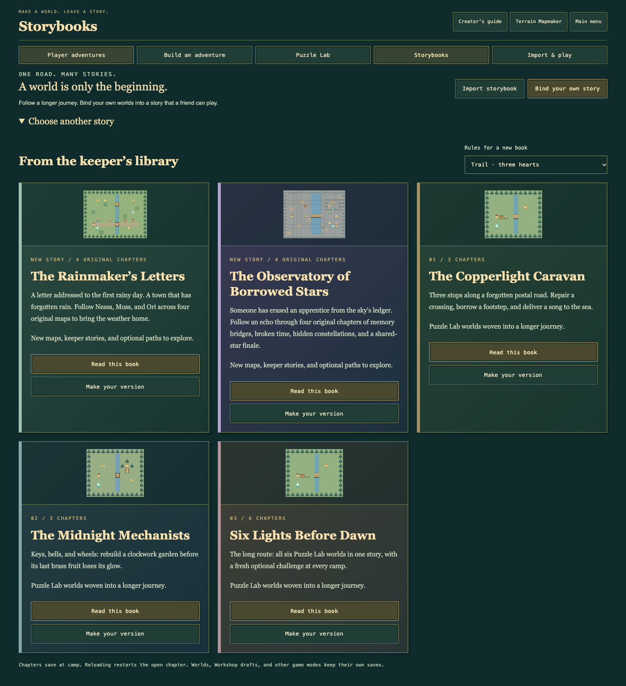

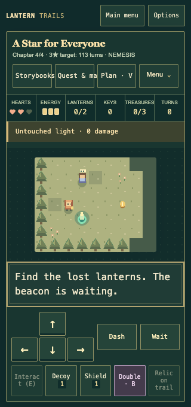

## Storybooks and chapter promises — v0.17.0

**338 Node tests**, syntax checks, and a **63-file static package** pass.
Twenty-one new tests cover real full-book wins on Trail/Nemesis, attainable
featured speed targets, earned/missed promises, chapter progression, stale or
duplicate completion, snapshots, Unicode/RLE bundles, import bounds, isolated
storage, failed writes, damaged checkpoints, and bounded whole-book bests.

The sixteenth browser suite uses Chrome **156.0.8078.47** and native inputs to
complete all three featured books on both rules: **24 chapter wins**. It checks
interludes, honors, separate full-book records, camp reload, open-chapter restart,
a missed no-power honor, guide promises, portable downloads, and an unchanged
checkpoint while browsing another mode's rules. Continue returns to the book's
original rules. Existing-mode storage remains byte-for-byte unchanged.

The authoring flow remixes a book, writes scenes, reorders/removes chapters,
fills all six slots, reloads the draft, downloads it, and retains it after a
cancelled or malformed import. Blank titles and cancelled checkpoint replacement
leave active progress intact; an accepted custom book completes its first chapter.
A fresh friend browser imports all bundled worlds, chooses Nemesis, and wins a
chapter using touch. Blocked reads, quota-like failed writes, and damaged saves
still permit play with accurate feedback.

At 320×900, 390×900, 768×900, 1024×900, 1440×900, and 844×390 the reading screen,
chapter choices, world builder, and game ribbon have no sideways page overflow.
Normal-height gameplay keeps its map and controls inside one viewport; landscape
uses one bounded page scroll. Independent 390×844 and desktop measurements confirm
that fit. Screenshot review caught and fixed an exposed hidden file input and
removed redundant chapter-screen copy. Inactive phone challenge cards compact
their descriptions; the selected promise remains fully readable.

Retained title/options/navigation, creator, and full Workshop suites pass,
including all six original featured-world/rule playthroughs, all twenty recipes,
all object inspectors, normal creator clears, exports/imports, and failure cases.
These checks cover the listed Chrome flows and sizes; they do not establish
physical-device, other-engine, screen-reader, universal user-puzzle solvability,
or player-enjoyment certification. Book recovery is explicitly at chapter
boundaries, and portable book files exclude progress.

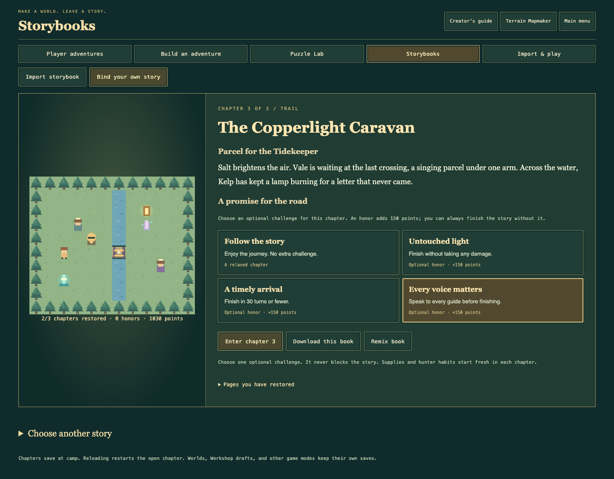

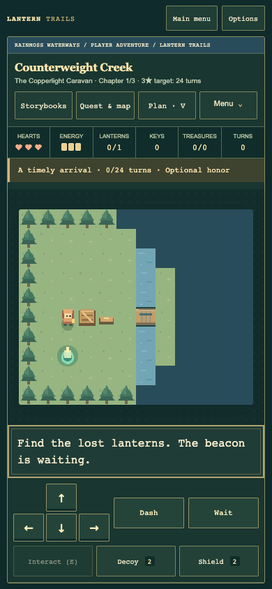

## Puzzle Lab and creative experiments — v0.16.0

**317 Node tests**, syntax checks, and a **59-file static package** pass.
Nineteen new tests cover all six rooms on Trail and Nemesis, portable verified
clear replays, mapped winning routes after each transform, rectangular/hidden
layer and patrol-route round trips, immutable editing, alternate solutions,
bounded cursor practice, and deterministic/varied design sparks.

The fifteenth browser suite uses Chrome **156.0.8078.47**. Native input completes
all twelve room/rule combinations, the crate alternative to the double crossing,
and the postkeeper's supplies branch. Each result returns to its Lab room with
a separate saved best. Browsing rooms and dealing reproducible sparks leave
saved data unchanged.

Native rotation and both mirrors each produce a new full playtest win. Undo
restores the previous world and attached clear; Redo restores the transformed
map. Practice from a different cursor position and its restart retain the draft,
creator clear, and bests byte-for-byte after a real win. A later full Playtest
records a normal clear. Blocked starts explain the problem inside the dialog.
A 64×8 world rotates to 8×64, then Undo/Redo keeps the cursor inside the current
bounds. This check caught and fixed a rectangular-world cursor issue.

At 320×900, 390×900, 768×900, 1024×900, 1440×900, and 844×390, the Lab supports
six-room browsing, native touch remix/rotate/undo, a complete touch playtest,
and editor return without horizontal page overflow. Retained creator and
responsive Workshop suites also pass. Physical devices, other browser engines,
screen-reader certification, and every player-authored puzzle remain outside
this verification claim.

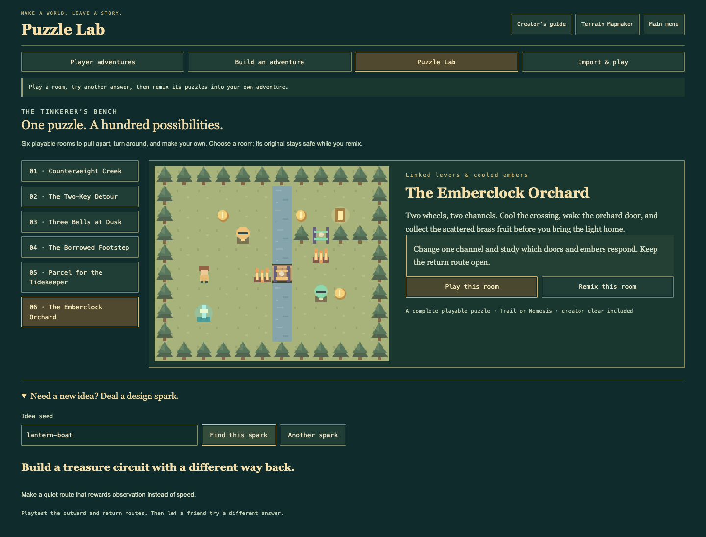

## Training camp and player entry — v0.15.0

**298 Node tests**, syntax checks, and the **57-file static distribution** pass.
Eight new tests exercise actual tutorial wins, locked crossings, free reading,
creator milestones, exported proof replay, invalid/immutable painting, proof
invalidation, independent worlds, and isolated/bounded completion storage.

The new fourteenth browser suite passes in Chrome **156.0.8078.47** at
1440×900, 390×900, 320×900, 768×900, 1024×900, and 844×390. It checks the bare
URL opens the title without source links or an automatic run; real keyboard
and touch tutorial wins; paused Plan/dialogue; exact Continue after training;
unchanged terrain, story/Guild, learned-memory, Workshop, and checkpoint saves;
completion after reload; and no sideways page overflow.

At desktop and phone sizes, the creator lesson uses native painting, Undo/Redo,
story entry, real world validation, an actual win, and a downloaded adventure.
The exported creator clear is replayed through the engine to another win.
Editing invalidates checks and the current clear. A cancelled Workshop handoff
retains the original draft and lesson; an accepted handoff transfers the actual
world and its proof. Disabled browser saving still permits a complete lesson
and reports completion as session-only. A separate 320×568 check confirms
Mira's dialogue fits, remains readable, and closes with Escape.

Retained title/options/navigation, terrain-editor, creator-shell, and responsive
Workshop suites pass, including startup recovery, downloads, compact panels,
touch painting, terrain copying, modal focus, and preserved ordinary saves.
These checks cover the listed Chrome flows; they do not claim universal browser,
physical-device, or assistive-technology coverage.

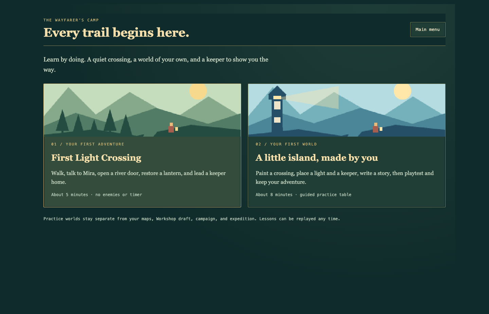

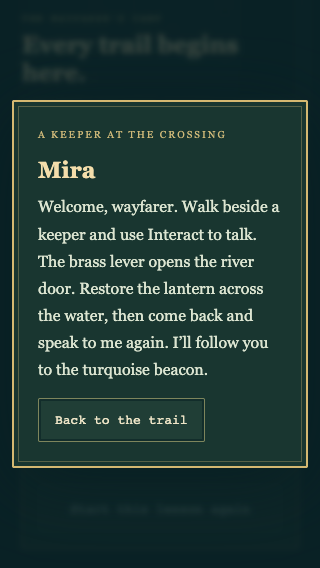

## Creator’s camp and player readiness — v0.14.0

The release retains **290 passing Node tests**, syntax checks, and a **54-file
static package**. No gameplay rules, map/progress formats, or expedition
checkpoint rules change. Runtime assets add the creator stylesheet, native
Mapmaker shell, and illustrated guide.

The new thirteenth browser suite checks the entire creator journey in Chrome
155.0.8059.85 at 320×740, 390×900, 768×900, 1024×768, 1440×900, 320×568, and
844×390. It opens compact palette/settings panels with native controls, paints
terrain, verifies keyboard focus after palette close, reads all three guide
chapters without save/gameplay changes, copies terrain into the Workshop,
paints with quick brushes, exercises Undo/Redo, edits story disclosures, checks
structure/clear readiness, and returns through Main menu to the retained map.
Fit shows the complete world without map scrolling; screens have no sideways
page overflow. Long player titles wrap. Invalid fields in a closed disclosure
reopen their panel for repair rather than trapping an invisible control.

The retained editor suite exercises every zoom, far-corner painting, native
touch panning, keyboard cursor visibility, structural layer editing, resizing,
JSON/PNG exports, and load failure through the new panels. Native nested dialogs
retain their context; actions outside a compact panel first close it visibly.
The Workshop suite retains actual wins for all three worlds on both rules,
alternate crossings, creator-clear/replay, file/code/link import in another
browser context, all twenty recipes, every object inspector, cancelled strokes,
failed saving, clipboard fallback, and an unreadable shelf without data loss.

Title, guide, preferences, journal, fitted gameplay, introductory/hard missions,
sluices, expeditions, atlas, Guild, and Horizon also pass in this release’s
full browser regression checks. Screenshot review covers both editors, the
creator’s camp, compact world notes, guides, new/share previews, and gameplay.
Fixes include grid children growing past a bounded workspace, asynchronous dialog focus return, unbroken player titles, and a false
“saved” label on an untouched default canvas. Existing-mode selection, title
behavior, live runs, editor history, and checkpoints remain intact.

These checks establish the listed flows on the tested Chrome builds and sizes.
They do not claim physical-device, other-engine, screen-reader certification,
or universal puzzle solvability or player enjoyment.

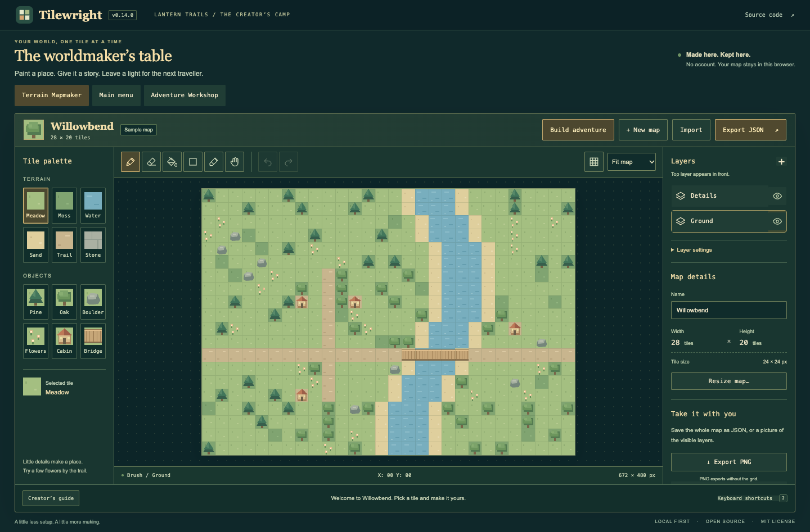

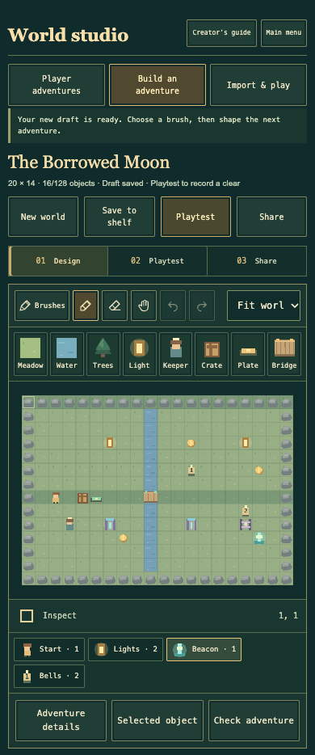

## Adventure Workshop — v0.13.0

**290 Node tests**, syntax checks, and the **51-file static build** pass.
Twenty-six new checks cover normalized/bounded adventure data, channels/routes,
all twenty deterministic region/mission recipes, terrain copying and stamps,
Unicode/RLE file and code round trips, malformed expansion/checksum/size limits,
private-origin link rejection, isolated stores and failed writes, shelf limits,
and real creator-clear replay. All three authored worlds and three alternate
solutions complete with ordinary actions on both Trail and Nemesis. Export size
checks count UTF-8 bytes so a generated file cannot exceed the import limit.

The new twelfth browser suite uses Chrome 155.0.8059.85 with disposable contexts.
It completes all three adventures on both rules, then exercises alternative
lever/supplies, waystone, and lantern-double solutions. It builds a world,
edits dialogue and terrain, draws a patrol, uses stamps and Undo/Redo, finishes
an actual creator trial, watches its replay, downloads a file, and imports the
file/code/fragment URL. A separate browser storage space receives the adventure
and completes it. Importing leaves the current draft and existing game saves
unchanged. Invalid clears, incomplete codes, and oversized files are rejected.

All twenty world recipes are also created using visible controls. Responsive
shelf/preview/designer/sharing and real paint actions pass at widths 320, 390,
768, 1024, and 1440. New-world playthroughs exercise touch movement, dialogue,
specialists, and interaction selection on smaller screens. Properties use a
dialog on compact layouts; Fit shows the entire world without inner scrolling.
Blocked storage retains a real win/clear in session and exposes backup guidance;
denied clipboard access exposes selected manual text. An unreadable shelf is
retained until the player explicitly saves/adds a world.

Every object inspector is checked for irrelevant controls. Visual review found
that checkbox display rules overrode hidden fields; a stronger scoped hidden
rule fixes it. World notes now show only the selected object's relevant settings.
Other fixes preserve unapplied metadata on Main menu, prioritize primary objects
when selecting overlapping cells, clear hidden upper terrain within stamps,
allow visibility editing on copied layers, and avoid phantom pressure-bridge
goals on worlds without plates. Native touch cancellation leaves no saved stroke.

The retained title, journal, fitted-play, editor, introductory, hard-contract,
sluice, expedition, atlas, Guild, and Horizon browser suites also pass for
this release. Desktop and phone shelf, designer, selected-object notes, preview,
sharing, and solution replay are visually inspected. Existing checkpoint rules
and saves retain their versions; no public upload/gallery service is implied.
These tests do not establish physical-device, other-engine, screen-reader,
human enjoyment, or universal puzzle-solvability coverage.

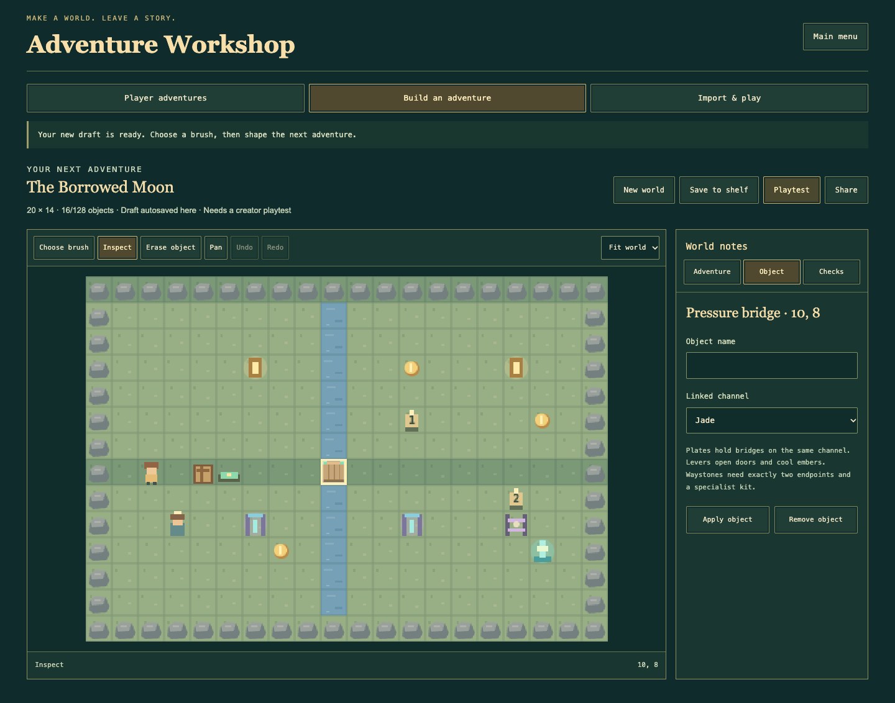

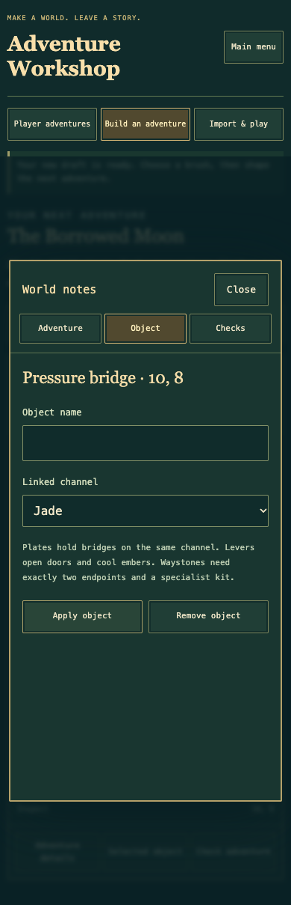

## Shared game theme, navigation, and Adventure Journal — v0.12.0

**264 Node tests**, syntax checks, and the **42-file static build** pass. Four
new journal tests verify separate rule/specialist totals, exclusion of unknown
records, attainable/unlocked suggestions, movement to other specialists after
mastery, replay after completion, and unchanged input records/logbook.

All **eleven browser suite families** pass in Chrome 155.0.8059.82 / .85 using
disposable contexts and visible controls. The title and fitted-play checks cover
seven viewport sizes; the new journal suite covers 320×740, 390×844, 768×900,
1440×900, 320×568, and 844×390. It verifies all four tabs, keyboard navigation,
sticky Main menu access, chapter/specialist/daily previews, no save writes while
browsing, guide/options return focus, inert gameplay keys off the board, and
exact run preservation through Main menu, pause, journal, guide, and Continue.

Real story wins, completed Guild dispatches, and finished expedition legs update
the journal on desktop and phone. Earned badges/results survive reload without
duplicate credit or changed saves. Blocked storage retains an actual win in the
session journal with a truthful warning. Camp choices scroll separately from
the aligned action row; bounds checks verify buttons stay on screen and do not
cover choices. A real completed leg also verifies the scroll cue after resizing.

The full retained editor, introductory, hard-contract, sluice, expedition,
atlas, Guild, and Horizon browser suites pass through the new navigation.
Coverage includes all 24 authored story missions; all 28 atlas and 22 Horizon
desktop variants; 48 main plus 20 alternate Guild desktop routes; and all nine
atlas, six Horizon, and eight Guild missions at each of 320/390/768/1024 touch
widths. Five complete multi-leg journeys, all 33 form configurations, actual
loss/retry, camps, backup/reload/import, genuine old saves, storage failure,
dialogue/forecast/pause isolation, and editor/history preservation also pass.

Desktop and phone title, mode cards, chapter banners, Guild, expedition setup,
board/HUD, notes, dialogue, camp, journal, pause, and results were visually
inspected. Fixed issues include a hidden return button made visible by display
styling, inconsistent panel colors, default blue focus outlines, and camp actions
overlapping the final route. The retained test helper now reaches Mapmaker via
Main menu and explicitly selects the first chapter when requested.

The journal reads existing stores and introduces no save migration or rule
change. These checks do not replace physical-device, other-engine, screen-reader,
or human enjoyment/balance studies.

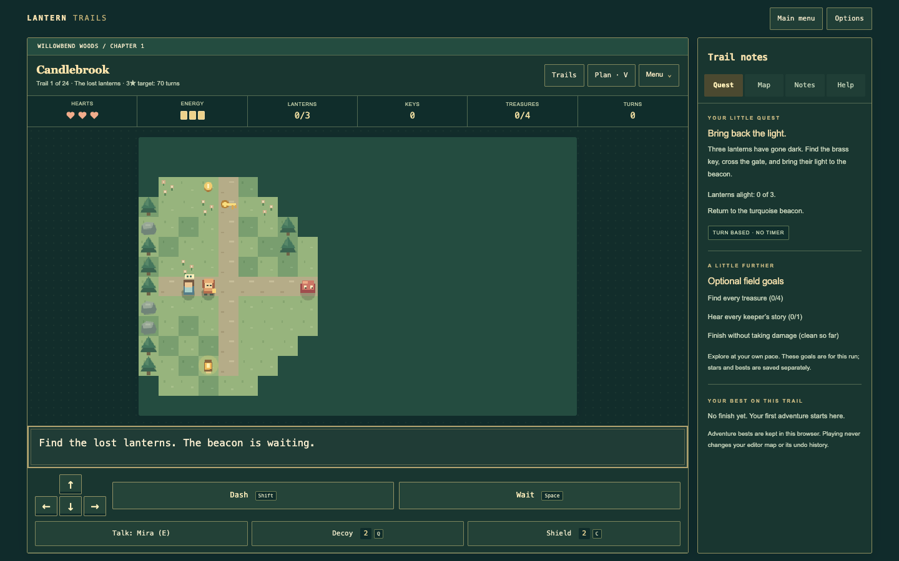

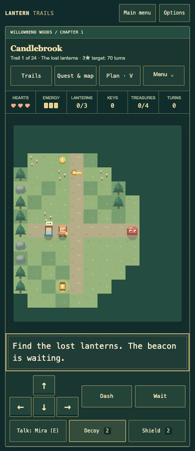

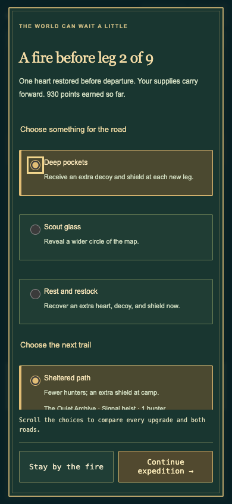

## Title, field guide, and game options — v0.11.0

**260 Node tests**, all JavaScript syntax checks, and the **40-file static build**
pass. Preferences tests cover bounds, malformed/unsupported data, failed storage,
and separation from map/journey saves. Audio checks cover volume scaling and mute.

The new Chrome 155.0.8059.82 front-menu suite passes at **320×740, 390×844,
768×900, 1024×768, 1440×900, 320×568, and 844×390**. It verifies a title screen
without an automatic run, inert gameplay keys while browsing, all four mode
previews, three guide pages, dialog focus/closing, remembered options, no audio
autoplay, and exact turn/position preservation through Continue and Mapmaker.
Custom-map entry works at 390/1440; a real invalid 1×1 map stays in the chooser
with useful guidance and a working editor exit. A real expedition checkpoint
resumes at the same position/turn after reload. Explicit native sound on/off and
blocked-storage/unavailable-audio paths also pass.

The existing seven-size gameplay layout suite and full introductory, editor,
hard-contract, sluice, and expedition browser suites pass through the new visible
menus. Coverage includes three-star wins, dialogue choices, map/undo preservation,
touch input, camp choices, actual loss/retry, checkpoint reload/export/import,
genuine older saves, and storage failures. Atlas's 28 desktop routes, Horizons'
22 desktop routes, and all **48 main plus 20 alternate Guild desktop routes**
pass, including result reload, pause/modal isolation, restart, and editor return.
These three suites' broader touch coverage retains its earlier version-specific
scope below. Two additional complete Borrowed Horizon touch runs at 320/390 use
Large reading and Reduced motion: every feedback message remains unclipped,
controls stay within 844px, and neither run creates sideways overflow.

Desktop and phone title, mode chooser, library, and options screenshots were
inspected. A white library panel and muted description contrast were corrected.
Legacy test helpers now explicitly choose a trail when a control requires a live
run; the product does not auto-start to accommodate tests. Physical devices,
other browser engines, screen-reader audits, and human usability studies remain
outside this verification.

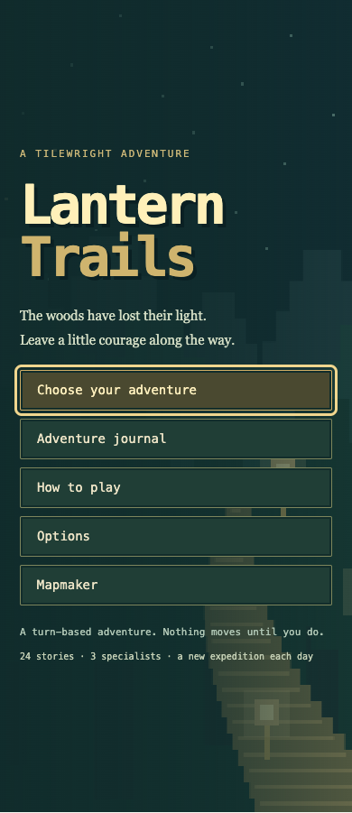

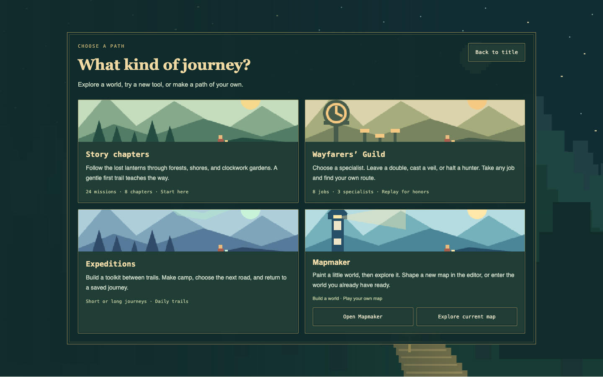

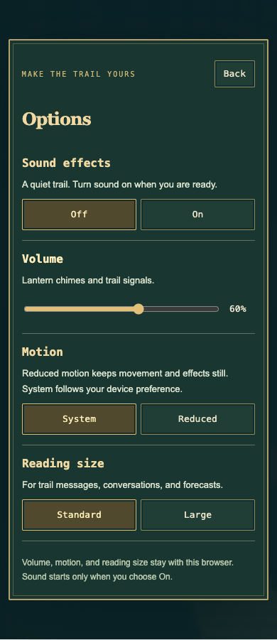

## Game text and symbol-free progress — v0.10.2

The 258 Node tests and 37-file build pass. The seven-size Chrome layout suite
verifies that the dark game text box has no status icon or alert heading,
contains no checkbox symbols, keeps 16px text and at least 7:1 contrast, and
preserves controls, focus, and bounded short-screen scrolling. Blocked keepers,
repeated input, dialogue, normal travel, and key pickups use real actions.

The complete introductory browser suite passes again, including three-star
wins, icon-free completed quest notes, saved progress, editor-history isolation,
touch/swipe, pause, and storage failure. Both new double jobs finish on 320px
and 390px touch layouts. The completed rescue/delivery job additionally checks
plain-text goals, earned commendations, and its saved Guild result. Other
browser helpers now inspect completion metadata rather than decorative glyphs;
their wider playthrough coverage retains the version-specific scope below.

Messages use a gold-framed, monospace game text box without checkmarks, circles,
or notification headings. Quest notes and Guild results use words and counts.
Desktop and phone screenshots were inspected. Saved game state and turn rules
remain unchanged; no new external fonts, assets, or services are required.

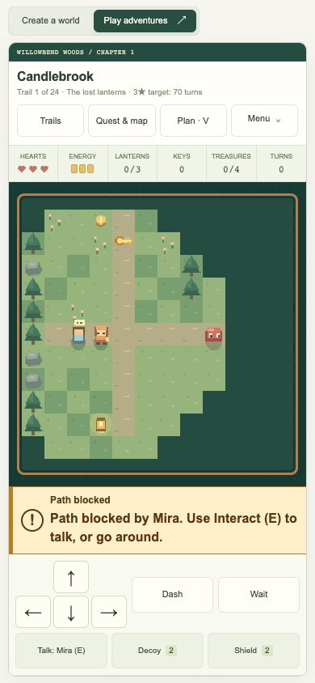

## Readable gameplay feedback — v0.10.1

**258 Node tests**, syntax checks, and the **37-file build** pass. The seven-size
Chrome layout suite now reaches a real blocked cell, checks that no turn is
spent, verifies at least 16px feedback text and a contrast ratio of at least 7:1,
and confirms the full message fits between the map and reachable controls.
It tests repeated blocked attempts, dialogue reading, return to play, and a real
key pickup switching the banner from warning to success. Normal-height layouts
retain their viewport fit; short phones/landscape retain bounded page scrolling.

The existing introductory browser suite also passes: three complete three-star
missions on desktop and phone, progression reload, pause/restart, hints, touch
and swipe, custom maps, failed storage, and preserved editor saves/history.
The new double missions additionally complete with touch controls at 320 and
390 pixels. Forecasts, conversations, and result panels remain operable with
larger text. Desktop and phone blocked-message screenshots were inspected.

This changes feedback presentation and the keeper-block explanation. Simulation
timing, save formats, and expedition rules remain unchanged. Other browser and
physical-device coverage retains its version-specific scope below.

## Lantern doubles — v0.10.0

**258 Node tests pass**, JavaScript syntax checks pass, and the **37-file static
build** succeeds. All eight Guild jobs have clean three-star witnesses for all
three kits on Trail and Nemesis: **48 main routes plus 20 alternate routes /
5,336 turns**. Both choices on each new job are covered, including manual Rain,
the lighthouse key, Neri's rescue, lens delivery, actual pressure crossings,
double-held plates, and returns before expiry. No witness edits runtime state.
Every recorded movement/tool input must advance a turn; rejected actions cannot
silently make an unplayable witness pass.

Focused checks cover six further turns after casting, separate cast/return
costs, unchanged cooldown on return, free blocked/powerless returns, hunter
capture, decoy priority, committed sweeps/fire, cargo, companions, pickups,
occupied bridge safety, and previous-state immutability. All 48 records survive
round-trip storage, including the original 24 identities. Genuine old checkpoint
fixtures and earlier story routes remain green; expedition rules stay 0.6.0.
The expanded **48,000-input Guild soak** brings the retained/new total to
**150,000 deterministic exploratory inputs**. These checks test specified rules
and executable routes, not human enjoyment or an absence of every possible bug.

The expanded Guild browser checks pass on **Chrome 155.0.8059.82**: 68 desktop
kit/rule/choice routes, 32 complete touch routes at **320, 390, 768, and 1024 ×
844 CSS pixels**, plus completed jobs under blocked and quota-limited storage.
All eight jobs finish through visible controls at every touch width; the new
jobs use Echoist, including the manual-Rain/plate route in Borrowed Horizon.
Desktop checks verify costs, result separation/reload, original save retention,
dialogue/modal/pause shortcut isolation, restart, and editor return. A separate
fresh-page check verifies the Echoist default and the two new jobs appearing first.

Touch testing caught a rejected dash and a displaced crate in the developer's
longer double witness. The corrected approach walks around the crate and
recharges before casting. All revised Echoist choice/rule routes were replayed
again through Chrome, then all four complete touch sets passed. The stricter
turn-advancement assertion now prevents that class of fixture from passing.

The seven-size layout suite also passes at 320×740, 390×844, 768×900, 1024×768,
1440×900, 320×568, and 844×390. It checks visible controls, bounded short-screen
scroll, chapter selection, tab focus, menus, library shortcuts, and responsive
notes relocation. Desktop and phone double sprites, countdowns, and the updated
Guild board were visually inspected. This release reruns Guild and layout
browser coverage; other story/expedition browser suites retain their earlier
version-specific results below. Physical devices, other browsers, screen-reader
audits, and human balance studies remain outside this verification.

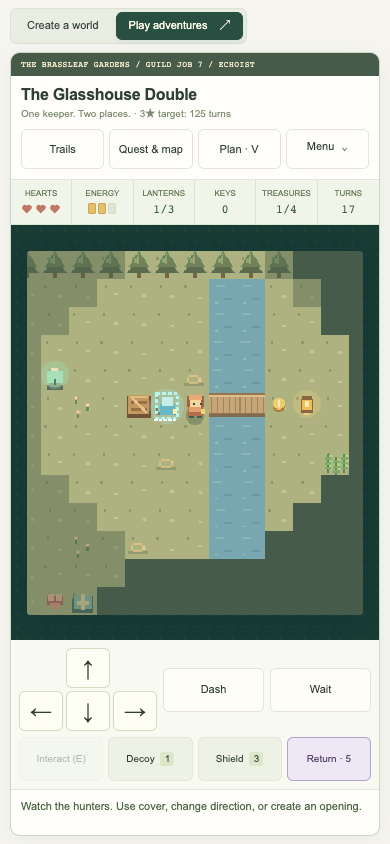

## New horizons — v0.9.0

**224 Node tests pass**, along with JavaScript syntax checks and the **37-file
static build**. Six new authored missions have **22 clean public-action route
witnesses / 2,419 turns**, covering every new dialogue choice on Trail and Nemesis, all
required treasure circuits, gates, relays, switches, rescues, and deliveries.
The final cart-route witnesses both open and actually use the optional northern
crossing, then finish with its two plates still held. Declining that crossing
also produces a valid clean finish. No witness edits positions or resources.

| Mission | Trail turns, by choice | Nemesis turns, by choice |
| --- | --- | --- |
| 19 | 83 / 83 | 85 / 85 |
| 20 | 89 | 91 |
| 21 | 125 / 127 | 123 / 124 |
| 22 | 50 / 62 | 50 / 63 |
| 23 | 153 / 153 | 158 / 160 |
| 24 | 127 / 149 | 128 / 151 |

The new 24,000-input exploratory test brings the retained/new total to
**126,000 deterministic inputs**. All eighteen pre-expansion mission definitions
match SHA-256 hashes captured from the committed v0.8.1 source. Tests protect
all 48 campaign/rule bests during custom-record eviction. Existing checkpoint
rules and genuine 0.5/0.6 restoration tests still pass.

The ninth browser suite replays the new missions through actual keyboard,
dialogue, target selection, and touch controls; the original editor map and a
real introductory-mission best are retained. It checks open chapter entries,
sequential unlocks, independent Trail/Nemesis results after reload, both finale
replay invitations, and focus on the visible chapter button after the last win.

The new suite passes on Chrome 155.0.8059.82. All six new missions also finish
cleanly through touch controls at **320, 390, 768, and 1024 × 844 CSS pixels**:
**46 new-level browser playthroughs** including the 22 desktop choice/rule
variants. The retained 28 atlas desktop variants pass, including the transition
from mission 18 to 19. The seven-size layout suite passes with all eight chapter
selectors, bounded forecasts, menu actions, notes/focus behavior, and no sideways
overflow. Desktop artwork, new terrain, and mobile screenshots were inspected.
Physical devices, Safari, Firefox, a full screen-reader audit, and human
usability/balance studies remain outside this verification.

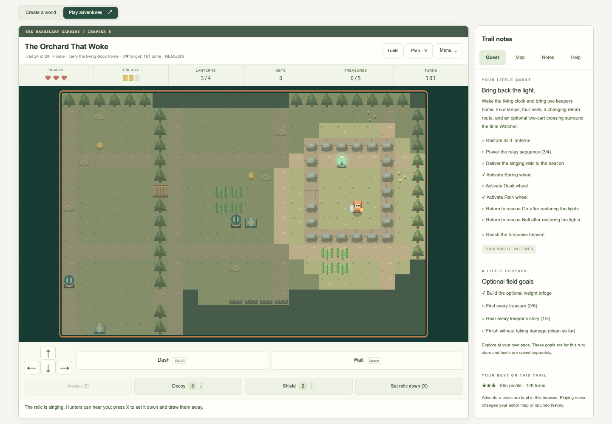

## Focused play layout — v0.8.1

**199 Node tests**, syntax checks, and the **36-file static build** pass.
The new layout suite covers **320×740, 390×844, 768×900, 1024×768,
1440×900, 320×568, and 844×390 CSS pixels** on Chrome 155.0.8059.82.
Normal portrait/desktop gameplay has no document scrollbar, with the board,
status, and tactical controls visible. Short and landscape screens use a
bounded document scroll instead of clipping controls. No sideways overflow
occurs at the tested sizes.

The checks open every chapter with only its three cards visible, switch all
notes tabs, exercise Arrow/Home/End focus, close the mobile panel with Escape,
and cross the responsive breakpoint while preserving the selected map tab.
Library, Menu, and mobile reading shortcuts consume no turns; returning to the
board resumes normal input. Direct menu activation checks verify that Pause
suppresses movement, Restart clears the turn count, and Tab dismisses the menu
without closing it before a chosen action can activate. Screenshots of desktop and phone play were inspected.
The retained browser playthroughs navigate the new visible controls through
`ui-driver.mjs`; they do not click hidden elements or alter game state.

All **eight browser suites pass**: editor, introductory quests, hard contracts,
expeditions, sluices, atlas, Guild, and the new layout suite. Retained coverage
includes all eighteen story missions, 28 atlas difficulty/choice variants, all
sluice branches, 32 Guild routes plus four touch widths, 33 expedition form
configurations, five complete multi-leg journeys, checkpoints/imports, old-save
migration, storage failures, opt-in sound, and unchanged editor saves/undo.
After fixing the menu focus timing, the introductory/hard runs, all 32 desktop
Guild routes, complete sluice/atlas/expedition suites, editor, and seven-size
Pause/Restart/focus checks pass again.

The UI change keeps simulation rules, checkpoints, and saved records unchanged.
Safari, Firefox, physical devices, and a full screen-reader audit remain outside
this verification. Human usability is not established by automated checks.

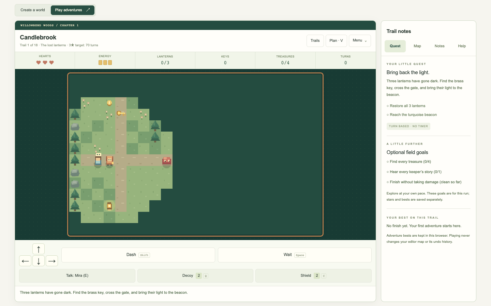

## Guild specialists and developer research — v0.8.0

**199 Node tests pass**, syntax checks pass, and the static build contains
**36 files** including release metadata. Switchback’s independent 42 tests and
build also pass. The new 24,000-input Guild soak brings the retained/new total
to **102,000 deterministic exploratory inputs**. Existing 2,304 generated-map
variants and all 256 expedition upgrade combinations remain green.

The six new Guild jobs have **24 clean public-action witnesses / 1,832 turns**,
including **56 waystone jumps and 25 tool activations**. Every job finishes with
three stars and all three optional commendations on both kits and both rule
sets. Eight additional clean routes verify the key-door option and one-jump
Sandfold finish on both kits/rules: **32 Guild routes / 2,245 turns** total,
including valid finishes that decline the Traveler commendation. The solvers
evaluate real actions; they do not change health, positions,
resources, gates, or enemy plans to obtain a win. Independent test replay checks
the results, required rescues/delivery/relays/switches, and retained input maps.

| Guild job | Trail: Bellrunner / Mistweaver | Nemesis: Bellrunner / Mistweaver |
| --- | --- | --- |
| The Folded Orchard | 68 / 69 | 66 / 66 |
| The Borrowed Minute | 70 / 70 | 68 / 71 |
| Reedglass Evacuation | 59 / 58 | 60 / 61 |
| The Hushed Folio | 98 / 99 | 104 / 104 |
| The Sandfold Exchange | 47 / 47 | 48 / 48 |
| Aurora Dispatch | 113 / 113 | 114 / 111 |

Focused checks cover current/next-turn Pulse interruption, blocked reach through
walls, expiry, cooldown and energy guards, contact/fire vulnerability, Veil’s
retained committed move and lead, cargo/alarm exposure, and new sight suppression.
Waystone tests cover a single paid turn, landing collection/fog/delivery,
enemy advancement, blocked/occupied/powerless rejection, malformed reciprocal
pairs, forecast purity, warned landing danger, and optional goals that do not
lock the exit. Records retain separate kits/rules and prioritize commendations
without farming cumulative credit. Corrupt/full/blocked storage is guarded.

Six genuine **pre-Guild 0.6 checkpoints**, generated using committed v0.7 source
in an isolated temporary directory, restore playing, dialogue, camp, loss,
held cargo, and finish without rewriting their fingerprints. Continued play
round-trips correctly. The older six 0.5 migration fixtures also pass. Only
Guild runs gain specialist state; existing story and seeded expedition behavior
remain unchanged. Package v0.8.0 still uses expedition rules 0.6.0.

All **seven browser suites pass on Chrome 155.0.8059.82**. The Guild suite
completes all 24 combinations through actual movement/interaction/tool controls,
checks energy/cooldown display and free forecasts, all saved results after reload,
shorter alternate routes that preserve a better commendation record, normal
map/story save retention, B/modal/pause isolation, restart, editor return,
and session play with blocked or full storage. All six Guild jobs also complete
cleanly using touch controls at **320, 390, 768, and 1024 × 844 CSS pixels**.
The checks cover visible entry controls, reduced motion, and no sideways overflow.
Desktop board, landing forecast, and mobile play screenshots were inspected.
After the final commendation-preview and minimap-legend refinements, all 32
Guild routes and the desktop navigation/storage checks were replayed again.

The retained six suites cover all eighteen story missions, all earlier branches,
four atlas touch widths, the editor, 33 expedition configurations, five long
journeys, camp/loss recovery, imports/exports, migration, and storage failures.
No Safari, Firefox, physical-device, full screen-reader, or human balance/
enjoyment study was performed. The [research notes](RESEARCH.md) describe primary
sources and the distinction between shipped behavior and future prototypes.

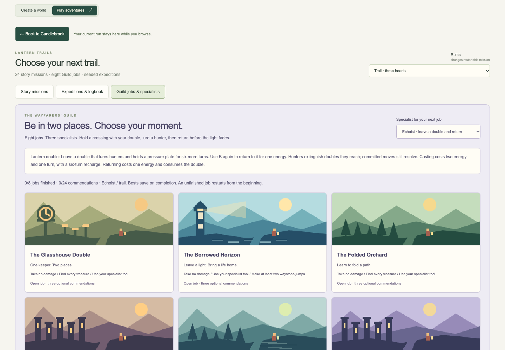

## Atlas expansion — v0.7.0

**158 Node tests pass**, JavaScript syntax checks pass, and the static build
contains **34 files** including release metadata. Switchback’s independent
42-test verification and build also pass. The new atlas soak adds 36,000
inputs to the retained 42,000: **78,000 deterministic exploratory inputs** in
all, alongside 2,304 generated-map connectivity variants and all 256 upgrade
combinations.

The nine new authored maps have **28 clean public-action playthroughs / 2,795
turns**. Every new keeper choice is covered on Trail and Nemesis. These fixtures
never change positions, inventory, health, puzzle flags, or enemy state to win.
Their independent Node replay verifies all required coins, rescues, switches,
relays, deliveries, restrictions, and three-star results.

| Mission | Trail turns: branch A / B | Nemesis turns: branch A / B |
| --- | --- | --- |
| Whispering Stacks | 64 / 64 | 64 / 64 |
| The Ink Market | 137 | 138 |
| Archivist’s Observatory | 127 | 131 |
| Cinder Caravan | 53 / 54 | 53 / 54 |
| The Sunken Bazaar | 82 / 82 | 84 / 84 |
| The Furnace Choir | 127 | 126 |
| Frostline Post | 101 / 101 | 100 / 101 |
| Mirror Reservoir | 96 | 96 |
| The Aurora Engine | 145 / 162 | 144 / 161 |

All **six optional browser suites pass on Chrome 155.0.8059.82**. The atlas
suite replays all 28 variants through real movement keys, interaction targets,
dialogue buttons, valves, relays, rescue, and cargo actions. It checks open
chapter starts, progression after reload, separate rule-set bests, chapter
stars, rule banners, disabled dash/shield controls, portrait dialogs, retained
editor saves, the final library return, and all three new Nemesis invitations.
The optional weight bridge appears among field goals, rather than the required
quest checklist; both built and unused routes win cleanly.

Each of the nine new missions also finishes with three stars through touch
buttons at **320, 390, 768, and 1024 × 844 CSS pixels**. Checks cover forecast
bounds, visible tactical controls at entry, mission constraints, chapter-jump
focus, reduced motion, and no horizontal overflow. The first 320-pixel run
caught a rule banner pushing action buttons below the screen. Constraint
missions now use a shorter phone board; all four widths pass. A fresh phone
render and the latest desktop finale were visually inspected after adding
worn paths, snow palettes, and optional-bridge labeling.

The retained five browser suites pass editor pan/zoom/scroll/export/history,
all earlier story missions, hard finales, 33 expedition configurations, five
complete multi-leg journeys, camp and loss recovery, quota/blocked storage,
backup import/export, six genuine 0.5 migrations, and modal navigation. Package
v0.7.0 retains expedition rules 0.6.0; generation and simulation are unchanged.
All 36 campaign best identities survive custom-record eviction.

No Safari, Firefox, physical-device, full screen-reader, or human enjoyment
study was performed. The checked routes and invariants pass; this is not a
claim that every possible play history or device is bug-free.

## Gameplay audit and sluice saga — v0.6.0

**127 Node tests pass** (36 additions), syntax checks pass, and the static build
contains 32 public files. The retained 30,000-input expedition soak and a new
12,000-input exploration test total **42,000 deterministic exploratory inputs**.
The 2,304 generated-map connectivity variants and all 256 upgrade combinations
remain green. None of these checks establishes that every possible play history
or device is bug-free.

The new public-action fixtures complete **14 clean runs / 1,222 turns** without
changing positions, health, inventory, flags, or enemy state. Both dialogue
branches are tested on Trail and Nemesis, plus Glasshouse declining both trades.

| New mission | Trail turns: branch A / B | Nemesis turns: branch A / B | Result |
| --- | --- | --- | --- |
| Rainmoss Sluice | 68 / 56 | 72 / 60 | No damage, three stars; both route choices and required pumps |
| Glasshouse Concord | 83 / 67 | 86 / 68 | No damage, three stars; both trades and shutter routes |
| The Last Ferry | 136 / 139 | 137 / 137 | No damage, three stars; both keepers, delivered relic, signal and ferry |

Glasshouse without buying a parcel also finishes cleanly in **55 Trail / 58
Nemesis turns**. Unit checks cover all four shutter combinations, hazard
suppression on the valve’s own turn, reversal, occupied player/crate/companion/
hunter/patrol guards, required final settings, malformed control references,
affordable/unaffordable/full-stock trades, retained treasure credit, one-time
choices, free forecasts, and reachable-control hints. A regression prevents
Luma’s exclusive ferry route being opened manually after choosing supplies.

The audit reproduced a native-modal trap: leaving Play through URL navigation
while speaking left a dialogue above the editor; Escape could not close it.
The fix closes game modals on leave while retaining conversation/camp state.
Five repeated browser leave/return cycles now pass. Additional fixes record
keepers without choices, expose competing adjacent interactions, and stop
expired individual leg tokens being credited again while a finish token remains.
Campaign-record protection now covers all nine normal/Nemesis mission bests.

Six genuine **0.5.0 checkpoints**, captured before rule changes, verify migration
of playing, mid-dialogue, camp, lost, carried-relic, and finished runs. Their old
fingerprints are checked during replay before new 0.6.0 saves are written.
Continued play and new save/reload round trips preserve their state. Existing
maps, campaign bests, and learned profiles remain separate.

The optional **Chrome 155.0.8059.82** sluice suite passes all 14 variants through
actual movement keys, dashes, dialogue buttons, valves, relays, and cargo/rescue
interactions. It checks both Nemesis invitations, unlocks after reload, declined/
unaffordable trades, free Plan dialogs, journal advice without a choice, editor
retention, camp navigation, six legacy file imports, and selecting a relic with
keyboard E while companions are also adjacent. No runtime, console, or asset
errors occur in the desktop flow.

At **320, 390, 768, and 1024 × 844 CSS pixels**, each new mission is completed
with three stars. Emulated touch checks cover dialogue, forecast bounds, reset,
visible controls at entry, competing interactions, reduced motion, and no
horizontal overflow. The phone valve preview and desktop finale were visually
inspected. All earlier editor, introductory, hard-contract, and expedition
browser suites also pass, including full long journeys, backups, actual loss/
retry, blocked/full storage, scrolling, PNG export, and real CDP swipes.

Run `npm run test:browser` for all **five** suites, or
`node scripts/sluice-browser-checks.mjs` for the new act. Playwright and Chrome
are independently installed; default verification still has no npm dependencies.
Contexts are disposable and never clear the user’s actual saves. Browser checks
are not part of the default GitHub Actions matrix.

[Phone valve preview](sluice-mobile.png), [desktop finale](sluice-finale.png),
[mission guide](MISSIONS.md), and [design references](DESIGN_NOTES.md) document
the result. Safari, Firefox, physical devices, screen readers, and extended
human difficulty/enjoyment studies remain untested.

## Replayable expeditions — v0.5.0

**91 Node tests pass**, including 28 new tests. Syntax checks and the static
build pass; the package contains 29 public files. Generated-map prerequisites
and objectives are reachable across **2,304 seed/leg/branch combinations**,
including all six mission families and four regions. All **256 upgrade subsets**
preserve resource bounds and oath restrictions. A deterministic **30,000-input**
soak covers varied seeds, movement, tactics, interactions, retries, both rule
sets, oaths, bounded state, and checkpoint replay.

Thirteen independent ordinary-action fixtures complete **34 legs / 3,534 turns**.
They cover all four oath choices on both rule sets in single contracts, plus:

| Completed expedition | Legs | Turns |
| --- | ---: | ---: |
| Trail long voyage | 9 | 887 |
| Unwarded Nemesis journey | 6 | 474 |
| UTC daily trail (2026-10-18) | 5 | 406 |
| Measured steps Nemesis journey | 3 | 422 |
| Treasure oath Nemesis journey | 3 | 408 |

No health, position, inventory, puzzle, or completion flags are overridden in
these playthroughs. Full runs exercise all eight camp upgrades, both branches,
all mission families, and all twelve attainable badges. Each offered camp
upgrade/restock × route combination is separately replay-checked. Tests verify
courier pickup/drop/distraction/reclaim/delivery, oath exit requirements,
permanent resource caps, exact save/replay, corrupt/oversized/future/tampered
backup rejection, lost-state reload/retry, independent campaign/map saves, and
no duplicate credit after camp/finish resume or a post-win learning reset.
Audio tests cover opt-in/off, unavailable/denied/closed contexts, synthesis
failure, and disconnecting completed oscillators/gains during long play.

The optional **Chrome 155.0.8059.82** expedition suite passes using disposable
contexts. It exercises all **33 form configurations** (24 journey combinations,
eight single contracts, one fixed daily), daily UTC rules and custom-setting
restoration, surprise seeds, invalid input, and canceling replacement. It
completes all five multi-leg runs above through real keyboard movement, dashes,
E interactions, dialogue choice clicks, and camp forms. It verifies camp cancel,
Escape and reload, all upgrade pickups in the nine-leg run, final resume with
unchanged logbook credit, and unchanged editor/campaign/movement saves.

Recovery checks include mid-dialogue resume, actual later-leg death and exact
reload, retry retaining earlier wins/upgrades, pause input suppression, story/
Create switching, downloaded JSON matching the checkpoint, valid import in a
new context, cancellation, and malformed/oversized/future/tampered rejection.
Blocked storage and quota failures still allow a complete contract and backup
export, with a visible warning. No runtime, console, or failed-asset errors are
observed in the desktop options/full-run flows.

At **320, 390, and 768 × 844 CSS pixels**, emulated touch/reduced-motion checks
complete a courier contract, exercise relic drop/reclaim and held-cargo import,
verify visible tactical controls, and choose restock/perilous at a bounded,
scrollable camp. Departure buttons stay visible while choices scroll. Testing
caught and corrected an oversized tablet board. All prior editor, six-story,
Nemesis, scrolling, swipe, resize, layer, export, and failed-startup suites also
pass. Run `npm run test:browser` for all four suites, or
`node scripts/expedition-browser-checks.mjs` for expeditions, with independently
installed Playwright and Chrome. Browser checks remain separate from default CI.

[Generated expedition](expedition.png), [hub/logbook](expedition-hub.png), and
[phone camp](expedition-camp-mobile.png) show real UI after ordinary inputs.
The [expedition guide](EXPEDITIONS.md) documents controls, goals, scores,
checkpoint compatibility and bounds. Coverage is evidence for tested inputs;
it cannot guarantee every possible seed, device, or strategy is bug-free.

## Adaptive missions and Nemesis — v0.4.0

The Node suite has **63 passing tests** (18 additions). New coverage verifies
movement-transition learning, decay, normalization, corrupt/blocked storage,
changed interception routes under different learned patterns, committed enemy
steps, visibility/cover/noise, fading awareness, decoy lifetime, shield lifetime,
ember timing, dialogue/one-time choices, following rescue companions, ordered
relays/alarms/gates, supply limits, required objectives, boss phases/sweeps,
Nemesis reinforcements/hazard windows, separate bests, and objective-aware hints.
Existing editor, map-format, build, and server checks remain green.

Complete input fixtures verify all second-act missions on both rule sets,
starting with fresh learned counts. Ordinary in-game moves then train opponents
throughout each run; no completion flags, inventory, health, puzzle state, or
positions are overridden in these playthroughs.

| Mission | Trail turns | Nemesis turns | Result |
| --- | ---: | ---: | --- |
| Briarwatch Rescue | 78 | 78 | All required lanterns/rescue, no damage, three stars |
| Bellforge Heist | 77 | 78 | Correct relay sequence and gate, no damage, three stars |
| The Watcher’s Crown | 97 | 104 | Crates, key, relays, Sola, signal gate, no damage, three stars |

Fixtures prove solvability for those action histories; adaptation means another
history can change enemy decisions. Different trained profiles are separately
tested to produce different interception routes. No psychological inference,
external model training, remote AI call, or broad difficulty study is claimed.

The optional Chrome 155.0.8059.82 browser checks pass at **390 and 1440 CSS
pixels** through actual keyboard movement, dashes, E interactions, dialogue
choice clicks, and tactical inputs. They finish the three harder contracts,
rescue/following objectives, and the Nemesis finale with three stars; verify
memory across reload, independent reset and bests, the final Nemesis invitation,
retained editor data, and absence of runtime/asset errors. A dialogue visibility
change regression verifies that tab visibility events cannot trap the player
inside a paused conversation.

At **320 × 844** with emulated touch and reduced motion, dialogue stays within
the screen, loadout choices and tactical actions work, controls remain visible,
and the page does not overflow sideways. Prior editor, introductory-adventure,
scrolling, resize/layer, PNG, failed-startup, and storage-failure suites also pass.

At v0.4.0, `npm run test:browser` covered the three existing suites; use
`node scripts/contract-browser-checks.mjs` for the new mission checks, with
Playwright separately installed and Chrome available. Browser tests use isolated
contexts and never clear existing user saves. Default Node verification still
needs no installed packages.

[Desktop Watcher](watcher.png), [phone Watcher](watcher-mobile.png), and
[phone dialogue](dialogue-mobile.png) screenshots are captured after real input,
including the Nemesis shield and incoming marked sweep. Existing fictional
editor and introductory campaign screenshots remain as historical records.

## Lantern Trails — v0.3.0

The Node suite has **45 passing tests**. Seventeen adventure/persistence tests
cover keys and permanent gates, crates and linked pressure plates, closed/open
river crossings, blocked pushes, dash pickup paths and energy, predictable
patrol intent, damage and two-turn recovery, loss, healing, beacon requirements,
scoring, visible-layer collision, exploration, reachable custom objectives,
minimum/disconnected maps, malformed markers, safe storage, bounded records,
and best-result ordering. Existing editor/server/build tests remain green.

Ordinary move fixtures complete Candlebrook in **54 turns**, Copper Crossing in
**50**, and The Ember Vault in **73**, all with three hearts and three stars.
They use real key collection, gate unlocking, crate pushes, bridge crossings,
and patrol timing; no state overrides unlock or complete these quests.

The combined optional browser suite passes in isolated Chrome 155.0.8059.82.
The adventure checks cover:

- All three quests completed through actual keyboard input at **390 and 1440
  CSS pixels**, including wait turns, result screens, and Next adventure.
- Locked/unlocked quest cards, three-star bests, and progression after reload.
- Dash energy, recharge, pause input suppression, restart, and scout hints.
- Custom expeditions using the current editor snapshot, unchanged editor saves,
  and preserved undo history after playing and switching modes.
- Useful rejection of an unplayable 1 × 1 map while the current game survives.
- **320, 768, and 1024 CSS pixel** layouts with reduced motion, touch direction
  buttons, actual CDP touch swipes, and no arrow-key page jump.
- Bounded camera/canvas geometry, no sideways page overflow, and mobile dash/
  wait controls staying on the same row and visible when entering play.
- A win and session unlock with localStorage blocked, plus an expedition on a
  maximum **64 × 64** map without stretching the board or page.
- No runtime errors or failed asset responses in the campaign completion flows.

The existing five-width editor, scrolling, layer/resize, touch, keyboard, PNG,
and startup-failure checks also pass. Run `npm run test:browser` with an
independently installed Playwright and Chrome; game-only checks are available
through `node scripts/adventure-browser-checks.mjs`. The application and Node
checks still require no npm packages. All browser contexts are disposable.

[Desktop adventure](adventure.png) and [phone adventure](adventure-mobile.png)
screenshots show Copper Crossing reached through normal keyboard play.
Synthesized sound is opt-in; audible quality and physical-device audio playback
have not been assessed by automation.

## Structural editing — v0.2.0

The Node suite has **28 passing tests**. Nine new operation tests cover safe
layer names, independent copies and unique IDs, compositing order, layer
limits, every resize anchor, new-cell fill, hidden-layer crop counts, odd center
offsets, extreme sizes, immutable source data, undo/redo, and version-1 JSON
round trips.

The browser suite additionally exercises structural editing at **390 and
1440 CSS pixels** in isolated Chrome 155.0.8059.82 contexts. Rename, duplication,
reordering, cancellation/confirmation of deletion, six-layer and final-layer
limits, and undo/redo pass. Opening settings and adding layers do not stretch
the canvas. Resize checks cover live preview, cancellation without an edit,
centered growth, fill only in new back-layer cells, fitting after resize,
crop warnings/previews, complete undo restoration, and invalid-size rejection.
The previous five-width scrolling, touch, keyboard, PNG, and loading checks
continue to pass. No runtime errors were observed in the added flows.

## Scrolling and rendering corrections — v0.1.1

The original checks confirmed page overflow and editing, but did not verify
that every map edge was initially visible or that touch users could pan a
zoomed map. The initial fixed 100% zoom clipped the map on small screens.
This revision adds Fit mode, bounded scrolling, pan controls, and a full-width
phone canvas, with regression checks for the actual navigation behavior.

The Node suite now has **19 passing tests**, including fit geometry at multiple
document/view sizes and coordinate mapping at every supported zoom. Server
tests verify successful loading of every public asset, including startup modules.

The reusable `scripts/browser-checks.mjs` suite passed in isolated headless
Chrome 155.0.8059.82 at **320, 390, 768, 1024, and 1440 CSS pixels**. It verifies:

- All four map edges are visible on initial load and after resizing.
- Every zoom from 25% to 200% changes only canvas scale, without growing the
  viewport or the page and without sideways page overflow.
- Both scrollbars reach the final row/column, and clicks at the far corner
  paint the correct tile after zooming and scrolling.
- Mouse and touch pan gestures move both axes without changing map data.
- Clicking the canvas does not jump the outer page; wheel gestures over a
  fitted map continue scrolling the document.
- Keyboard navigation scrolls the last cell into view and paints it correctly.
- PNG dimensions stay 672 × 480 when the editor is zoomed to 200%.
- Minimum (1 × 1) and maximum (64 × 64) maps open fully fitted.
- Every tool has its SVG icon, all public assets load, and no browser runtime
  errors occur during the normal navigation flows.
- An intentionally failed application-module request displays startup guidance
  instead of leaving an empty map with no explanation.

Updated [desktop](tilewright.png) and [phone](tilewright-mobile.png) screenshots
show the untouched fictional map. Browser checks remain separate from default
Node verification and CI. They use disposable contexts, not existing user saves.

## Initial implementation — October 18, 2026

Automated verification used Node.js 26.0.0 on macOS. The 16 `node:test` cases
cover immutable edits, unchanged layers, boundary-safe flood fill, maximum-size
fill, continuous brush lines, reversed rectangles, undo/redo branching and
bounds, JSON round trips, maximum export/import compatibility, malformed data,
storage failures, build output/rebuild safety, and HTTP asset restrictions.
Run them with `npm --prefix Tilewright run verify` from the repository root.
The HTTP test needs permission to bind to loopback in restricted sandboxes.

Browser checks used Chrome 155.0.8059.82 through Playwright in a separate
headless browser with disposable contexts, leaving existing browser saves
untouched. The following checks passed:

- A five-cell brush drag fills intermediate cells and is one undo/redo step.
- Rectangle fills all nine cells of a three-by-three region.
- Object painting and erasing affect the selected layer.
- Fill covers a connected empty layer; hidden layers reject painting.
- Layer visibility persists, and eyedropper samples the selected layer.
- Renames and map edits survive a reload.
- Arrow-key cursor drawing with Space and keyboard undo work.
- Downloaded JSON matches every field of the saved document.
- Downloaded PNG has a valid PNG signature and the expected 672 × 480 size.
- Invalid JSON leaves the current map intact; valid JSON imports successfully.
- The new-map dialog creates an 8 × 6 map with two layers.
- Shortcut help opens and closes; no runtime errors or automatic external
  requests were observed during the desktop flow.
- Widths of 390, 768, and 1280 CSS pixels do not overflow the page; large maps
  scroll inside the canvas viewport.
- Emulated touch at 390 pixels paints the selected layer.
- Blocked localStorage still permits editing and displays an export warning.

The desktop screenshot in this folder shows the untouched fictional sample at
a 1440-pixel viewport. Browser checks are separate from the dependency-free
Node suite; CI currently runs the Node suite and build, not browser automation.

## Repeatable manual checklist

1. Start on a disposable browser profile; retain any real work with Export JSON.
2. Drag a terrain tile across the map and undo/redo the whole stroke. Try a
   reversed rectangle, boundary fill, erase, and eyedropper.
3. Add a detail layer, paint objects, hide it, and verify hidden-layer painting
   is rejected. Undo its visibility change and layer addition.
4. Make a keyboard rectangle with Space, arrows, Space. Cancel another stroke
   with Escape and verify the map is unchanged.
5. Rename, reload, and compare the map. Export JSON and PNG; verify JSON can be
   reimported and PNG excludes hidden layers and editor overlays.
6. Import malformed, oversized, and future-version JSON; verify the original
   document survives. Cancel a replacement confirmation and retain the map.
7. Create a maximum-sized map, add six layers, paint, and export/reimport.
8. Test Tab order, visible focus, status announcements, phone-width layout,
   touch painting, zoom scrolling, and unavailable/full browser storage.

## Limits and follow-up

No Safari, Firefox, physical phone/tablet, screen-reader, or extended user
playtest is claimed. Native download/file-picker behavior, maximum-size
interactive performance, and cross-browser pointer cancellation need further
device coverage. New maps currently have a fixed tile size; selections, multiple local projects,
custom tilesets, custom puzzle authoring, richer multi-mission dialogue consequences, and
additional authored campaign content remain unfinished ideas. Nine story missions,
seeded branching journeys, daily trails, camps/upgrades, courier missions, oaths,
checkpoints, reversible sluices, trades, forecasts, adaptive hunters, dialogue/
rescues, and Nemesis are implemented.
No physical-device or extended player difficulty/enjoyment study is claimed.
