# Verification record

## Adventure Home, staged clues and tiny practice — v0.53.0

The release suite contains **1,654 Node tests**, including sixteen focused
navigation/hint/practice cases. The production package contains **175 files**.
Catalogue checks cover all forty-four real missions and ten regions, literal
combined search/progress filters, meaningful saved-setup selection, suggested
roads, exact final authored routes and unchanged classic hints. Every duo story
has three distinct stages; early clues contain no authored card sequences or
repair coordinates. Browsing and hints preserve projects, share codes and saves.

The three practice rooms clear through the real engine in **5, 5 and 6 ticks**.
Checks cover immutable turns, collision avoidance, correct cargo/deliveries,
blocked bridges and seals, all six next-card choices, strict invalid commands,
terminal behavior, exact Undo/reset, no attached proof/best and no save access.
Populated mixed-version journals, complete backups and separate journey
namespaces retain their original projects and progress.

Ten required live cases cover direct phone/desktop entry and every mission card;
staged clues and canceled example replacement; guided/manual practice with
unchanged parent saves and paused tests; captured v0.51 collection tick-58
continuation, Undo/reload and actual full-backup rollback from tick 59; recent
ordinary drafts; protected unreadable/quota saves; enlarged themed menus and
sticky-header offsets; creator/builder/import/classic paths with journey
switching; and Escape/focus/main-menu/legacy Workshop navigation. The full
catalogue contains **198 distinct cases**, partitioned **66/66/66**, with prior
gameplay, migration and publication gates retained.

The storage-fallback scenario also fills all eight collection slots, opens a
ninth collection for the visit, pauses a real test and returns through Adventure
Home. It verifies exact resume/Undo, keeps that visit accessible after playing
another story, and compares all eight saved records and the assembly unchanged.
An in-memory visit cache supplies this continuation without an extra save slot.

Local Chromium runs cover all ten new flows and fourteen selected older creator,
collection and classic-invention regressions. Firefox and WebKit each pass all
ten new flows plus collection-replacement and blueprint regressions. Final
Chromium checks cover the enlarged practice/status alignment and classic
keyboard placement after the last navigation adjustment.

Visual review covers title/home, live garden, route cards, hints, practice,
creator menus, collection shelf and paused-test resume at **320/390/768/844/1440**
pixels, including short landscape, largest text and high contrast. Review fixes
keep main-menu/header words intact, use measured scroll clearance, preserve the
inspection readout beside the garden, and give practice its own Garden/Cards
shortcuts. Viewport/touch emulation remains separate from physical-device,
screen-reader and human-enjoyment testing. Generated reports/captures are ignored.

## Sealkeepers and optional bonus editions — v0.52.0

**1,638 Node tests** pass, including 39 focused checkpoint/bonus cases, four added full-engine rehearsal comparisons and four added blueprint-template cases. The production package contains **169 files**. New reference clears are **13, 196, 61 and 97 ticks**; every supplied repair is necessary. Frame checks prove immutability, non-overlapping couriers, correct inspected entry, required deliveries/handoffs/relays/home flags and quiet bells.

Checkpoint tests cover the full cargo/badge/heading matrix, all real movement directions, blocked-card advancement and readable events, free return directions, cargo retention, changed cargo while occupying a seal, collision safety, strict versions and captured-piece exchange. Palettes preserve empty/any-hand conditions; transforms rotate inspection vectors and trading couriers swaps badges. All forty-four solved stories and new pieces round-trip through mixed saves, full archives and journey namespaces. Captured v0.51 project bytes/codes/state hashes, blueprint bytes, PC1 and a paused collection journal remain exact.

Bonus tests cover numeric bounds, creator-proof pars, optional normal clears, same-answer multi-bound goals, real 61/62-tick alternate answers, earned-result preservation through slower retries, independent current snapshots, strict foreign/forged-clear validation, saved-goal updates and goal-aware duplicate-card remapping. PC2 envelopes match their editions; malformed/future/downgraded payloads fail atomically. Selection/copying retains targets and credits without progress; remixes/replacements and new variants reset inherited goals. Shelves, backups, restored retries and protected unreadable data retain their validation boundaries. New posters have bounded goal rows and seal keys.

Eight required live scenarios cover all new missions at phone/desktop widths, real seal edits with blocked-entry feedback, transformed blueprint exchange, creator-par/Undo/selection/PC2/poster sharing, ribbons through slower retries and backup rollback, enlarged themed menus/numeric validation, and starter/edition protection with exact v0.51 journal continuation. The catalogue contains **188 distinct cases**, partitioned as **63/63/62**. The chapter menu keeps optional goal details folded and aligns desktop action buttons. Required platform, migration and publication gates remain in force. Viewport/touch/keyboard emulation is separate from physical-device and human usability testing. Generated captures and reports remain ignored.

Local Chromium passes all eight new scenarios. Firefox and WebKit each pass those eight plus four selected older creator/collection regressions. Final targeted checks in all three engines verify the transformed passport-rule readout; Chromium also rechecks optional goal sharing, enlarged menus and saved Undo. Reviewed captures cover chapter menus, goal editing, live gardens, directional gates, resume, creator goals and blueprints at 320/390/768/1440 pixels, plus the standalone collection poster. The largest-text phone view and high-contrast theme retain accessible controls and themed dropdowns.

The initial CI attempt passed five platform jobs and browser groups 1/3 and 3/3; group 2/3 timed out during an Ubuntu Azure mirror download before gameplay started. Its setup also stalled on retry. CI now substitutes the HTTPS Ubuntu archive for that mirror, retains signed repository configuration, sets 30-second HTTP/HTTPS acquisition timeouts with two retries, and caps browser installation at eight minutes. The full 35-minute group limit, gameplay catalogue and migration checks remain in place.

## The Bellkeeper and collection curation — v0.51.0

**1,591 Node tests** pass, including 32 focused timed-power/curation cases, four additional full-engine rehearsal comparisons and four additional blueprint-template cases. The production package contains **167 files**. The four new stories have exact portable clears at **10, 11, 196 and 97 ticks**; every supplied repair is necessary, frames remain immutable, couriers never overlap, and required delivery/relay/home/silence goals hold.

Rule checks cover next-tick power, once-per-tick decay, one-beat safe crossings, enforced authored duration caps with unrestricted creator settings, pulse extension without shortening, independent channels, remembered/held power, actor-independent signal sampling, cargo/card preservation, repeat-state countdown identity and the silent-bell goal. Rehearsals reproduce real engine frames and explain pending silence. Version-5 projects and version-4 blueprints round-trip through codecs, placement/capture, shelves, mixed-version saves and complete backups. All forty solved stories retain exact drafts/proofs/bests; paused test tick 58 restores the three-tick ring and its four-tick Undo predecessor. Captured v0.50 project bytes, codes, final-state hashes, blueprint exports and PC1 bytes remain exact.

Curator checks cover ordered validated selections, empty/repeated/out-of-range indices, immutable copies, six-slot atomic bounds, empty assemblies, maker credits, private-state exclusion, fresh selected collections and unchanged source/duplicate progress. New posters include timed-bell keys and silence goals. Responsive captures cover the chapter/resume menu, curator checklist, themed source menu, timed garden, creator goals and configurable blueprint at 320/390/768/1440 pixels, plus the standalone poster. Scroll padding keeps an applied-part return below the sticky header. Eight required live cases cover missions, actual duration and goal edits, lantern/bell canvas symbols, blueprint import protection, curated downloads/poster decoding/batch Undo, countdown backup restoration, enlarged themed menus and legacy continuation. Local Chromium, Firefox and WebKit runs pass the new flows and selected older regressions; a final targeted run verifies authored bell limits in all three engines and curated progress after reopening. The full catalogue contains **180 distinct cases**, partitioned exhaustively as **60/60/60**. Local links intentionally remain disabled by the public-host guard; hosted checks exercise the copied public link. Platform, migration and publication gates remain required. Viewport/input emulation is separate from physical-device and human usability testing; generated reports remain ignored.

## Lantern Workshop and variant collections — v0.50.0

**1,551 Node tests** pass, including 24 focused lantern/collection cases, four additional full-engine rehearsal comparisons and four added blueprint-template cases. The production package contains **165 files**. Four new stories have verified clears at 10, 11, 184 and 55 ticks; every supplied reference repair is necessary. Immutable steps, collision avoidance and all required delivery, relay, home and quiet-switch goals are checked.

Rule tests cover next-tick activation/deactivation, persistent power after leaving, same-channel double toggles, independent channels, plate/occupied-bridge safety, cargo preservation, signal sampling and repeat-state identity. Version-4 projects and version-3 blueprints round-trip through codecs, shelves, complete backups and deterministic collection replay with Undo. A populated mixed-version journal with all 36 solved stories retains every exact draft, proof and best through save/load and full backup restoration (32,612 bytes). Captured v0.49 projects retain exact exports, codes and final-state fingerprints; old blueprint and PC1 bytes also remain exact.

Creator tests cover atomic variant presets, six-slot bounds, honest route proofs, accurate generated instructions, maker credits, unchanged original progress and private-state-free one-chapter exports. Eight required live scenarios exercise the missions and these tools at phone/desktop widths, including actual new-part/goal edits, blueprint capture/import, saved switch-memory restoration, full-backup rollback, enlarged high-contrast themed menus and malformed/future/forged import protection. The full catalogue contains **172 distinct cases**, partitioned exhaustively as **58, 57 and 57**. Local Chromium, Firefox and WebKit checks pass for the new scenarios, with selected older creator/collection regressions. Reviewed 320/390/768/1440-pixel captures include playable gardens, two powered lanterns, chapter/resume menus, variants, enlarged themed dropdowns, story goals and the standalone poster. The review corrected native grey editor text fields and completed the poster’s switch/bridge legend. Platform, migration and publication gates remain required. Viewport/touch emulation remains separate from physical-device and human usability testing; generated reports and captures stay ignored.

## Star Atlas and collection direction — v0.49.0

**1,519 Node tests** cover the expanded game, including 28 focused mission/tool/poster cases and four additional full-engine rehearsal comparisons. The production package contains **164 files**. Four explicit Clocktower variations require eight, nine, ten and twelve repairs, with verified clears at 181, 181, 163 and 181 ticks. Every reference repair is necessary; frames remain immutable, companions remain separate, required goals hold and project exports retain valid proofs.

Pure tests cover all six transformations, source and maker credits, changed courier-order clear timing, genuinely broken route-to-draft fallback, protected quarter turns, atomic map replacement, empty/full assembly copying, original save/share isolation, selective progress reset/remapping and bounded escaped SVG covers. Duplicate-map cards reserve unchanged title/note matches before map-only fallback, preventing a changed or removed clear from reaching an unplayed copy. No shared output includes personal chapter progress. Existing journal formats and PC1/project bytes remain supported.

Eight required live cases cover all new missions at phone/desktop widths, source copying and arrangement Undo across reloads, verified remixes and honest drafts, confirmed map replacement with unchanged progress preserved, six-map poster decoding and legacy PC1 round trips, enlarged high-contrast themed menus across phone/landscape/tablet/desktop sizes, and paused-test resume/Undo from the Star Atlas starter. The full release catalogue has **164 distinct scenarios**, split into three exhaustive groups of **55, 55 and 54**. Five platform jobs, preserved migration and publication gates remain required. Local Chromium, Firefox and WebKit checks include the final duplicate-map replacement fix. Reviewed captures cover the director, chapter tools, themed remix menu, paused-test resume and playable garden at 320/390/768/1440 pixels, plus the standalone six-chapter poster. Viewport/touch emulation remains separate from physical-device and human usability testing; generated reports and captures remain ignored.

The first hosted pass caught a test synchronization race: the progress assertion could read the old journal before the confirmation close event committed the update. The saved shelf had the correct final state. The corrected helper awaits modal removal, and the replacement case waits for the completed-save notice with a deliberately delayed close event. The unchanged published game passes that strengthened check. Initial diagnostics are preserved in the ignored report directory. CI retains all 164 cases across three groups to provide more runtime margin; action timeouts and assertions stay enforced.

## Clocktower and persistent collections — v0.48.0

**1,487 Node tests** pass, including 24 focused timing/persistence cases and four additional catalogue-wide rehearsal comparisons. The production package contains **161 files**. Four original mastery repairs have real-engine clears at 181, 181, 163 and 181 ticks, with four-to-eight-part trays, unequal courier pacing, full-locker backpressure, a required broken-road tube crossing and two-way deliveries. Every supplied reference repair is necessary; immutable frames, collision avoidance, required goals, mirrored/palette remixes and portable proofs are checked.

The local journal tests cover empty and populated assemblies, eight-slot bounds without eviction, independently saved copies, setup snapshots, real-engine resume with Undo, proof validation, map-identity remapping through edits/reordering, duplicate chapter occurrences, restart/removal, malformed/future/oversized saves, quota failures and conflicting writers. Full journey archives, profile namespaces and generation-guarded fresh starts include the new key. Shared PC1 bytes exclude personal progress.

Eight required live cases exercise all four missions at phone/desktop widths; autosaved assembly and independent copies; full-shelf visit fallback and later saving; exact resume/Undo/clear/reset across reloads; update/reorder/remix identity; real backup/journey/reset/restore controls; corruption downloads, quota and two-tab protection; and enlarged high-contrast shelf menus with focus return and confirmed removal. Existing collection, blueprint and creator cases remain required.

The complete release catalogue has **156 distinct cases**, split into two exhaustive groups of **78**. Five platform jobs, preserved save migration and production artifact/deployment checks remain required. Local browser checks use Chromium, Firefox and WebKit. Reviewed captures cover the collection overview, saved shelf, paused-test resume and playable garden at 320/390/768/1440 pixels, including the largest high-contrast text and themed shelf menu. Storage warnings remain visible beside the active chapter while playing. Viewport/touch emulation does not substitute for physical-device or human usability testing. Generated screenshots, traces, builds and reports remain ignored.

## After Hours and adventure collections — v0.47.0

**1,459 Node tests** pass, including 18 focused repair/collection cases and four additional full-engine rehearsal comparisons. The production package contains **159 files**. Four explicit Canopy mastery variations have verified clears at 96, 60, 72 and 91 ticks, with three-to-six-part trays and three deliveries per window. Each supplied reference-route repair is necessary; immutable turns, non-overlapping companions, handoffs, relays, empty lockers, home flags, mirrored remixes, exact clear timing and portable proofs are checked.

Collection tests cover one-to-six old/new/custom chapters, immutable snapshots, title/note and text bounds, exact file/code round trips, UTF-8 byte limits, transit checks, private/credentialed/oversized-link refusal and validation of every included creator clear. Fresh-route tests strip official solution parts/cards/proofs while preserving authored custom gardens. Mechanical chapter identity ignores cards and presentation metadata, canonicalizes road/part ordering and detects changed terrain, stations, starts or goals. Chapter reorder/removal stays immutable and rejects invalid indices/actions.

Eight required browser scenarios cover all four new repairs on phone/desktop; snapshot assembly with saved chapters, reordered titles/notes and capacity; fresh/replay/next/completion navigation; remix clears without false original-chapter credit; damaged/oversized/forged imports without losing the active collection; confirmed collection replacement/remixing, starter chapters and clipboard fallback; and enlarged themed menus with focus return. A controller regression check exercises directional menu focus, activation, Back and isolation of Undo from the underlying bench. New cases and existing Canopy, rehearsal, creator shelf, blueprint and original editor regressions pass in Chromium. Collection progress requires a real test win, rather than merely opening an attached proof.

The complete required release catalogue has **148 distinct cases**, split into two exhaustive groups of **74**. Existing platform, migration and deployment gates remain required. Individual project/blueprint formats, save keys and exact captured compatibility fixtures are retained. Collection assembly and collection-menu progress are explicitly visit-only; existing project drafts/bests still use normal journey storage. Generated builds, screenshots, traces and verification reports remain ignored. Browser viewport/touch/keyboard emulation remains separate from physical-device and human usability testing.

## The Canopy Fair and blueprint connections — v0.46.0

**1,437 Node tests** pass, including 21 focused Canopy/wiring tests plus additional template and rehearsal catalogue cases. Syntax and the **156-file** production package are checked with the normal release commands. Four original 13×9 stories have verified clears at 66, 36, 42 and 61 ticks. Frame checks prove immutable turns, non-overlapping companions, complete handoff/relay/home goals and portable clears. Omitting any supplied repair from the example route prevents its completion. Mirrors and palette shifts retain exact clear timing.

Timing checks cover a waiting compass sampling Pip’s same-tick handoff, a guarded bridge throughout outward/returning crossings, and the finale’s windows finishing at 57 before both flags at 61. Both new templates create real playable routes: a two-handoff waiting bell clears at 36 and a configured corner atelier at 12. New story drafts, custom remixes and rewired pieces round-trip through the existing bounded journal. Project/blueprint versions, ordinary world rules, save keys and captured v0.43 compatibility bytes remain unchanged.

Wiring checks prove that tube and locker numbers change independently of parcels, recipes, signals, cargo conditions, programs and geometry. Atomic swaps work; merged destinations, absent source numbers and malformed maps are rejected. Unused-link allocation reserves already-free source numbers before remapping conflicts, treats the two network families separately and refuses shortages without partial changes. Manual one-ended lockers can intentionally complete an existing connection. Valid-space searches enforce board bounds, occupied stations and global connection limits while preserving the input and its proof.

Eight required browser cases cover all new story wins on phone/desktop, independent wiring and download/placement/Undo/save/reload, invalid-map recovery and number swaps, valid-space cycling and an actual recipe clear, a waiting-handoff creator clear, enlarged themed menus with test-mode locks, and exhausted-link recovery with an intentional locker join. The new cases and existing Dawn, blueprint revision, creator shelf, large-text and original name/Undo regressions pass in Chromium. Reviewed captures include 390/1440-pixel mission/connection views, tablet placement and the 320-pixel largest-text/high-contrast connection menu. The complete required catalogue has **140 distinct cases**, split into two exhaustive groups of **70**; existing platform, migration and publication gates remain required. Phone/tablet/desktop viewport and touch/keyboard emulation do not replace physical-device or human usability testing.

## Dawn Workshop, rehearsals and garden tools — v0.45.0

**1,408 Node tests** pass, including 43 new workshop-tool tests, syntax checks and the **153-file** production package. The four Dawn commissions have verified clears at 45, 61, 84 and 98 ticks, with two-to-four-part inventories, protected fixed hardware and portable creator proofs. They are explicit repair variations of the night-post network, with mirrored banks, changed recipes and increased deliveries. Existing project formats, ordinary adventure rules and save namespaces remain unchanged.

Rehearsal tests compare complete traces against real engine wins in all **26** classic/duo workshop layouts. They verify immutable inputs/frames, exact clear timing, event records, bounded horizons, repeating routes and actionable missing-Use/structural advice. Live checks cover paged events, delivery filtering, Earlier/Later, playback interruption, opening tick 94 as a real test, Undo/advance, verified completion at 98, invalidation after editing and a six-tick original single-Pip clear/export. Previewing alone does not record a personal best.

Geometry tests prove mirror and palette timing invariance across six complex gardens, quarter-turn reversibility, directional cargo banks and prism handedness, companion/card/home-flag swaps, centred resizing, station/start protection, complete-area validation and no-op proof preservation. Live tests complete a turned and resized map, paint and clear regions, undo station removal and verify coordinate/capture controls after changed dimensions. New shared remixes preserve the original challenge drafts and clear correctly after reopening.

Six required scenarios cover both full Dawn runs at phone/desktop widths, rehearsal inspection, bulk garden edits, palette/partner sharing and enlarged controls. These and existing Night Post, blueprint and part-editor regressions pass in Chromium, Firefox and WebKit. Reviewed captures include 390/1440-pixel rehearsal panels, the pinned garden, shaped-map controls and 320-pixel largest-text/high-contrast menus. Controls remain folded until needed; phone Earlier/Later controls sit above a full-width Inspect button.

A reload regression reached the visible menu while the startup overlay was still present. Workshop browser helpers now await both ready markers after navigation/reload; startup failure and action timeouts remain enforced. The affected save/reload case passed on rerun. Final focused checks cover pausing playback through rehearsal controls and original single-Pip export compatibility. Browser viewport/input emulation remains distinct from physical-device and player usability testing.

The required release catalogue now contains **132 distinct cases**, split into two exhaustive groups of **66**, with all existing platform, migration and publication gates. Generated builds, captures, traces and private saves remain ignored. The repository index includes the focused story, model, UI and browser modules.

## The Night Post and creative blueprint tools — v0.44.0

**1,365 Node tests** pass, with syntax checks and a **148-file** production build. Thirty-one new night-post tests and four additional template cases cover the new mechanics, repair inventories, persistence and blueprint operations. Seven projects captured from v0.43 retain exact serialized exports, share codes, final-state fingerprints and verified clears; four original blueprint exports also remain exact. New station rules use project format 3 and blueprint format 2, while original version-1/2 projects and ordinary adventure formats retain their behavior.

All six new stories have deterministic clears at 72, 45, 54, 61, 73 and 73 ticks. Frame-by-frame checks prove immutable turns and collision safety. Tests cover shared locker capacity, independent channels, send/collect roles, same-tick Pip-first exchanges, self-retrieval without relay credit, empty-locker goals, correct home flags and every cargo match against every carried parcel. The two repairs enforce their inventory, fixed tiles and two-part budget; changed hardware invalidates an old clear, and false attached proofs are rejected.

Blueprint checks cover all eight templates, reflected geometry/cards/prism handedness, arbitrary-cargo preservation during palette shifts, bounded multi-copy layouts, independent copied links, atomic placement/Undo and collision preflight. Arrangements exceeding locker, memory or home-flag limits fail before becoming saved pieces. Revision checks prove that an explicit saved-piece update leaves placed hardware and other saved copies unchanged. New/old drafts, repaired proofs, showcases and both libraries round-trip together through the existing journey namespace; unreadable data stays protected.

Six new required browser cases exercise every night-post mission on phone and desktop, real repair wins, new part/goal editing, reflected/repeated blueprints with confirmed update/cancel flows, version-3 file/code sharing and version-2 continuation. Controls are checked at 320×568, 844×390, 768×1024 and 1440×1000 with largest text, high contrast and themed menus. These cases, existing blueprint flows and part-editor regressions pass in Chromium, Firefox and WebKit. Reviewed captures include the pinned desktop garden, phone blueprint drawer, enlarged narrow dropdowns and placement feedback.

Several initial local checks were interrupted by host suspension; a recorded browser trace contained a roughly seventeen-minute gap during a click. The affected cases passed on rerun without increasing action timeouts, with idle sleep prevented during test processes. Physical-device and human usability testing remain separate from browser viewport/input emulation.

The required release catalogue contains **126 distinct scenarios**, split into two exhaustive groups of **63**, with the five-platform, preserved-migration and publication gates. The repository index includes the new story catalogue, focused browser/rules checks and captured compatibility fixture. Generated builds, private saves and test reports remain ignored.

## Pip-and-Sprout adventure creator — v0.43.0

**1,330 Node tests** pass, including 23 new duo tests, syntax checks and a **147-file** production package. The repository index covers **435 files** and checks 1,909 local references. New rules are confined to duo project format 2; the ten classic inventions, original adventure exports and captured v0.41 checkpoint retain their behavior. Duo saves use a separate journey-scoped key, so saving a duo never rewrites legacy workshop bytes.

The six authored stories replay deterministically in 9, 11, 13, 19, 27 and 55 ticks. Tests verify every immutable frame, both companions’ occupancy, handoffs, parcel conversion/counts, colour-specific tubes and bridge timing, signal samples, both home flags, all six portable projects and exact creator clears. False proofs, malformed programs, oversized files, unknown versions, altered official layouts and unsafe coordinates are rejected. Remixes retain credit and leave originals intact.

Creator tests cover terrain/start edits, station limits, readiness messages, atomic placement and Undo, blueprint rotations and directional programs, linked colour shifts, first A/B routes, configurable delivery targets and rectangular capture. Partial tube captures, collisions and over-budget pieces fail without mutation. Twelve-adventure and twelve-blueprint shelves refuse overflow without eviction; explicit replacements leave other entries intact. Quota/corrupt storage, backup/reset/restore and journey isolation are checked.

Eight required live cases exercise all six story wins at 390- and 1440-pixel widths; real player-built clears; shelf save/reload/update/cancel; project files/codes/postcards; configured, captured and imported pieces; shared finale replay and forged-proof rejection; terrain, starts, dialogue and part settings; and recovery downloads without overwriting unreadable saves. These cases and the three existing part-editor regressions pass in Chromium, Firefox and WebKit. Layout checks include 320×568, 844×390, 768×1024 and 1440×1000 with largest text, high contrast and themed dropdowns. Precise Column/Row controls complement direct touch placement on larger gardens.

The required release catalogue now contains **120 distinct cases**, split into two exhaustive groups of 60, with the existing five-platform and legacy-migration publication gates. Local reports, screenshots, traces, private save data and generated builds remain ignored. Browser viewport/input emulation does not replace testing on physical devices or a player usability study.

## Pip workshop editing and regression audit — v0.42.1

**1,307 Node tests**, syntax checks, the **143-file** production build, public
packaging checks and the **429-file** repository index pass. Eight new parity
tests compare all three-card programs across eight single-companion challenge
layouts, including both initial banks in the route-memory lesson: 1,944
program/layout combinations, checked against the real adventure rules for up
to 24 ticks each. Position, next card, transformed program, cargo and receiver
counts agree. Adventure and project formats and core turn rules are unchanged.

A live regression reproduced the old name-field mismatch: Undo restored the
original title but left the edited title in its input. Both name fields now
render the canonical saved values, and renaming at the bench keeps a verified
clear. The test exercises blur, Undo, normalized creator names, export, reload
and locked editing during a test. Firefox explicitly leaves the creator field
before asserting the committed value, rather than assuming browser Tab timing.

Two more required cases exercise editing and removing placed prisms, recipes
and route memories; both loaded card banks and first-route selection; budget
preservation; export with an invalidated mechanical clear; Undo and actual
finished tests; fixed-station protection; and enlarged high-contrast menus at
320×568, 844×390, 768×1024 and 1440×1000. All three new cases pass in Chromium,
Firefox and WebKit. Reviewed phone/desktop captures include the part editor,
board controls and 320-pixel enlarged first-bank dropdown.

The broader dropdown family opens all 40 existing game/editor choices in each
of those three engines. It covers real settings, creator and replay screens,
controller selection with a finished mission, keyboard/touch behavior, a missing
Popover fallback, grouped lists, rotation and viewport bounds. This audit found
that Community filters had a hidden attribute overridden by their flex layout:
visible buttons could not open. The stylesheet now hides them outside the
Community shelf, and the required community test checks both directions.
Themed choices also reflect a disabled parent fieldset, including accessible
state, and reject opening or committing while disabled. The audit now names a
failed control directly.

The required release catalogue contains **112 cases**, split into two groups
of 56, with the existing migration and five-platform publication gates. Reports
and captures remain ignored. Before this patch, the preceding v0.42 release
was independently confirmed: all 109 release cases and migration passed for
8cf93bb, all 142 served files matched that commit, and eight targeted scenarios
passed against the published website.

## Pip’s invention workshop — v0.42.0

**1,299 Node tests**, syntax checks and the **143-file** production build pass.
The 38 new tests prove all ten inventions, both rule sets for compiled ordinary
adventures, alternate prism/tube solutions, portable verified projects, budgets,
terrain/occupancy constraints, parcel retention, handoff uniqueness, no collisions
or swaps, plate timing, independent flip memory, bounded playback, storage failures,
journey isolation/full backups/fresh starts, and immutable longer rehearsals.
A deterministic sweep of 432 relay programs checks 10,368 simulated ticks for
legal positions, card indices, unique cargo and bounded receiver counters.
The v0.41 checkpoint still wins with the original fingerprint and exact v13 world
export hash. Existing core adventure rules and formats are unchanged.

Eleven new required live scenarios cover all ten inventions on phone/desktop,
keyboard and touch building, budget refusal, Undo, verified project/adventure
exports and actual shared wins, postcard/feedback downloads, relay import,
wardrobe/display persistence, confirmation before a display replaces a newer draft,
storage recovery, themed menus and enlarged
high-contrast views at 320×568, 844×390, 768×1024 and 1440×1000. They also check
Stop, keyboard interruption and focus restoration for event advancement, honest
community filtering, and actual v0.41 continuation. All eleven pass in Chromium.
The first draft of the harness toggled an already-open hint drawer and used
Escape as if it had no existing pause action. Both checks now exercise the
intended visible controls, preserving the normal pause behavior and timeouts.

Reviewed phone/desktop captures show the board, relay layout, appearance page,
sharing page and enlarged high-contrast view. The review moved the invention
picker and garden instructions into optional drawers to bring the board higher
on phones. Largest-text navigation uses full-width choices to avoid broken
words. Workshop entry buttons explicitly retain their return-focus target,
including browsers where clicking a button does not focus it. New controls remain inside the optional workshop or existing Pip panel.

The required release catalogue now has **109 cases**, partitioned exhaustively
into 55 and 54; both Chromium groups, baseline migration and five platform jobs
gate publication. Local browser reports remain ignored. This is automated and
visual QA, not a volunteer usability study. A local-only feedback download is
available for the owner’s future player sessions; no real player feedback or
public community uploads have been invented.

## Pip and the Clockwork Gardens — v0.41.0

**1,261 Node tests**, syntax checks and the **138-file** production build pass.
All six chapters have three-star Trail/Nemesis clears, all-treasure routes and
paused-card alternatives. The finale has a separate manual route while the
normal clear coordinates keeper movement with Pip's running loop. Tests cover
A/B starting banks, next-card restart, latched cards, retained cargo, independent
signs, bounded own-ID bits/route records, shared station limits and no external
signal requirement. All 216 rehearsal drafts remain immutable.

Blueprint checks cover all four complete portable networks, independent copied
snapshots, full-shelf/unknown-ID refusal, geometry transforms, fresh pasted IDs,
parcel/tube links and storage round-trips. Repaint, whole-map/room turns, dock
reset, Undo, Continue and route reviews preserve their expected state. A captured
v0.40 checkpoint and exact full v12 export hash retain the original outcome.
New proved worlds/book round-trip; the largest official link is 6,399 characters.

The release catalogue has **98 cases**, in two exhaustive groups of 49. Eight
new cases cover full phone/desktop books and honors; rehearsal/reset/Undo;
creator repaint, both banks, starting route, swaps and rotations; copied,
mirrored, exported/imported/placed blueprints and verified shared play; quota
and damaged-shelf recovery; next-bank descriptions, themed menus and enlarged
high-contrast layouts at 320×568, 844×390, 768×900 and 1440×1000; independent
route memories; and original v0.40 continuation. Baseline migration and the
platform matrix remain publishing gates. Profiles are disposable.

All eight new scenarios pass in Chromium, Firefox and WebKit. The creator check
selects the sign beneath its overlapping delivery flag, then places an imported
piece on a connected road; the normal validator still refuses disconnected
missions. The blueprint browser check also fills all twelve slots before
exercising quota failure and damaged-shelf recovery. No console errors are
filtered and no action timeout is increased.
The first full CI run exposed one remaining older Prism capacity/recovery test
that checked a generic details element. Both new drawers matched it, so the
selector is now the explicit capture ID; the optional expansion check uses the
same target. The focused Prism check passes in Chromium, Firefox and WebKit,
and native drag, keyboard corners and Escape capture checks also pass.
The release gate held publication until the correction passed.

Reviewed phone/desktop captures cover the original cover, all six maps, route
message, next-bank directory, creator programs and themed bank menu, folded
assembly drawer, blueprint previews and copied cards. Blueprint metadata gives
dimensions/object count, its text is compact, and copying has immediate visible
feedback beside the button. Enlarged high-contrast menus keep the existing
unwrapped Back/Close navigation. Physical-device and assistive-technology
sessions remain outside these emulated viewport/engine checks.

## Pip and the Glassworks — v0.40.0

**1,210 Node tests**, syntax checks and the **136-file** production build pass.
All six chapters have three-star Trail/Nemesis clears, all-treasure routes and
paused/manual alternatives. Tests cover matching/empty/wrong inputs, ordinary
card advance, no rewrite/parcel duplication, capped success targets, continued
conversion, cargo questions and delivery, tubes/prisms, directed recipes and
supplied cycles. All 216 rehearsal drafts leave state unchanged. Dock reset,
Undo, Continue and completed reviews preserve the expected cargo/counts.
The book and proved worlds round-trip; the largest official play link is 9,022
characters with its complete creator clear.

Repaint, world/room transforms, complete recipe capture and independent input/
output remapping are checked. Piece metadata edits preserve original geometry
and preview transforms, validate before replacement and omit blank notes.
Compact creator clears are bounded at 2,000 expanded actions; malformed,
unknown, mixed and oversized encodings are refused. Plain arrays remain valid.
The captured v0.39 checkpoint retains its original winning fingerprint and
exact full v11 export SHA-256.

The **90-case release catalogue** adds eight Glassworks cases: full clean books
on phone and desktop, free rehearsal and wrong-input return recipes, dock reset
and Undo, real creator repaint/settings and transformed puzzle exchange, edited
piece metadata with Cancel and failed validation, verified shared play, quota/
damaged-shelf recovery, enlarged high-contrast forms and themed menus at
320×568, 844×390, 768×900 and 1440×1000, and original v0.39 continuation.
CI runs all cases in two exhaustive groups of 45; baseline migration also gates
publishing. Test profiles are disposable.

All eight new cases pass in Chromium, Firefox and WebKit. Phone/desktop screenshot review covers
the original cover, camp, map, conversion message, recipe hardware, creator
inspector and custom output menu, compact pieces and metadata editor. Review
caught an unthemed note textarea; it now uses the game colours, readable text
and focus ring. An open piece editor spans the desktop drawer's columns. The enlarged inspector
header reserves its Close button width so its label stays on one line.
The final enlarged-text captures keep the edit controls inside a 320×568 view.
WebKit exposed a recovery-test race: a second reload interrupted dynamic imports
67 ms after the first. The test now waits for actual startup completion before
injecting damaged storage and reloading again. The focused recovery retest passes;
console errors still fail scenarios and runtime startup behavior is unchanged.
Browser/viewport checks do not replace physical-device or assistive-technology
sessions.

## Pip and the Switchback Station — v0.39.0

**1,156 Node tests**, syntax checks and the **135-file** production build pass.
All six new chapters have three-star Trail/Nemesis clears, all-treasure routes
and paused/manual alternatives to automatic loops. Junction tests cover exact
cargo sampling, empty/wrong-colour branches, retained cargo, latched programs,
both-result goals, source validation and the shared station cap. Rehearsal
checks all 216 drafts without mutations. The finale requires releasing jade
so its counting stamp can read Quiet. The full book, worlds, proofs and links
round-trip; the largest official play link is 11,187 characters.

Geometry, repaint and assembly checks preserve both banks and parcel links.
Builder notes survive mirrors, turns, files and local storage. Invalid notes,
missing junction sources and partial networks are refused. Empty notes retain
legacy piece bytes. Continue, Undo and completed reviews preserve decisions;
a captured v0.38 checkpoint keeps its original win fingerprint and exact v10
export SHA-256.

The **82-scenario release suite** adds eight Switchback cases: phone/desktop
six-chapter books; free rehearsal and actual branch messages; reset/Undo;
creator repaint, bank swap/rotation, note capture/download/import/place and
proved shared play; malformed notes and quota failure; long names, large text,
themed menus and 240-character notes at 320×568, 844×390, 768×900 and 1440×1000;
and original v0.38 checkpoint continuation. CI retains both exhaustive groups
and preserved-baseline migration as publishing gates.

All eight Switchback cases pass in Chromium. Final retests also cover the folded
builder-note disclosure and affected older Loom/Orchard engraving tools. Reviewed
phone/desktop captures show the new station cover, map, Otherwise/Matching
messages, hardware, bank menus, compact puzzle cards and expanded large notes.
Notes start folded, and station help shows only the types present in the world.

Browser checks use disposable profiles. Browser-engine and emulated-viewport
coverage does not replace physical-device or assistive-technology sessions.

## Pip and the Lantern Foundry — v0.38.0

**1,105 Node tests**, syntax checks and the **134-file** production build pass.
All six new chapters have clean three-star Trail/Nemesis clears, all-treasure
routes and automatic-loop solutions. Tests cover reusable sources, one-parcel
inventory, wrong/full receivers, one-to-three delivery targets, all-receiver
power, powered routing, tubes/prisms, rewrite limits, reset occupancy and
immutable rehearsal across all 216 programs. Continue, Undo and completed route
reviews retain parcel state. A captured v0.37 checkpoint keeps its original
winning fingerprint and full v9 export SHA-256. New worlds, files, links and the
book round-trip with proofs; the largest official link is 10,299 characters.

Assembly tests cover both reflections, rotations, terrain, patrol routes, both
program banks, prism handedness and independent pasted channels. Preview and
download transformations leave the saved puzzle and current draft unchanged.
Incomplete parcel networks are rejected before capture or sharing.

The **74-scenario release suite** adds eight Foundry cases: complete phone/touch
and desktop/keyboard books; free rehearsal, carrying, automatic delivery and
victory focus; an occupied-crossing dock refusal with Undo; actual station
repaint/settings, mirrored puzzle capture/download/import/place and proved
shared-adventure play; both reflected program banks; long names, enlarged text
and themed controls; and original v0.37 checkpoint continuation.

All eight Foundry cases pass in Chromium, Firefox and WebKit. A direct rotating-
room check also preserves receiver power, Pip and all station positions after
four turns. Phone/desktop screenshot review covers
the original cover, camp, game board, pickup message, hardware directory,
receiver inspector, themed channel/reflection menus and transformed puzzle
previews. Enlarged checks use 320×568, 844×390, 768×900 and 1440×1000 with
extra-large text and high contrast. New browser checks use the actual status
message element and channel numbers; the blue bridge chapter correctly uses
Q4/N4. Existing search helpers select exact book titles when related synopses
produce extra results. The full release run exposed an older Orchestra test
reading hidden turn-zero text before Continue finished. Older Pip checkpoint
checks now wait for their exact saved turn, then still assert unchanged save
bytes, Undo and the original win; no action timeout or game rule was changed.

The full local 74-scenario run passes. CI reached 72 passing cases before its
25-minute job limit cancelled it, with no failed case reported. CI now partitions
the same ordered catalogue into two balanced groups; both gate deployment.
Selection tests prove exhaustive, disjoint membership and stable focused retries.
Each job allows 35 minutes; individual action timeouts remain unchanged. The
preserved-baseline migration also remains required.

Browser runs use disposable profiles. Viewport/emulated-touch tests and browser
engines do not replace physical-device, assistive-technology or extended player
difficulty/enjoyment studies.

## Pip and the Prism Observatory — v0.37.0

**1,044 Node tests**, syntax checks and the **132-file** production build pass.
All six chapters have clean three-star Trail/Nemesis clears, including
all-treasure detours and automatic loops. Coverage includes all five prism
operations, next-card restart, bounded activation goals, dock/rewrite behavior,
immutable rehearsal for all 216 programs, transform algebra across all programs
and map symmetries, room turns, assemblies, own-ID records, Continue/Undo and
completed route reviews. A captured v0.36 save retains its original winning
fingerprint and the original v8 export hash. Every new map and the book round-trip;
the largest official play link is 9,162 characters.

The **66-scenario release suite** includes seven Prism scenarios: full phone/touch
and desktop/keyboard books; free rehearsal, automatic running and victory focus;
actual prism repaint/settings, puzzle download/remove/import/place, proved
world export and shared-link play; malformed/oversized/future puzzle files,
quota failures, twelve-slot capacity and damaged storage; large-text themed
menus and long names; and previous-release continuation. Sizes include
320×568, 844×390, 768×900 and 1440×1000 with largest text and high contrast.
Live checks exposed and repaired long-name wrapping in the prism directory and
puzzle drawer, and simplified the drawer’s small-screen heading. A test route
was also corrected to hold the bridge before walking across; game rules were
not weakened.

All seven Prism scenarios pass across Chromium, Firefox and WebKit, including
final retests of damaged-store removal/capture and the long-name drawer. The
resized keyboard check explicitly resets from any map position with the pointer
away from the board; it no longer assumes the hover cursor stayed at the last
keyboard cell during a viewport change. No action timeout was increased. The Orchard browser helper now chooses its
exact cover title after searching: the new Observatory synopsis legitimately
adds a related second match for “Signal Orchard.”

Reviewed phone/desktop captures cover the original observatory illustration,
board, prism messages/hardware, compact creator inspector, themed operation
menu, puzzle-file controls and 320-pixel enlarged long-name cards.

Portable puzzle tests preserve original storage on failed writes and reject
unsafe/incomplete files before appending. Duplicate names use new slots and
a full drawer never evicts a piece. Browser tests use disposable profiles.
Physical-device and assistive-technology sessions remain outside this
browser-engine/viewport coverage.

## Pip and the Signal Orchard — v0.36.0

**987 Node tests**, syntax checks and the **131-file** production build pass.
All six chapters have clean three-star Trail/Nemesis clears, including
all-treasure detours and automatic loops. Tests cover signal sampling after
the keeper move, all-plate occupancy, lever overrides, latched programs, both-route
goals, dock rules, repeated records, prototype-named IDs, all 216 rehearsal
drafts, linked assemblies, both-program transforms, Continue/Undo and route
review. A captured v0.35 checkpoint keeps its original winning fingerprint;
the full prior v7 export keeps its SHA-256. All new worlds, links and the book
round-trip with proofs. The largest official play link is 7,865 characters.

The **59-scenario release suite** includes six Orchard cases: full phone/touch
and desktop/keyboard books; free Quiet/Powered rehearsal, automatic running
and victory focus; actual brush repaint, per-bank satchel borrowing/rotation,
linked capture/paste, proved export and shared-link play; enlarged text and
damaged-satchel recovery; and previous-release continuation. The creator case
checks that an isolated copy is rejected before sharing, then exports a
connected copy. Largest-text/high-contrast checks exercise both program banks,
the bank menu and both-route goals at 320×568, 844×390, 768×900 and 1440×1000.

All six Orchard scenarios pass in Chromium, Firefox and WebKit. Final enlarged
checks exercise both program banks and their themed menus across all three
engines. The illustrated cover uses the full Pip-book art frame. Release CI
gates publishing on the full browser suite, baseline migration and five Node/OS
jobs; its total browser budget is 25 minutes as full-book coverage grows, with
individual action timeouts unchanged.

Reviewed captures cover the phone/desktop board, original Orchard cover,
loaded signal, hardware text, 320-pixel enlarged mode, creator map and themed
Powered-card/bank menus. Optional details remain inside existing disclosures.

Browser contexts use disposable local saves. The production package contains
no runtime dependencies or external uploads. Browser engines and emulated
viewports do not replace physical-device or assistive-technology sessions.

## Pip and the Lantern Loom — v0.35.0

**936 Node tests**, syntax checks and the **130-file** static build pass.
All six new chapters have three-star clears on Trail and Nemesis, including
all-treasure and automatic-loop routes. Tests cover stamp loading, next-card reset, unchanged keeper
rewrite counts, required/optional stations, repeated-use bounds, dock behavior,
all 216 rehearsal drafts, engraving repaint/rotation/assemblies, room transforms,
Continue/Undo and completed reviews. A captured v0.34 save keeps its original
winning fingerprint and exact prior export bytes. New compact v7 links preserve
canonical worlds, programs, goals and proofs, including the larger finale.

All six Loom scenarios pass in Firefox and WebKit; automatic handoff and long-name
layouts also pass a final Chromium check. The **53-scenario release suite**
includes six Loom cases: complete phone/touch
and desktop/keyboard books; free changing-program rehearsal and victory focus;
actual brush repainting, satchel borrowing, engraving rotation, assembly reuse,
proved export and shared-link play; enlarged/corrupt-satchel recovery; and v0.34
continuation. Sizes include 320×568, 844×390, 768×900 and 1440×1000 with largest
text and high contrast. The creator retains usable map height, failed satchel
reads keep the original data, and manual engraving remains available. A full
Chromium run exposed an older test reading the hidden initial turn counter before
async save restoration completed. It now waits for the exact saved turn before
asserting and continuing; no legacy state or golden outcome was changed.

Reviewed phone/desktop captures cover the original pixel-art book cover, board,
loaded program, combined hardware directory, engraved card fields and themed
satchel menu. Pip controls retain the earlier small-screen layout; optional
engraving tools and hardware details remain in disclosures. Release CI runs the
full browser gate, preserved-baseline migration and five Node/OS jobs before
publishing. Tests use disposable profiles; physical-device and assistive-tech
sessions remain outside this browser-engine/viewport coverage.

## Pip and the Midnight Parcelworks — v0.34.0

**887 Node tests**, syntax checks and the **129-file** static build pass.
The five chapters have clean three-star clears on Trail and Nemesis, including
all-treasure variations. Tests cover tube-only travel, blocked landings, ordered
exit deliveries, isolated-room connectivity, paired assemblies with independent
channel space, room/map transforms, immutable rehearsal and draft transforms,
version-6 files/links/books, exact Continue/Undo and route-review replay. A captured
v0.33 checkpoint keeps its original winning fingerprint alongside the earlier
v0.31/v0.32 fixtures.

All six expansion scenarios pass sequentially in **Firefox and WebKit**: complete
phone/desktop books, free program remix/rehearsal and satchel export, creator tube
painting/capture/paste plus proved export and shared-link play, enlarged text and
48-character tube names, and old-save continuation. Layouts include 320×568,
844×390, 768×900 and 1440×1000. Screenshots review the board, numeric tube/flag
labels, compact pair directory, custom card menus, creator inspector and original
Parcelworks cover. Enlarged creator tests reserve at least 180 pixels of map
height, check readable section headings, and navigate tube inspection by keyboard. Tests use fresh disposable storage.

Chromium regression testing exposed and repaired two navigation issues: the
peaceful-story shortcut now finds its target across shelf pages; companion
controls restore board focus immediately so a fast first movement is accepted.
A final delivery made while the keeper waits at home also retains victory-button
focus. The required release suite contains **47 scenarios**, including the new
six; CI gates deployment on that full suite, legacy-browser migration and the
five Node/OS jobs. Browser engine and viewport checks do not replace physical
device or assistive-technology sessions.

## Pip and the Brassbound Atlas — v0.33.0

**853 Node tests**, syntax checks, the **128-file** build and public packaging
checks pass. The four harder trials have clean three-star routes on Trail and
Nemesis. Tests cover ordered/early deliveries, final parking, exhausted rewrites,
sealed docks, Undo, allowed-return resets, disconnected flags, overlay repainting,
assembly numbering, rotating rooms, exact Continue and route reviews. Captured
v0.31/v0.32 journals retain their original outcomes and fingerprints.

The **41-scenario Chromium release suite passes**. Six focused expansion cases
also pass in Firefox and WebKit: both complete trial-book widths, eight-slot
satchel save/import/export/Undo/reload, actual creator flag/rule editing and
proved export, enlarged layouts/storage faults, and v0.32 continuation. Layout
checks include 320×568, 844×390, 768×900 and 1440×1000 with largest reading size,
high contrast and a maximum-length program name. The free card-discard action
keeps the current loop usable after the rewrite allowance has been spent.

Reviewed screenshots led to keeping delivery numbers visible on shared tiles,
showing flag coordinates in the manifest, and removing duplicate list numbering.
Satchel tests reject invalid/oversized data, retain in-memory edits after quota
or silent-write failures, and verify journey/backup isolation. Sharing remains
bounded data with no scripts or external assets.

An initial concurrent browser run hit click/startup timeouts and a Continue
assertion that read the counter before restoration finished. The affected checks
passed separately; the Continue check now waits for the expected restored turn.
Final browser suites run sequentially without forced clicks or longer action
timeouts. Tests use disposable profiles, not existing player saves. Physical
devices, screen readers and extended difficulty/enjoyment studies are not claimed.

## Pip and the Pocket Orchestra — v0.32.0

**829 Node tests**, syntax checks and the **125-file** static build pass. The
repository index checks **1,505 local references**. The
new six-chapter book has clean three-star witnesses on Trail and Nemesis,
version-4 file/code/book portability, creator proof verification, exact
Continue/Undo and route-review replay. Tests exercise all **216** three-card
programs for bounded, immutable rehearsal. A captured v0.31 Pip checkpoint
continues to its original winning fingerprint; earlier formats remain readable.

The **35-scenario Chromium release suite** covers new and existing adventures.
Focused Firefox/WebKit playthroughs repeat both new-book viewport widths,
recipes/rehearsal, creator editing/export/reload/clears, the original Clockwork
Post and its older checkpoint. The final interface checks also exercise
320×568, 844×390, 768×900 and 1440×1000 layouts with enlarged text and high
contrast, keyboard isolation, Escape/focus return, unchanged checkpoints while
reading, workbench scroll reset and correct Storybook arrival position.

Reviewed phone/desktop screenshots led to initially revealing Pip in new-format
worlds, drawing it above instruments, and correcting reopening/navigation scroll.
Use handles empty tiles, wrong/already-complete melodies and occupied crossings.
Rehearsal holds the player still; it does not promise that later player movement
will leave the same bridges open. The three retained-baseline migration checks
also pass. Browser tests use disposable contexts; no physical-device,
screen-reader or long-term enjoyment study is claimed.
One additional Firefox menu click timed out while suites ran concurrently;
the final cases were repeated in isolation without forcing clicks or changing
their timeouts. The isolated Firefox rerun passed.

## The Clockwork Post and saved story shelves — v0.31.0

All **803 Node tests**, syntax checks, the **124-file** static build, public
artifact validation and the repository's **1,474 local references** pass.
The **30-scenario Chromium release suite** passes against the built game.
Firefox and WebKit each pass eight focused expansion/library scenarios.
The new chapters have executable clean routes on Trail and Nemesis. Additional
checks cover blocked cards, turn timing, pressure plates, room/map/assembly
rotation, version-3 sharing, creator proofs, exact Undo/Continue and route-review
replay. Earlier world formats and retained save fixtures still pass.

Live checks complete all three new chapters at phone/desktop widths, edit and
export a real creator program, reload and attach its playtest clear, switch books
while preserving the latest exact trail, restart/remove inactive bookmarks, and
recover from an interrupted active-book write. Bookmark tests also retain a
branch choice and honor, enforce capacity without eviction, and verify profile
and backup isolation. Native browser confirmations are replaced with visible
game dialogs; cancellation, Escape, Tab/Enter, large text, nested prompts and
focus return are exercised through actual controls.
Additional Chromium Workshop (14), creator layout (7), legacy Storybook (8),
and Expedition (13) checks pass, including every object inspector and 20 seeded
world recipes.

The three retained-baseline migration scenarios pass, including a real win
continued from v0.30.1 and a shared-world win under `/Tilewright/`. Reviewed
phone/desktop screenshots led to corrections for main-menu grid specificity
and narrow, enlarged companion Back text. Covers use four-item pages with
expandable descriptions. Browser checks use disposable contexts. They do not
establish physical-device, screen-reader or long-term player-study coverage.

## Free play and commercial-use notices — v0.30.3

All **780 Node tests**, syntax checks, the **119-file** build, public-artifact
validation and repository references pass. The focused packaging checks also
reject an altered rights page or missing legacy permissions. The retained MIT
notice remains unchanged; see [rights and permissions](RIGHTS.md).

Three built-game migration cases verify exact old-save continuation to a real
win, keyboard opening of the rights page without changing any saves/settings,
and a shared custom-world win under the project URL prefix. Options fits
320/844/1440-pixel viewports; the rights page fits phone and short landscape.
Additional live Chromium, Firefox and WebKit checks pass with extra-large text and high
contrast at all three sizes, Tab/Enter link activation, return navigation and
a real playable turn. An explicit focus target fixes WebKit skipping the link.
The permissions link follows reading size, and the Options Back button remains
on one line at the narrowest tested size.

## Complete recheck and interface fixes — v0.30.1

**778 Node tests**, syntax, the **114-file** build, and all **30 extended
Chromium families / 483 reported cases** pass. Live Chromium, Firefox, and
WebKit checks cover the corrected landscape popups, enlarged text, fullscreen,
pause/result keyboard focus, actual wins, and navigation. The audit fixes
inaccessible pack headers, overlapping enlarged tracks, missing post-run notes,
and keyboard focus leaving the pause panel. See the [complete record](audits/2026-10-25-v0301-full-recheck.md)
for scope, reruns, reviewed screenshots, and device limits.

## Compact play, screen modes, and eighteen new worlds — v0.30.0

**778 Node tests**, syntax checks, and the **114-file** package pass. The
23-scenario release suite passes in Chromium, Firefox, and WebKit, including
full new books, difficult optional routes, native/fallback fullscreen, safe
areas, viewport resizing, long-message reading, and library navigation. A
Firefox phone tap timeout passed on an isolated rerun. Additional Chromium
checks cover 12 dropdown, 19 control, 5 accessibility, 4 settings, and 11
interface scenarios. See the [detailed audit](audits/2026-10-25-screen-and-sagas.md)
and [player guide](SCREEN_AND_SAGAS.md) for coverage and hardware limits.

## The Lost Cartographer — v0.29.0

699 Node checks pass, including clean chapter/practice/vault witnesses, immutable
rotation, cooperative roles, exact Undo/checkpoint/review recovery, real v0.28
save compatibility, versioned sharing, and invalid creator data. The complete
13-case built-release suite passes in Chromium, Firefox, and WebKit; additional
Chromium dropdown (12), controls (19), and accessibility (5) scenarios pass.
See the [release audit](audits/2026-10-24-cartographer.md) and
[player/creator guide](LOST_CARTOGRAPHER.md).

## Saved looks and release hardening — v0.28.0

633 Node tests pass, including seeded action/Undo/checkpoint interleavings,
Unicode name boundaries, timer/frame recovery, wardrobe faults and namespaces,
and serving the actual release directory. Six live release scenarios now gate
Pages deployment and produce screenshots, console/error logs, and traces on
failure. They play phone and desktop adventures, restore with animation frames
suspended, complete both training lessons and export a proven world, exercise
wardrobe backups/fresh starts across journeys, recover from quota failures,
and finish all four Lanternfair chapters. Firefox and WebKit repeat these flows.
See [development test commands](../scripts/README.md).

## Traveler’s Tent and Lanternfair — v0.27.0

598 Node checks pass. The new browser family covers every appearance and
atmosphere choice, outfit presets, names, saved looks, live renderer updates,
large text, high contrast, and no-turn changes. All four peaceful chapters are
played through real controls on Trail and Nemesis, with complete treasure,
keeper conversations, optional honors, and saved camps. Chrome checks phone,
tablet, desktop, and landscape layouts; Firefox and WebKit repeat phone/tablet
cases. Seven affected existing browser families were also rechecked.
See the [detailed release audit](audits/2026-10-24-traveler-lanternfair.md).

## Branching adventures and creative tools — v0.25.0

564 tests pass. The release adds five original worlds, branching book authoring,
specialist Expedition relics, Vesper’s readable counters, personal puzzle
assemblies, curated discovery/bookmarks, route reviews, and reactive village
scenes. The new features receive Chrome, Firefox, and WebKit gameplay checks,
alongside the existing browser regression families. See the [full feature and
release audit](audits/2026-10-23-keepers-promise.md) for coverage, reruns, and limits.

## Delayed-startup recovery — v0.24.2

A deliberately delayed application-module request shows a safe Retry after
15 seconds without changing saves. Releasing the request completes startup,
clears the notice, and permits real gameplay. The full front-menu family
including this new case passes in Chrome, Firefox, and WebKit. A failed load
continues to use its explicit error/retry message. See the full audit below.

## Full-game audit and responsive fixes — v0.24.1

All **25 Chrome browser families**, **516 Node tests**, syntax checks, and the
**83-file** package pass. Firefox and WebKit repeat ten core feature/settings
families, including full Trailhouse play and recovery. Published-site checks
exercise actual wins, creator workflows, native backups, and restored journeys.

The audit fixes WebKit phone overflow in restored commission selectors
(460px content on a 320px screen) and scopes Mapmaker keyboard instructions to
the editor’s accessibility tree. The new settings matrix checks every preference
value, sound/volume, large text, persistence, arrows-only input, held movement,
non-repeating Wait, and training at four viewport sizes in three engines.

See the [full audit record](audits/2026-10-23.md) for coverage, observed failures,
fixes, live verification, and the limits of emulated-device/controller testing.

## Separate save journeys — v0.24.0

**516 Node tests**, syntax checks, and the **83-file** static package pass.
Nineteen new storage cases cover the virtual first journey without migration,
separate logical/physical keys, exact switching, portable per-journey backups,
legacy archive compatibility, scoped resets/restores, renaming and duplicate
names, the three-slot limit, protected active deletion, inactive namespace
removal, removal of the original slot, quota/read-only/silent failures, exact
catalogue/file rollback, recovery archives, stale tabs, metadata notifications,
and corrupt/unsupported catalogue rejection without erasure.

The twenty-fourth browser family, `save-profiles-browser-checks.mjs`, exercises
actual story play, a named creator draft, separate control preferences, turn-eight
resume and wins in two journeys, native backups, isolated fresh start/restore,
creation/cancellation, names, the slot limit, inactive backup/deletion, and slot
reuse. An older open tab follows the new journey. Two tabs confirming together
serialize management without overwriting the winning request. Cancelling a
queued request does nothing later. A real storage failure leaves the original
run playable; a deletion plus failed rollback produces the correct recovery
file, which is restored into its affected journey before real play continues.

Chrome **156.0.8078.47**, Firefox **156.0**, and WebKit **26.6** cover these flows
and 320×568, 390×844, 820×1000, 1440×1000, and 844×390 layouts. Checks include
44-pixel touch actions, long/multilingual names, default Cancel, actual switching
and gameplay, runtime errors, and horizontal overflow. Manual image review
covers phone journey cards and name entry. A Firefox native-lock callback
reported a handled cancellation as a page error; returning cancellation/error
results across that callback fixes it while retaining visible failure handling.

The existing full backup/reset/restore family passes in all three engines,
including controller cancellation/confirmation, failed rollback/recovery,
interrupted saves, native downloads, and actual resumed wins. Retained Chrome
checks cover title/options, interface fixes, both training lessons, exact
Continue/Undo across supported modes, Puzzle Lab, Storybooks, and Workshop.
All destructive cases use disposable contexts, never existing player saves.
These checks do not establish physical-device, real-controller, or screen-reader
coverage. See [Saved data](SAVED_DATA.md) for per-journey scope and recovery.

## Fresh starts and complete game backups — v0.23.0

**497 Node tests**, syntax checks, and the **82-file** static package pass.
Seventeen new storage/session cases cover all owned save versions, exact raw
UTF-8 backup recovery, malformed/oversized/foreign/future/duplicate archive
rejection, metadata exclusion, complete reset and replacement, failed initial
reads/writes, silent deletion failure, exact rollback, refused rollback writes,
recovery archives, stale-tab write prevention, changing/ready generations,
interrupted-update recovery, and continued saving after a restored rollback.

The twenty-third browser family, `save-data-browser-checks.mjs`, passes in
Chrome **156.0.8078.47**, Firefox **156.0**, and WebKit **26.6**. It creates real
story progress, a named creator draft, an unfinished caravan, and training
practice before downloading a native complete backup. Cancel/Escape leaves
the exact save unchanged. Confirmed reset returns to the bare-path title with
no player save or Continue entry. A second old tab reloads, cannot recreate the
erased run, and can start fresh. Restoration replaces the exact original files,
refreshes the other tab, and finishes the restored caravan through real input.
A separate browser context imports an actual downloaded backup, resumes turn
eight, and wins while leaving the source browser unchanged.

Failure checks exercise invalid/oversized/late imports, a failed deletion with
exact rollback and continued gameplay, refused rollback writes followed by a
native recovery download/reload/import, and an interrupted generation recovered
without erasing player files. Other-game storage is retained. Controller tests
verify default Cancel, Back cancellation, and deliberate confirmation. WebKit
needed a guarded next-frame focus restoration when a dialog was reopened;
the fix defaults to Cancel without stealing a deliberate newer focus.

All three engines repeat 320, 390, 820, 1440, and 844×390 layouts with readable
confirmation copy, 44-pixel new actions, touch confirmation, real new gameplay,
and no sideways scrolling. Manual visual review covers phone saved-data and
confirmation screens. Retained Chrome checks pass for front menus/options,
interface regressions, both training lessons, Workshop creation/sharing/storage
fallbacks, Storybook play/author/import/recovery, Lab transforms/practice, exact
Continue/Undo across supported modes, and the ten-size controls family.

All reset tests use disposable browser contexts; existing player browser data
is not used or erased. A non-player generation marker remains after reset for
cross-tab coordination and is excluded from backups and player-save counts.
This coordination protects copies running v0.23 or later; older open copies
should be refreshed before saved-data management is used.
Physical devices, real controllers, and screen readers are not newly verified.
See [Saved data](SAVED_DATA.md) for scope, recovery, and backup limits.

## Consistent game dropdowns — v0.22.1

**480 Node tests**, syntax checks, and the **80-file** static build pass.
The new twenty-second browser family, `dropdown-browser-checks.mjs`, opens
**all 40 existing selectors through their actual game/editor screens** in
Chrome **156.0.8078.47**, Firefox **156.0**, and WebKit **26.6**. Every backing
native select is hidden; only the labelled game combobox is interactive.
Open lists retain the original choices and preserve unconfirmed values when
cancelled. Hidden options, disabled fields, groups, generated options, saved
settings, direct value changes, nested dialogs, and replay-speed choices are
covered. A simulated missing Popover method still uses the styled HTML list.

All three engines test 320, 390, 820, 1440, and 844×390 viewports, real browser
touch taps, long grouped room lists, option placement above/below the field,
rotation, dialog layering, and no sideways overflow. Trigger targets are at
least 44 pixels. Keyboard checks cover arrows, Home/End, word-prefix search,
Enter, Escape, and Tab. Controller simulation opens/explores/cancels/chooses a
list, closes only the choices on Back, changes closed fields with left/right,
and completes a real story mission without accidental menu turns. Main-game
and training interaction selectors are reached through actual play, including
E from a focused gameplay selector and Mira following beside the training lever.

The retained controls family passes at ten sizes in all three engines. Retained
Chrome checks pass for menus, interface regressions, training/creator handoff,
world editing and all twenty generated recipes, Lab alternatives/transforms,
Storybook creation/sharing/recovery, all expedition form configurations and
multi-leg journeys, exact Continue/Undo, terrain editing/zoom/resize/exports,
sluice dialogue/interaction variants, and Trailhouse commissions/festival.
Browser selection helpers now click the visible game options rather than
programmatically choosing a native select. Existing save formats and adventure
checkpoint rules remain unchanged.

Visual review covers phone and desktop Options and narrow grouped room menus.
Full-page screenshot capture can change the viewport and dismiss an off-screen
anchor, so open-menu images use the actual viewport. Resize assertions wait for
layout frames. Tests use disposable contexts; physical devices/controllers and
screen-reader behavior are not claimed as newly verified.

## Exact Continue and gameplay Undo — v0.22.0

**480 Node tests** pass, with syntax checks and a **78-file** static build.
The 37 added model cases cover exact intermediate recovery and resumed wins
in all twelve Lab rooms on both rules, full prior-state Undo, dialogue choices,
real loss recovery, completed-win boundaries, the 60-frame limit after reload,
all source families, current-leg expedition frames, controller edges, invalid
or oversized checkpoints, storage isolation, and separate lesson recovery.
Creator practice covers history, unfinished forms, partial and completed
playtests, actual proof verification, corruption, and failed saving.

The new twenty-first browser family, `checkpoint-browser-checks.mjs`, passes
in Chrome **156.0.8078.47**, Firefox **156.0**, and WebKit **26.6**. All use
ordinary input for an exact saved story/Guild run, a companion-and-cargo caravan,
reconsidered dialogue rewards, Lab seals, resumed creator proof, a newer-draft
conflict, unscored cursor practice, a Storybook chapter, book replacement/cancel,
visible damaged-chapter recovery followed by a real restart/win, Trailhouse
commission credit, an expedition camp boundary, an actual lost imported world,
both training lessons, unfinished creator text, and resumed training playtests.
Fault injection covers corrupt, blocked, and quota-limited checkpoint storage.
Reload deliberately leaves the title idle until Continue is chosen.

Chrome repeats 320, 390, 820, 1440, and 844×390 layouts; Firefox and WebKit
repeat 320, 390, and 820. Native browser touch input completes the narrow-world
runs, including Undo after reload. Both new utility buttons retain at least
44-pixel targets without sideways scrolling. The existing controls family also
passes in all three engines at ten portrait, landscape, tablet, split-view,
and desktop sizes, with five styles, 52-pixel controls, and simulated standard
controller polling. Right-stick Undo is single-press and cannot change the
main or training board behind Options. Held controls stay isolated across close.

Retained Chrome suites pass for menus/guide/options, interface regressions,
both tutorials and explicit creator handoff, Lab alternate routes/transforms/
painting history/practice, Workshop authoring/sharing/import/save failures,
and Storybook playing/authoring/recovery. The book suite completes Copperlight
Caravan; all five books are not claimed newly replayed in this release. The
full expedition family passes its forms, multi-leg journeys, camps/upgrades,
backup export/import, real loss/retry, and failed-storage paths. Trailhouse
checks clear all twelve commissions under both rules, restore the village,
play both festival rules, and test passport/recovery and narrow touch layouts.

Testing caught missing checkpoint removal through the application storage
adapter, a hidden Storybook recovery message, training Undo behind Options,
and Lab goals describing village rewards. These are fixed. Visual inspection
covers the compact Undo/save row and readable phone/desktop gameplay. Model
and browser tests use disposable contexts and saves. Physical devices,
real controllers, screen readers, every player-authored puzzle, and universal
bug absence are not claimed. [Player behavior and limits](CONTINUE.md).

## After-hours adventures and Lab mastery — v0.21.0

**443 Node tests** pass, with syntax validation and a **75-file** static build.
Nineteen new model/level cases add six actual new-world clears under both
rules, cumulative progress, all 72 attainable seals, distinct reward thresholds,
unchanged original room identities, bounded journals, rejected invalid awards,
and corrupt/unavailable storage. The expanded transform check rotates and
mirrors all twelve actual winning routes, including dash directions. Every
new creator clear survives portable export and real engine verification.

The twentieth browser family, `mastery-browser-checks.mjs`, passes in Chrome
156.0.8078.47, Firefox 156.0, and WebKit 26.6. Each engine completes all six
new rooms on Trail and Nemesis using ordinary keyboard actions. They also
verify the permanent-crate alternative, cumulative/nonfarmable seals, live
Quest goals, selected-rule previews, Lab return, missing-seal suggestions,
native journal download/reload, fresh-context import/cancellation/restoration,
invalid and oversized files, and fallback progress for corrupt, blocked, and
full storage. Other modes' saves and the original Workshop draft stay isolated.

The final journal-navigation guard and artifact presentation repeat native
Trail wins in all three engines. A deliberately held file-read promise finishes
after Main menu is chosen; no stale restoration dialog may reopen. Chrome
repeats 320, 390, 820, 1440, and 844×390 layouts, with ordinary touch wins on
phones including the ferry, floodgate circuit, and complete caravan finale.
Firefox and WebKit repeat 320, 390, and 820 layouts. No sideways document
scrolling or gameplay controls outside the board is observed. Phone room
selection uses a native picker; wide layouts show six room cards and hide
the phone-only picker. Detailed seals and discoveries fold away.

Retained Chrome suites pass for the title/guide/options/Continue, interface
regressions and early Nemesis wins, both training lessons, Lab alternatives,
transform/Undo/Redo/practice, Workshop creation/sharing/recovery, and the
Storybook player/creator/import/recovery flows. The focused book run completes
the original three-chapter Copperlight Caravan; the previously audited five
books are retained, rather than all claimed newly replayed here. New-world
sources are also available in the book author on phone and desktop.

Visual review covers the two room collections, folded and expanded seals,
four illustrated discoveries, phone gameplay and control fit, and desktop
alignment. All browser contexts and saves are disposable. This establishes
these tested paths; physical devices/controllers, screen readers, every
possible creative world, and universal bug absence are not claimed.

## Whole-game audit — v0.20.1

**424 Node tests**, syntax checks, and the **73-file static package** pass.
The complete Chrome audit covers all **19 browser families**: main menu,
feedback/layout, journal, training, controls, terrain editor, introductory
adventures, contracts, sluices, atlas chapters, horizon chapters, Guild,
Workshop, Puzzle Lab, Storybooks, Trailhouse, creator tools, expeditions,
and the new interface regressions.

Coverage includes actual ordinary-input winning routes, all 24 authored story
missions, all Guild specialists, dialogue branches, bells/plates/crates,
rescue/cargo objectives, both rules where authored fixtures apply, complete
expeditions and camps, daily options, score/unlock persistence, old/corrupt/full
storage, cancelled imports, backups, replay proofs, creator history and checks,
whole-book editing/sharing, village purchases, keepsakes, and the festival.
The first three missions now additionally have clean, three-star Nemesis
witnesses, replayed natively in every audited browser engine. Every campaign
mission has a known winning engine route under both rules from fresh hunter
memory; the UI checks use the ordinary Forget learned habits control.

The expanded cross-engine checks pass in Chrome **156.0.8078.47**, Firefox
**156.0**, and WebKit **26.6**. Firefox and WebKit repeat menus, layouts,
controls, introductory adventures, training, Workshop, Storybooks, Trailhouse,
and the interface regressions. Chrome runs every family. Firefox omits the
unsupported isMobile emulation flag while retaining touch input and responsive
viewport sizes. Chrome uses native CDP touch gestures; other engines use
captured pointer drags/cancellation plus native browser touchscreen taps.

Reproduced and fixed:

- Holding a training movement key scrolled the document while the one-step
  preference correctly kept the turn unchanged. Native repeated keydown input
  now preserves both page position and turns; held Wait does not repeat.
- Controller Back chose Orin’s “I will bring back the light” option because
  the handler searched button text. Back now closes the actual dialog and
  leaves choices untouched. A still selects the choice deliberately. Controller
  volume adjustment, pause/menu return, and polling shutdown are checked.
  Layered sharing dialogs route controller input to the focused modal; Back
  closes Share first and preserves the underlying world preview.
- WebKit did not consistently return focus to pointer-opened guide/options
  buttons. Explicit opener restoration fixes that without stealing a newer
  canvas focus when the native close event arrives later.
- A cancelled training-creator pointer could paint after early capture release.
  Cancelling, losing capture, resizing, or blurring now abandons the paint click.
- Storybooks/Quest labels overlapped their adjacent buttons at 320 pixels.
  Labels fit distinct buttons, and the studio’s narrow zoom choice reads Fit.

Test corrections retain current product behavior: #mapmaker opens the editor;
the bare address opens the title. Sound checks await asynchronous toggle
completion. Long courier feedback is allowed to extend the document; controls
must remain inside the board and become fully visible by ordinary page scrolling
without a turn. These cases do not truncate text or add a nested control scroll.

Fresh visual review includes title, world studio, book authoring, Trailhouse,
Guild play, control settings, and large right-hand controls at **320, 390, 820,
and 1440 pixels**, plus campaign/finale/dialog/share/camp screenshots from the
full suites. Viewport captures avoid full-page sticky-header screenshot artifacts.
Small-phone and landscape layouts, large reading text, readable blocked
feedback, modal bounds, native focus, and no sideways document scrolling are
covered by the retained and new responsive checks.

All browser saves are disposable. These checks establish the listed tested
behavior, not universal bug absence; physical devices/controllers, screen
readers, and every possible player-authored puzzle remain outside this audit.

## Device and control choices — v0.20.0

**420 Node tests**, syntax checks, and a **73-file static package** pass.
Eleven new pure-policy, browser-adapter, and preference cases cover movement
layouts, deliberate gestures, actual-player tap anchors, standard controller
mapping, held-input edges, connection/visibility/focus latches, unavailable
APIs, and old-save defaults. Pointer regressions cover cancellation, multiple
pointers, lost capture, and capture released before it becomes active.

The eighteenth browser family, `controls-browser-checks.mjs`, passed with
**Chrome 156.0.8078.47**, **Firefox 156.0**, and **WebKit 26.6** on macOS.
All used disposable saves and normal UI input. The matrix for each engine:
320×568, 390×844, 430×932, 768×1024, 820×1180, 1024×768, 1280×720,
844×390, 568×320, and 600×800, with 2× pixel density for smaller layouts.

- Each engine completes Candlebrook with the saved IJKL keyboard layout,
  native direction-pad taps, swipes, and player-relative taps. A separate
  390-pixel phone case completes the mission with swipes after rotation.
- All five movement styles fit all ten sizes without sideways scrolling.
  Switching style, size, and side spends no turns. Large direction targets
  measure at least 52×52; the right-hand pad renders to the right of actions.
- Rotate each viewport and retain the current turn and position. Wait for the
  browser’s resize frame before measuring; canvas and controls remain inside
  the board. Screenshots of phone and tablet play/options were inspected.
- Real captured mouse gestures followed by pointer cancellation or early
  capture release spend no turns. Chrome also checks a native CDP two-finger
  gesture. Chrome phone swipes use CDP touch input; Firefox/WebKit swipes use
  browser mouse-pointer drags, and map/pad taps use touchscreen emulation.
- A simulated standard controller exercises the actual browser polling adapter,
  one action per press, held-button suppression, settings Back without a second
  wait action, and controller pause/menu navigation. Unit tests additionally
  cover hidden tabs, unfocused windows, reconnect, disabled polling, and API errors.
- Preferences persist through reload, old saves receive new defaults, and
  unavailable reads/writes keep in-session movement styles usable. Training
  accepts the chosen keyboard layout and hides its pad for tap/swipe modes.
- Retained Chrome regressions pass: title/settings/Continue, feedback and layout
  at seven sizes; both full training lessons and portable creator clears;
  creator guides, editing, history, terrain handoff, protected drafts, and
  responsive panels; Storybook saves, native/touch chapter wins, authoring,
  imports, and failures; all twelve Trailhouse commissions on Trail, both
  festival rules, village/keepsake progress, passports, and remixes.

These are browser-engine and device-layout simulations. WebKit is not a
branded Safari run; physical iOS/Android devices, physical controllers,
screen readers, and every browser/OS combination have not been tested.
The mode remains playable without controller support. No personal browser
or game save was used for testing.

## The Trailhouse — v0.19.0

**409 Node tests**, syntax checks, and a **70-file static package** pass.
Thirty-five new model cases execute every commission on Trail and Nemesis,
exercise alternate-route failures, verify the original festival on both rules,
and check non-farmable rewards, bests, all six purchases, immutable snapshots,
locked content, mode/world guards, passport bounds and contradictions, corrupt
reads, blocked storage, and quota failures.

The new `trailhouse-browser-checks.mjs` is the seventeenth available browser
family. Chrome 156.0.8078.47 headless used disposable browser contexts and
normal keyboard, pointer, and touch input; no in-game state was forced to win.
Responsive cases use a legitimately earned model passport to inspect the full
village without repeating every purchase at each viewport.

- Desktop: all twelve commissions on both rules, an ordinary world clear that
  misses its favor, replay without extra light, live goal ribbon and Quest
  notes, independent bests, and unchanged unrelated browser saves.
- Restore all six places with the exact earned balance, read all twelve keeper
  topics, collect six keepsakes, unlock and complete both festival rule sets,
  collect the seventh keepsake, and check synchronized challenge selectors.
- Download the actual passport, reload, import in a fresh browser, preview and
  cancel without mutation, then confirm an exact restore. Reject malformed and
  oversized files while preserving progress and unrelated saves.
- Remix a keeper world into the studio, protect an existing draft on cancel,
  accept a festival remix, and return to the main menu.
- Layouts at 320×568, 390×900, 768×900, 1024×900, 1440×900, and 844×390.
  All three hub sections fit without sideways scrolling. Phone village cards
  use compact rows, and gameplay controls stay inside the fitted game layout.
  Both phone widths complete a commission and the festival with native taps.
- Corrupted, blocked, and full Trailhouse storage: the mode starts, remains
  playable, keeps earned progress during the visit, and explains backup needs.
- Retained regressions: title/options/Continue and game feedback/layout across
  seven viewports; Storybook camp reload, native play, authoring, import/export,
  optional-honor failures, touch gameplay, six layouts, and save failures.

Village and phone screenshots were visually inspected. These checks cover the
implemented flows and tested Chrome layouts; they do not establish universal
bug absence, real-device coverage, or screen-reader verification. No unrelated
project or user browser save was changed.

## Eight original chapters — v0.18.0

**374 Node tests**, syntax checks, and a **65-file static package** pass.
Thirty-two new content tests cover sixteen clean world/rule wins, eight clean
alternate-route/rule wins, actual exported-proof replay, original book bundles,
attainable speed honors, wrong-note recovery, sluice dependencies, echo/crate
solutions, six waystone jumps with delivered cargo, multi-keeper finales,
quiet/exposed hunter behavior, and independent world snapshots. The existing
book tests also add four cases for the two new books on both rules.

The extended Storybooks suite completes all **five books on both rules** with
native Chrome input: 40 chapter wins, including all sixteen new level/rule
combinations. It reads original chapter endings and reopens restored pages to
verify opening scenes and endings. Four alternate solutions on both rules earn
voice, treasure, or no-power honors through real play. Clean clears, whole-book
records, and existing-mode saves remain separate.

Two further full touch playthroughs complete The Rainmaker’s Letters at 390×844
and The Observatory of Borrowed Stars on Nemesis at 320×568, including all eight
new chapters, dialogue, deliveries, rescues, and final epilogues. Six retained
responsive widths verify library/creator navigation, every new authoring source,
shared files, and unchanged ordinary saves. Blocked, quota-like, and damaged
storage cases remain playable with appropriate feedback.

Screenshot review found a short-phone finale could clip the bottom controls
and retain an invisible internal scroll. Compact chapter metadata and a board
minimum based on real controls/feedback fix the issue. Phone assertions now
verify controls remain inside the board; short displays use ordinary page
scrolling. Original-game layout and title/options/navigation regressions pass.

This verifies the listed Chrome 156.0.8078.47 flows and sizes; physical devices,
other engines, assistive-technology certification, and arbitrary player-made
puzzle solvability remain outside the claim. It does not establish universal
bug freedom or player enjoyment. Book checkpoints remain at chapter boundaries.

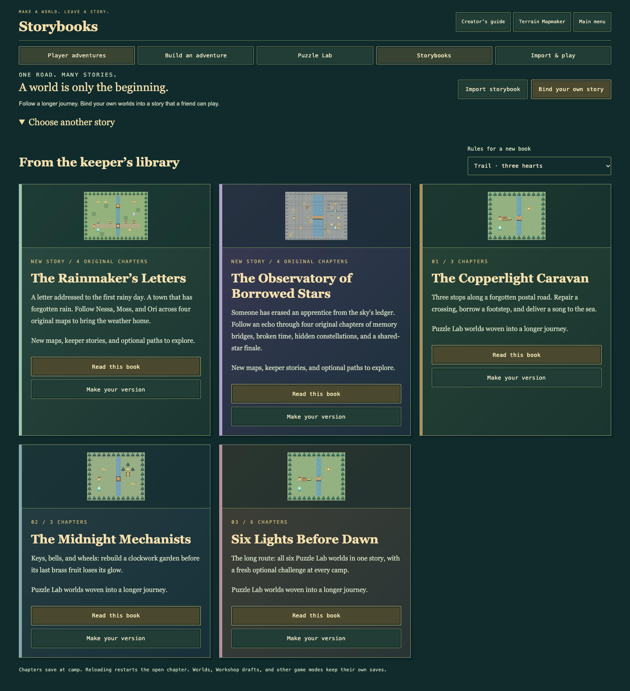

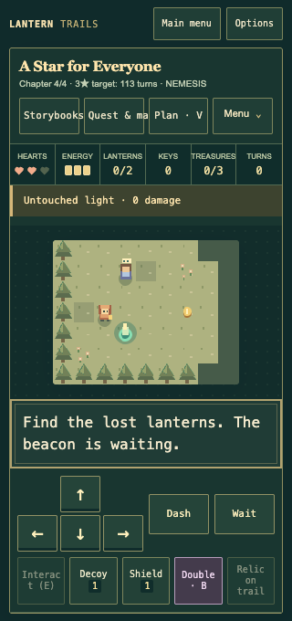

## Storybooks and chapter promises — v0.17.0

**338 Node tests**, syntax checks, and a **63-file static package** pass.
Twenty-one new tests cover real full-book wins on Trail/Nemesis, attainable
featured speed targets, earned/missed promises, chapter progression, stale or
duplicate completion, snapshots, Unicode/RLE bundles, import bounds, isolated
storage, failed writes, damaged checkpoints, and bounded whole-book bests.

The sixteenth browser suite uses Chrome **156.0.8078.47** and native inputs to
complete all three featured books on both rules: **24 chapter wins**. It checks
interludes, honors, separate full-book records, camp reload, open-chapter restart,
a missed no-power honor, guide promises, portable downloads, and an unchanged
checkpoint while browsing another mode's rules. Continue returns to the book's
original rules. Existing-mode storage remains byte-for-byte unchanged.

The authoring flow remixes a book, writes scenes, reorders/removes chapters,
fills all six slots, reloads the draft, downloads it, and retains it after a
cancelled or malformed import. Blank titles and cancelled checkpoint replacement
leave active progress intact; an accepted custom book completes its first chapter.
A fresh friend browser imports all bundled worlds, chooses Nemesis, and wins a
chapter using touch. Blocked reads, quota-like failed writes, and damaged saves
still permit play with accurate feedback.

At 320×900, 390×900, 768×900, 1024×900, 1440×900, and 844×390 the reading screen,
chapter choices, world builder, and game ribbon have no sideways page overflow.
Normal-height gameplay keeps its map and controls inside one viewport; landscape
uses one bounded page scroll. Independent 390×844 and desktop measurements confirm
that fit. Screenshot review caught and fixed an exposed hidden file input and
removed redundant chapter-screen copy. Inactive phone challenge cards compact
their descriptions; the selected promise remains fully readable.

Retained title/options/navigation, creator, and full Workshop suites pass,
including all six original featured-world/rule playthroughs, all twenty recipes,
all object inspectors, normal creator clears, exports/imports, and failure cases.
These checks cover the listed Chrome flows and sizes; they do not establish
physical-device, other-engine, screen-reader, universal user-puzzle solvability,
or player-enjoyment certification. Book recovery is explicitly at chapter
boundaries, and portable book files exclude progress.

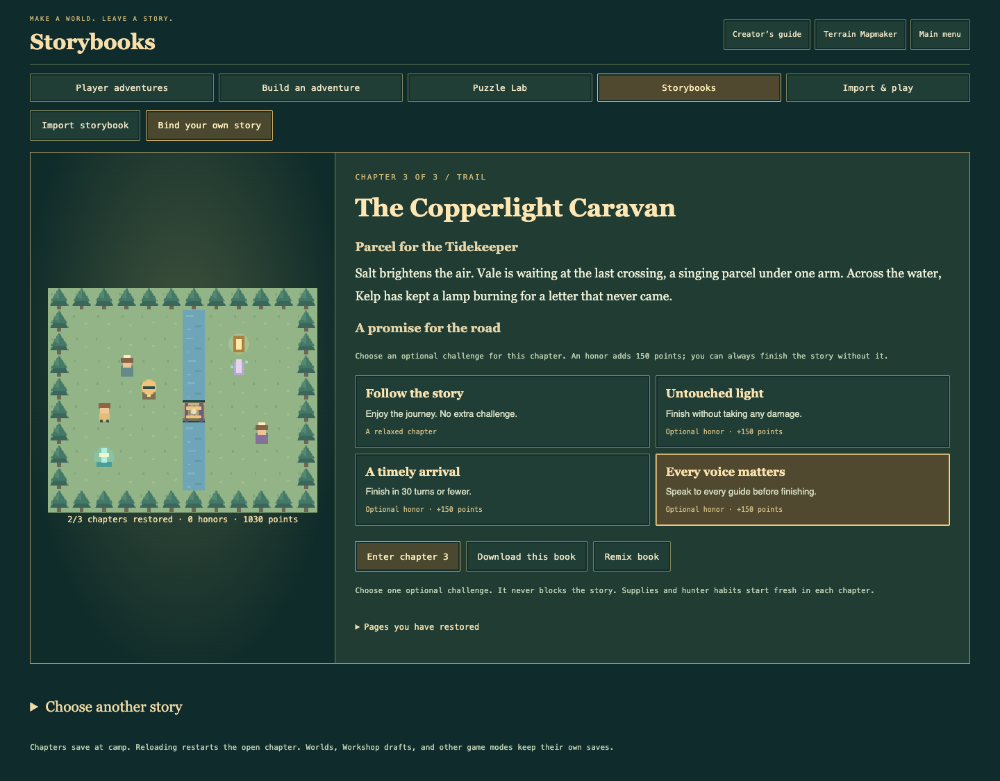

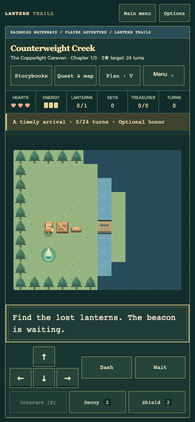

## Puzzle Lab and creative experiments — v0.16.0

**317 Node tests**, syntax checks, and a **59-file static package** pass.
Nineteen new tests cover all six rooms on Trail and Nemesis, portable verified
clear replays, mapped winning routes after each transform, rectangular/hidden
layer and patrol-route round trips, immutable editing, alternate solutions,
bounded cursor practice, and deterministic/varied design sparks.

The fifteenth browser suite uses Chrome **156.0.8078.47**. Native input completes
all twelve room/rule combinations, the crate alternative to the double crossing,
and the postkeeper's supplies branch. Each result returns to its Lab room with
a separate saved best. Browsing rooms and dealing reproducible sparks leave
saved data unchanged.

Native rotation and both mirrors each produce a new full playtest win. Undo
restores the previous world and attached clear; Redo restores the transformed
map. Practice from a different cursor position and its restart retain the draft,
creator clear, and bests byte-for-byte after a real win. A later full Playtest
records a normal clear. Blocked starts explain the problem inside the dialog.
A 64×8 world rotates to 8×64, then Undo/Redo keeps the cursor inside the current
bounds. This check caught and fixed a rectangular-world cursor issue.

At 320×900, 390×900, 768×900, 1024×900, 1440×900, and 844×390, the Lab supports
six-room browsing, native touch remix/rotate/undo, a complete touch playtest,
and editor return without horizontal page overflow. Retained creator and
responsive Workshop suites also pass. Physical devices, other browser engines,
screen-reader certification, and every player-authored puzzle remain outside
this verification claim.

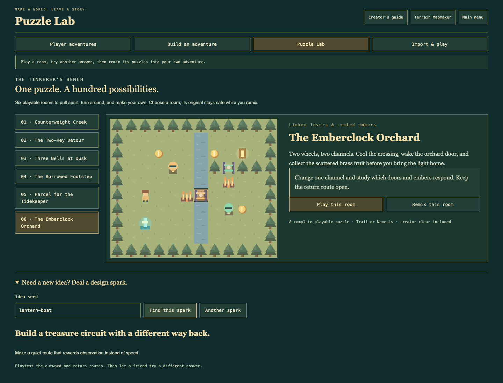

## Training camp and player entry — v0.15.0

**298 Node tests**, syntax checks, and the **57-file static distribution** pass.
Eight new tests exercise actual tutorial wins, locked crossings, free reading,
creator milestones, exported proof replay, invalid/immutable painting, proof
invalidation, independent worlds, and isolated/bounded completion storage.

The new fourteenth browser suite passes in Chrome **156.0.8078.47** at
1440×900, 390×900, 320×900, 768×900, 1024×900, and 844×390. It checks the bare
URL opens the title without source links or an automatic run; real keyboard
and touch tutorial wins; paused Plan/dialogue; exact Continue after training;
unchanged terrain, story/Guild, learned-memory, Workshop, and checkpoint saves;
completion after reload; and no sideways page overflow.

At desktop and phone sizes, the creator lesson uses native painting, Undo/Redo,
story entry, real world validation, an actual win, and a downloaded adventure.
The exported creator clear is replayed through the engine to another win.
Editing invalidates checks and the current clear. A cancelled Workshop handoff
retains the original draft and lesson; an accepted handoff transfers the actual
world and its proof. Disabled browser saving still permits a complete lesson
and reports completion as session-only. A separate 320×568 check confirms
Mira's dialogue fits, remains readable, and closes with Escape.

Retained title/options/navigation, terrain-editor, creator-shell, and responsive
Workshop suites pass, including startup recovery, downloads, compact panels,
touch painting, terrain copying, modal focus, and preserved ordinary saves.
These checks cover the listed Chrome flows; they do not claim universal browser,
physical-device, or assistive-technology coverage.

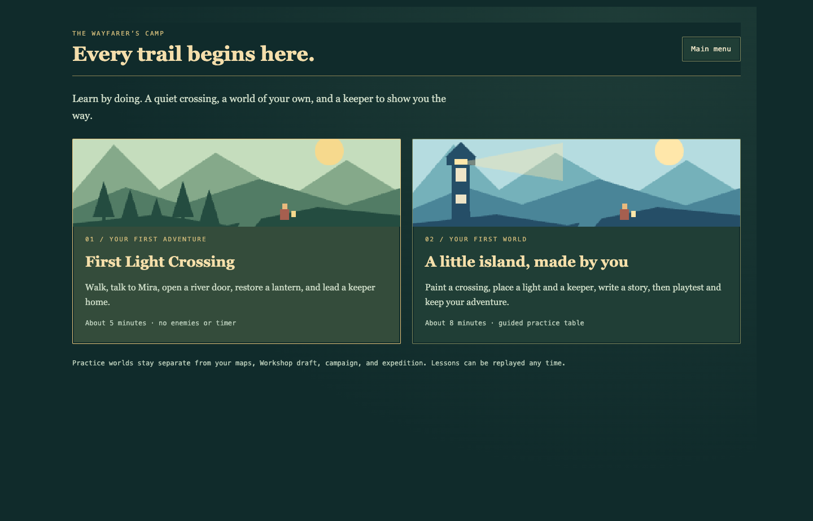

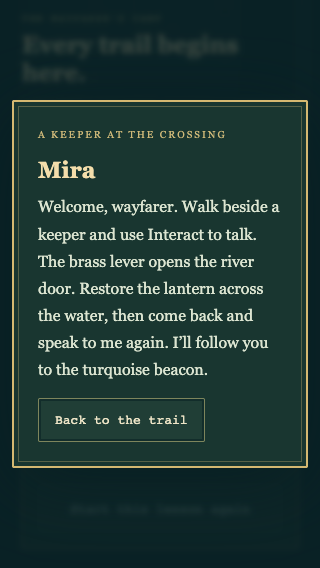

## Creator’s camp and player readiness — v0.14.0

The release retains **290 passing Node tests**, syntax checks, and a **54-file
static package**. No gameplay rules, map/progress formats, or expedition
checkpoint rules change. Runtime assets add the creator stylesheet, native
Mapmaker shell, and illustrated guide.

The new thirteenth browser suite checks the entire creator journey in Chrome
155.0.8059.85 at 320×740, 390×900, 768×900, 1024×768, 1440×900, 320×568, and
844×390. It opens compact palette/settings panels with native controls, paints
terrain, verifies keyboard focus after palette close, reads all three guide
chapters without save/gameplay changes, copies terrain into the Workshop,
paints with quick brushes, exercises Undo/Redo, edits story disclosures, checks
structure/clear readiness, and returns through Main menu to the retained map.
Fit shows the complete world without map scrolling; screens have no sideways
page overflow. Long player titles wrap. Invalid fields in a closed disclosure
reopen their panel for repair rather than trapping an invisible control.

The retained editor suite exercises every zoom, far-corner painting, native
touch panning, keyboard cursor visibility, structural layer editing, resizing,
JSON/PNG exports, and load failure through the new panels. Native nested dialogs
retain their context; actions outside a compact panel first close it visibly.
The Workshop suite retains actual wins for all three worlds on both rules,
alternate crossings, creator-clear/replay, file/code/link import in another
browser context, all twenty recipes, every object inspector, cancelled strokes,
failed saving, clipboard fallback, and an unreadable shelf without data loss.

Title, guide, preferences, journal, fitted gameplay, introductory/hard missions,
sluices, expeditions, atlas, Guild, and Horizon also pass in this release’s
full browser regression checks. Screenshot review covers both editors, the
creator’s camp, compact world notes, guides, new/share previews, and gameplay.
Fixes include grid children growing past a bounded workspace, asynchronous dialog focus return, unbroken player titles, and a false
“saved” label on an untouched default canvas. Existing-mode selection, title
behavior, live runs, editor history, and checkpoints remain intact.

These checks establish the listed flows on the tested Chrome builds and sizes.
They do not claim physical-device, other-engine, screen-reader certification,
or universal puzzle solvability or player enjoyment.

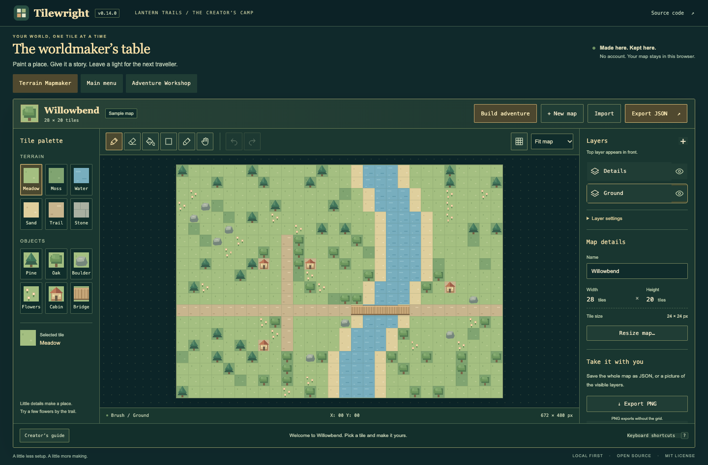

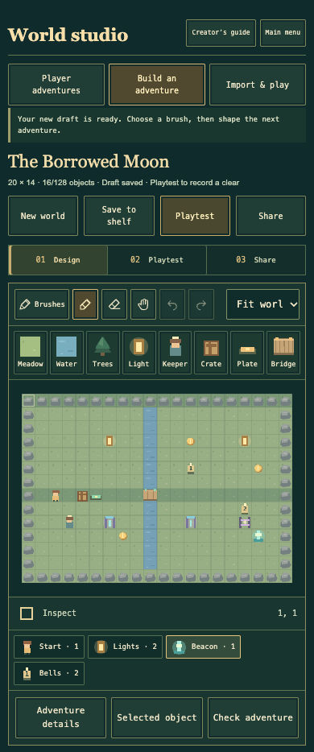

## Adventure Workshop — v0.13.0

**290 Node tests**, syntax checks, and the **51-file static build** pass.
Twenty-six new checks cover normalized/bounded adventure data, channels/routes,
all twenty deterministic region/mission recipes, terrain copying and stamps,
Unicode/RLE file and code round trips, malformed expansion/checksum/size limits,
private-origin link rejection, isolated stores and failed writes, shelf limits,
and real creator-clear replay. All three authored worlds and three alternate
solutions complete with ordinary actions on both Trail and Nemesis. Export size
checks count UTF-8 bytes so a generated file cannot exceed the import limit.

The new twelfth browser suite uses Chrome 155.0.8059.85 with disposable contexts.
It completes all three adventures on both rules, then exercises alternative
lever/supplies, waystone, and lantern-double solutions. It builds a world,
edits dialogue and terrain, draws a patrol, uses stamps and Undo/Redo, finishes
an actual creator trial, watches its replay, downloads a file, and imports the
file/code/fragment URL. A separate browser storage space receives the adventure
and completes it. Importing leaves the current draft and existing game saves
unchanged. Invalid clears, incomplete codes, and oversized files are rejected.

All twenty world recipes are also created using visible controls. Responsive
shelf/preview/designer/sharing and real paint actions pass at widths 320, 390,
768, 1024, and 1440. New-world playthroughs exercise touch movement, dialogue,
specialists, and interaction selection on smaller screens. Properties use a
dialog on compact layouts; Fit shows the entire world without inner scrolling.
Blocked storage retains a real win/clear in session and exposes backup guidance;
denied clipboard access exposes selected manual text. An unreadable shelf is
retained until the player explicitly saves/adds a world.

Every object inspector is checked for irrelevant controls. Visual review found
that checkbox display rules overrode hidden fields; a stronger scoped hidden
rule fixes it. World notes now show only the selected object's relevant settings.
Other fixes preserve unapplied metadata on Main menu, prioritize primary objects
when selecting overlapping cells, clear hidden upper terrain within stamps,
allow visibility editing on copied layers, and avoid phantom pressure-bridge
goals on worlds without plates. Native touch cancellation leaves no saved stroke.

The retained title, journal, fitted-play, editor, introductory, hard-contract,
sluice, expedition, atlas, Guild, and Horizon browser suites also pass for
this release. Desktop and phone shelf, designer, selected-object notes, preview,
sharing, and solution replay are visually inspected. Existing checkpoint rules
and saves retain their versions; no public upload/gallery service is implied.
These tests do not establish physical-device, other-engine, screen-reader,
human enjoyment, or universal puzzle-solvability coverage.

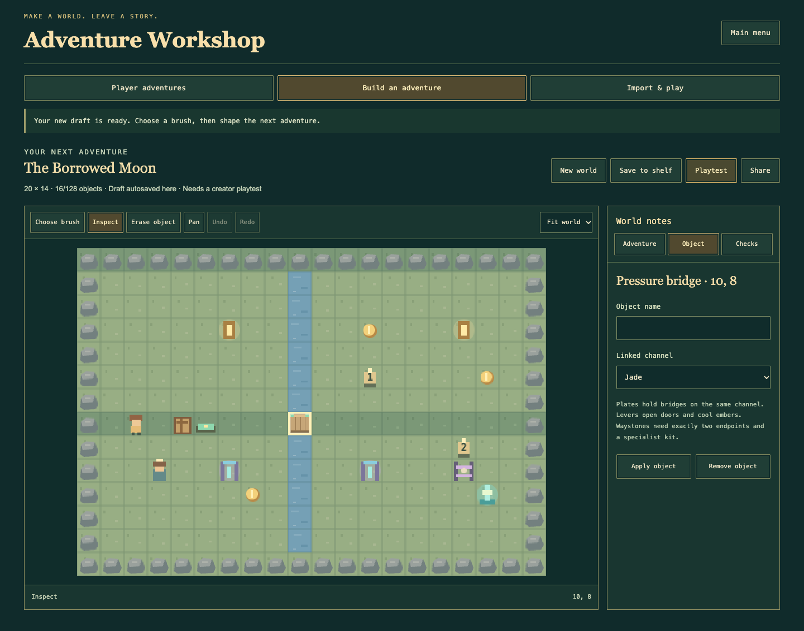

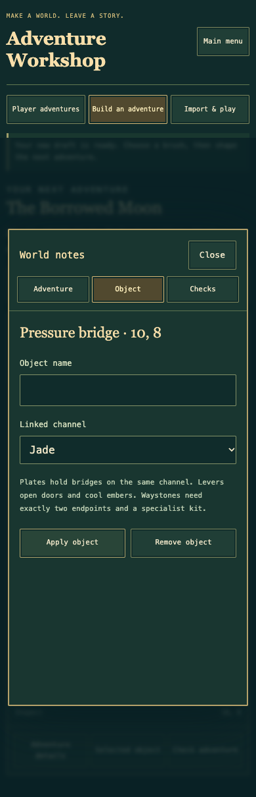

## Shared game theme, navigation, and Adventure Journal — v0.12.0

**264 Node tests**, syntax checks, and the **42-file static build** pass. Four
new journal tests verify separate rule/specialist totals, exclusion of unknown
records, attainable/unlocked suggestions, movement to other specialists after
mastery, replay after completion, and unchanged input records/logbook.

All **eleven browser suite families** pass in Chrome 155.0.8059.82 / .85 using
disposable contexts and visible controls. The title and fitted-play checks cover
seven viewport sizes; the new journal suite covers 320×740, 390×844, 768×900,
1440×900, 320×568, and 844×390. It verifies all four tabs, keyboard navigation,
sticky Main menu access, chapter/specialist/daily previews, no save writes while
browsing, guide/options return focus, inert gameplay keys off the board, and
exact run preservation through Main menu, pause, journal, guide, and Continue.

Real story wins, completed Guild dispatches, and finished expedition legs update
the journal on desktop and phone. Earned badges/results survive reload without
duplicate credit or changed saves. Blocked storage retains an actual win in the
session journal with a truthful warning. Camp choices scroll separately from
the aligned action row; bounds checks verify buttons stay on screen and do not
cover choices. A real completed leg also verifies the scroll cue after resizing.

The full retained editor, introductory, hard-contract, sluice, expedition,
atlas, Guild, and Horizon browser suites pass through the new navigation.
Coverage includes all 24 authored story missions; all 28 atlas and 22 Horizon
desktop variants; 48 main plus 20 alternate Guild desktop routes; and all nine
atlas, six Horizon, and eight Guild missions at each of 320/390/768/1024 touch
widths. Five complete multi-leg journeys, all 33 form configurations, actual
loss/retry, camps, backup/reload/import, genuine old saves, storage failure,
dialogue/forecast/pause isolation, and editor/history preservation also pass.

Desktop and phone title, mode cards, chapter banners, Guild, expedition setup,
board/HUD, notes, dialogue, camp, journal, pause, and results were visually
inspected. Fixed issues include a hidden return button made visible by display
styling, inconsistent panel colors, default blue focus outlines, and camp actions
overlapping the final route. The retained test helper now reaches Mapmaker via
Main menu and explicitly selects the first chapter when requested.

The journal reads existing stores and introduces no save migration or rule
change. These checks do not replace physical-device, other-engine, screen-reader,
or human enjoyment/balance studies.

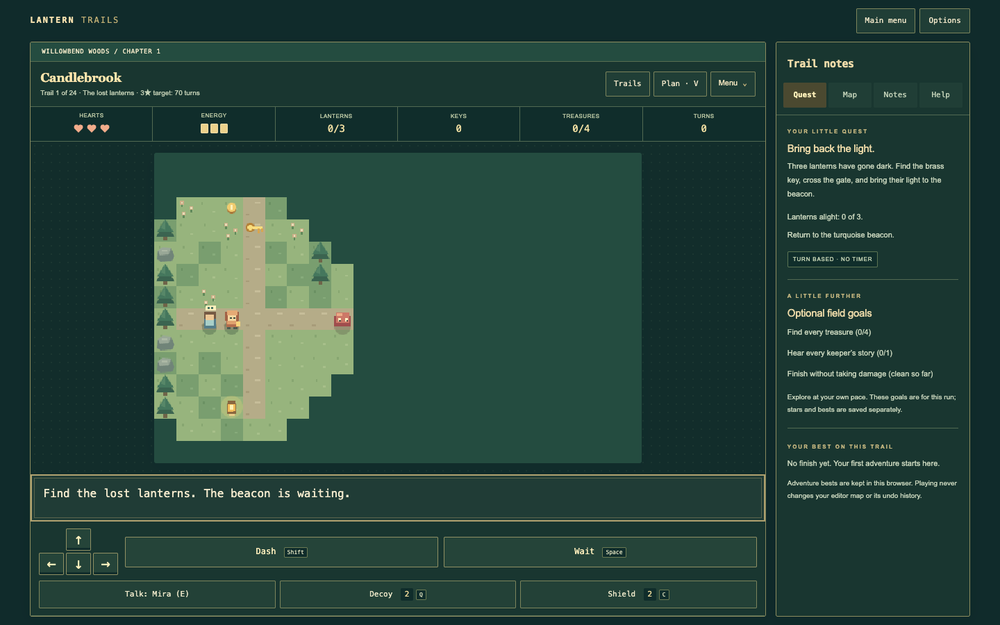

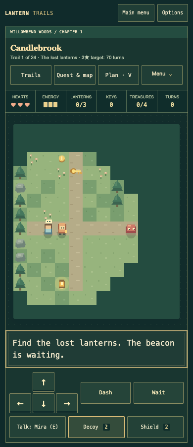

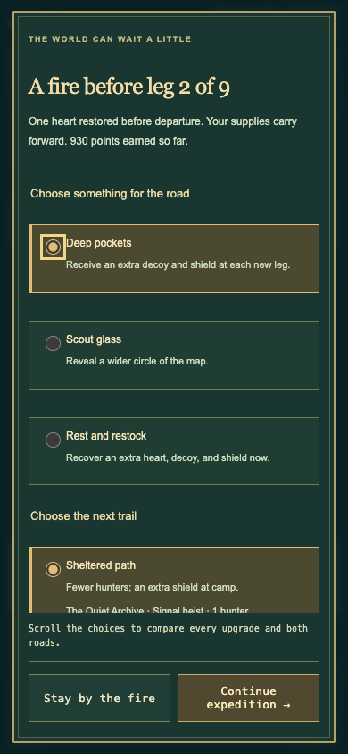

## Title, field guide, and game options — v0.11.0

**260 Node tests**, all JavaScript syntax checks, and the **40-file static build**
pass. Preferences tests cover bounds, malformed/unsupported data, failed storage,
and separation from map/journey saves. Audio checks cover volume scaling and mute.

The new Chrome 155.0.8059.82 front-menu suite passes at **320×740, 390×844,
768×900, 1024×768, 1440×900, 320×568, and 844×390**. It verifies a title screen
without an automatic run, inert gameplay keys while browsing, all four mode
previews, three guide pages, dialog focus/closing, remembered options, no audio
autoplay, and exact turn/position preservation through Continue and Mapmaker.
Custom-map entry works at 390/1440; a real invalid 1×1 map stays in the chooser
with useful guidance and a working editor exit. A real expedition checkpoint
resumes at the same position/turn after reload. Explicit native sound on/off and
blocked-storage/unavailable-audio paths also pass.

The existing seven-size gameplay layout suite and full introductory, editor,
hard-contract, sluice, and expedition browser suites pass through the new visible
menus. Coverage includes three-star wins, dialogue choices, map/undo preservation,
touch input, camp choices, actual loss/retry, checkpoint reload/export/import,
genuine older saves, and storage failures. Atlas's 28 desktop routes, Horizons'
22 desktop routes, and all **48 main plus 20 alternate Guild desktop routes**
pass, including result reload, pause/modal isolation, restart, and editor return.
These three suites' broader touch coverage retains its earlier version-specific
scope below. Two additional complete Borrowed Horizon touch runs at 320/390 use
Large reading and Reduced motion: every feedback message remains unclipped,
controls stay within 844px, and neither run creates sideways overflow.

Desktop and phone title, mode chooser, library, and options screenshots were
inspected. A white library panel and muted description contrast were corrected.
Legacy test helpers now explicitly choose a trail when a control requires a live
run; the product does not auto-start to accommodate tests. Physical devices,
other browser engines, screen-reader audits, and human usability studies remain
outside this verification.

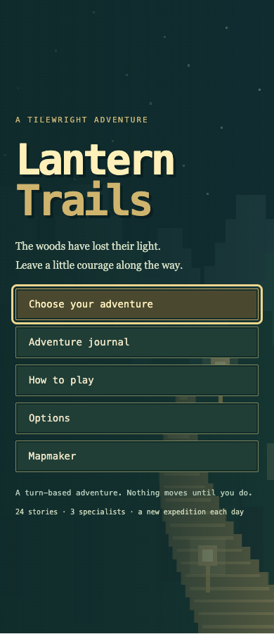

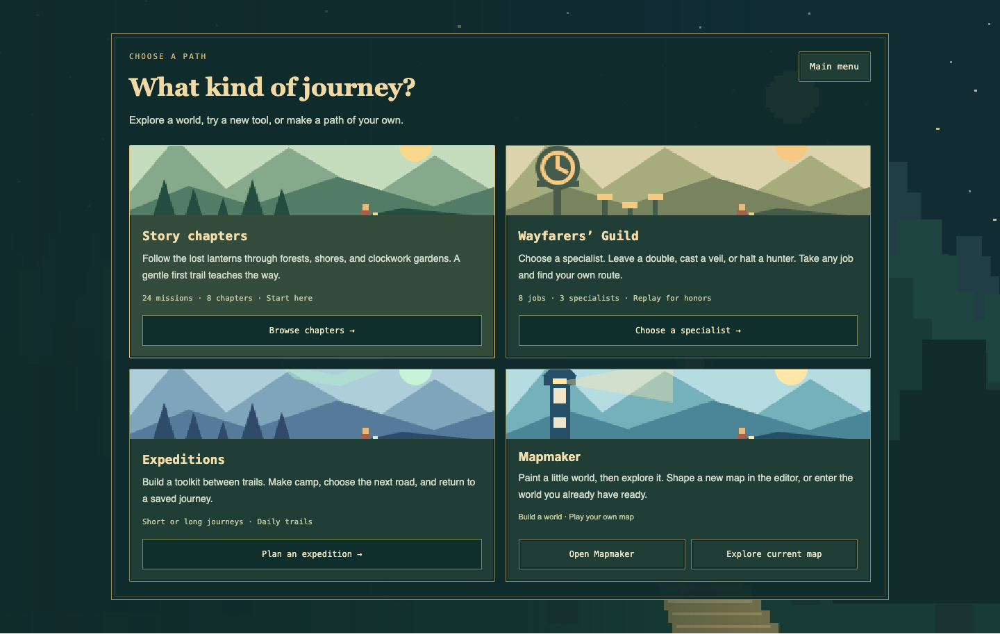

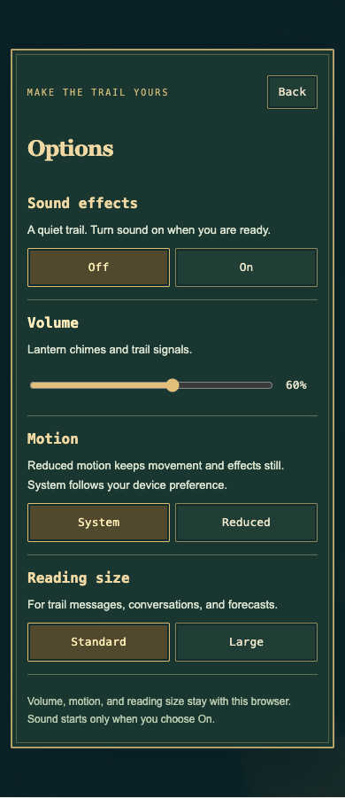

## Game text and symbol-free progress — v0.10.2

The 258 Node tests and 37-file build pass. The seven-size Chrome layout suite
verifies that the dark game text box has no status icon or alert heading,
contains no checkbox symbols, keeps 16px text and at least 7:1 contrast, and
preserves controls, focus, and bounded short-screen scrolling. Blocked keepers,
repeated input, dialogue, normal travel, and key pickups use real actions.

The complete introductory browser suite passes again, including three-star
wins, icon-free completed quest notes, saved progress, editor-history isolation,
touch/swipe, pause, and storage failure. Both new double jobs finish on 320px
and 390px touch layouts. The completed rescue/delivery job additionally checks
plain-text goals, earned commendations, and its saved Guild result. Other
browser helpers now inspect completion metadata rather than decorative glyphs;
their wider playthrough coverage retains the version-specific scope below.

Messages use a gold-framed, monospace game text box without checkmarks, circles,
or notification headings. Quest notes and Guild results use words and counts.
Desktop and phone screenshots were inspected. Saved game state and turn rules
remain unchanged; no new external fonts, assets, or services are required.

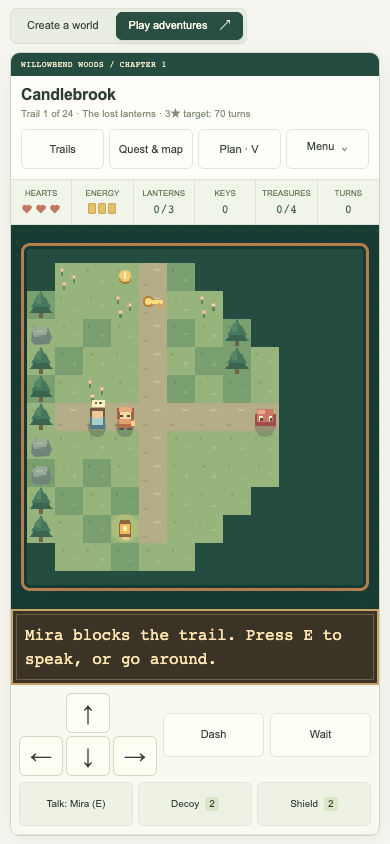

## Readable gameplay feedback — v0.10.1

**258 Node tests**, syntax checks, and the **37-file build** pass. The seven-size
Chrome layout suite now reaches a real blocked cell, checks that no turn is
spent, verifies at least 16px feedback text and a contrast ratio of at least 7:1,
and confirms the full message fits between the map and reachable controls.
It tests repeated blocked attempts, dialogue reading, return to play, and a real
key pickup switching the banner from warning to success. Normal-height layouts
retain their viewport fit; short phones/landscape retain bounded page scrolling.

The existing introductory browser suite also passes: three complete three-star
missions on desktop and phone, progression reload, pause/restart, hints, touch
and swipe, custom maps, failed storage, and preserved editor saves/history.
The new double missions additionally complete with touch controls at 320 and
390 pixels. Forecasts, conversations, and result panels remain operable with
larger text. Desktop and phone blocked-message screenshots were inspected.

This changes feedback presentation and the keeper-block explanation. Simulation
timing, save formats, and expedition rules remain unchanged. Other browser and
physical-device coverage retains its version-specific scope below.

## Lantern doubles — v0.10.0

**258 Node tests pass**, JavaScript syntax checks pass, and the **37-file static
build** succeeds. All eight Guild jobs have clean three-star witnesses for all
three kits on Trail and Nemesis: **48 main routes plus 20 alternate routes /
5,336 turns**. Both choices on each new job are covered, including manual Rain,
the lighthouse key, Neri's rescue, lens delivery, actual pressure crossings,
double-held plates, and returns before expiry. No witness edits runtime state.
Every recorded movement/tool input must advance a turn; rejected actions cannot
silently make an unplayable witness pass.

Focused checks cover six further turns after casting, separate cast/return
costs, unchanged cooldown on return, free blocked/powerless returns, hunter
capture, decoy priority, committed sweeps/fire, cargo, companions, pickups,
occupied bridge safety, and previous-state immutability. All 48 records survive
round-trip storage, including the original 24 identities. Genuine old checkpoint
fixtures and earlier story routes remain green; expedition rules stay 0.6.0.
The expanded **48,000-input Guild soak** brings the retained/new total to
**150,000 deterministic exploratory inputs**. These checks test specified rules
and executable routes, not human enjoyment or an absence of every possible bug.

The expanded Guild browser checks pass on **Chrome 155.0.8059.82**: 68 desktop
kit/rule/choice routes, 32 complete touch routes at **320, 390, 768, and 1024 ×
844 CSS pixels**, plus completed jobs under blocked and quota-limited storage.
All eight jobs finish through visible controls at every touch width; the new
jobs use Echoist, including the manual-Rain/plate route in Borrowed Horizon.
Desktop checks verify costs, result separation/reload, original save retention,
dialogue/modal/pause shortcut isolation, restart, and editor return. A separate
fresh-page check verifies the Echoist default and the two new jobs appearing first.

Touch testing caught a rejected dash and a displaced crate in the developer's
longer double witness. The corrected approach walks around the crate and
recharges before casting. All revised Echoist choice/rule routes were replayed
again through Chrome, then all four complete touch sets passed. The stricter
turn-advancement assertion now prevents that class of fixture from passing.

The seven-size layout suite also passes at 320×740, 390×844, 768×900, 1024×768,
1440×900, 320×568, and 844×390. It checks visible controls, bounded short-screen
scroll, chapter selection, tab focus, menus, library shortcuts, and responsive
notes relocation. Desktop and phone double sprites, countdowns, and the updated
Guild board were visually inspected. This release reruns Guild and layout
browser coverage; other story/expedition browser suites retain their earlier
version-specific results below. Physical devices, other browsers, screen-reader
audits, and human balance studies remain outside this verification.

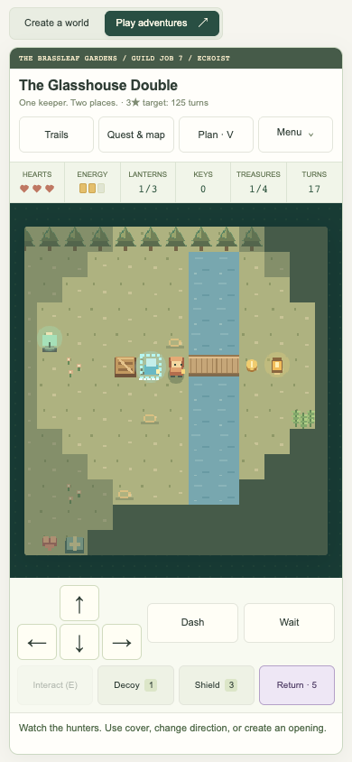

## New horizons — v0.9.0

**224 Node tests pass**, along with JavaScript syntax checks and the **37-file
static build**. Six new authored missions have **22 clean public-action route
witnesses / 2,419 turns**, covering every new dialogue choice on Trail and Nemesis, all
required treasure circuits, gates, relays, switches, rescues, and deliveries.
The final cart-route witnesses both open and actually use the optional northern
crossing, then finish with its two plates still held. Declining that crossing
also produces a valid clean finish. No witness edits positions or resources.

| Mission | Trail turns, by choice | Nemesis turns, by choice |
| --- | --- | --- |
| 19 | 83 / 83 | 85 / 85 |
| 20 | 89 | 91 |
| 21 | 125 / 127 | 123 / 124 |
| 22 | 50 / 62 | 50 / 63 |
| 23 | 153 / 153 | 158 / 160 |
| 24 | 127 / 149 | 128 / 151 |

The new 24,000-input exploratory test brings the retained/new total to
**126,000 deterministic inputs**. All eighteen pre-expansion mission definitions
match SHA-256 hashes captured from the committed v0.8.1 source. Tests protect
all 48 campaign/rule bests during custom-record eviction. Existing checkpoint
rules and genuine 0.5/0.6 restoration tests still pass.

The ninth browser suite replays the new missions through actual keyboard,
dialogue, target selection, and touch controls; the original editor map and a
real introductory-mission best are retained. It checks open chapter entries,
sequential unlocks, independent Trail/Nemesis results after reload, both finale
replay invitations, and focus on the visible chapter button after the last win.

The new suite passes on Chrome 155.0.8059.82. All six new missions also finish
cleanly through touch controls at **320, 390, 768, and 1024 × 844 CSS pixels**:
**46 new-level browser playthroughs** including the 22 desktop choice/rule
variants. The retained 28 atlas desktop variants pass, including the transition
from mission 18 to 19. The seven-size layout suite passes with all eight chapter
selectors, bounded forecasts, menu actions, notes/focus behavior, and no sideways
overflow. Desktop artwork, new terrain, and mobile screenshots were inspected.
Physical devices, Safari, Firefox, a full screen-reader audit, and human
usability/balance studies remain outside this verification.

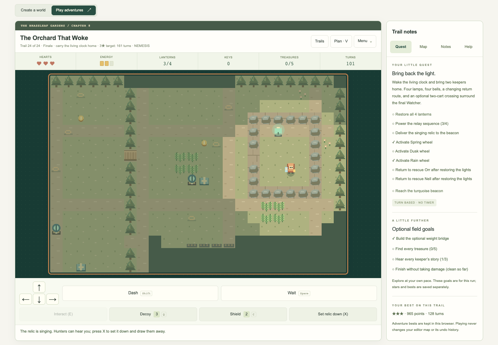

## Focused play layout — v0.8.1

**199 Node tests**, syntax checks, and the **36-file static build** pass.
The new layout suite covers **320×740, 390×844, 768×900, 1024×768,
1440×900, 320×568, and 844×390 CSS pixels** on Chrome 155.0.8059.82.
Normal portrait/desktop gameplay has no document scrollbar, with the board,
status, and tactical controls visible. Short and landscape screens use a
bounded document scroll instead of clipping controls. No sideways overflow
occurs at the tested sizes.

The checks open every chapter with only its three cards visible, switch all
notes tabs, exercise Arrow/Home/End focus, close the mobile panel with Escape,
and cross the responsive breakpoint while preserving the selected map tab.
Library, Menu, and mobile reading shortcuts consume no turns; returning to the
board resumes normal input. Direct menu activation checks verify that Pause
suppresses movement, Restart clears the turn count, and Tab dismisses the menu
without closing it before a chosen action can activate. Screenshots of desktop and phone play were inspected.
The retained browser playthroughs navigate the new visible controls through
`ui-driver.mjs`; they do not click hidden elements or alter game state.

All **eight browser suites pass**: editor, introductory quests, hard contracts,
expeditions, sluices, atlas, Guild, and the new layout suite. Retained coverage
includes all eighteen story missions, 28 atlas difficulty/choice variants, all
sluice branches, 32 Guild routes plus four touch widths, 33 expedition form
configurations, five complete multi-leg journeys, checkpoints/imports, old-save
migration, storage failures, opt-in sound, and unchanged editor saves/undo.
After fixing the menu focus timing, the introductory/hard runs, all 32 desktop
Guild routes, complete sluice/atlas/expedition suites, editor, and seven-size
Pause/Restart/focus checks pass again.

The UI change keeps simulation rules, checkpoints, and saved records unchanged.
Safari, Firefox, physical devices, and a full screen-reader audit remain outside
this verification. Human usability is not established by automated checks.

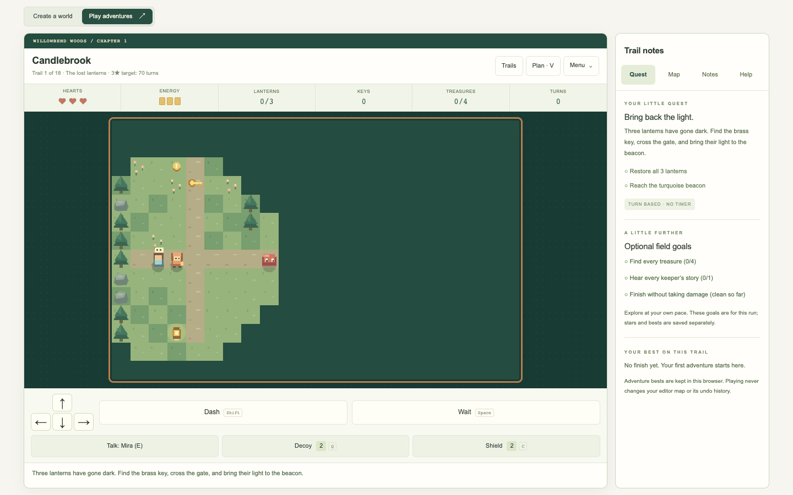

## Guild specialists and developer research — v0.8.0

**199 Node tests pass**, syntax checks pass, and the static build contains
**36 files** including release metadata. Switchback’s independent 42 tests and
build also pass. The new 24,000-input Guild soak brings the retained/new total
to **102,000 deterministic exploratory inputs**. Existing 2,304 generated-map
variants and all 256 expedition upgrade combinations remain green.

The six new Guild jobs have **24 clean public-action witnesses / 1,832 turns**,
including **56 waystone jumps and 25 tool activations**. Every job finishes with
three stars and all three optional commendations on both kits and both rule
sets. Eight additional clean routes verify the key-door option and one-jump
Sandfold finish on both kits/rules: **32 Guild routes / 2,245 turns** total,
including valid finishes that decline the Traveler commendation. The solvers
evaluate real actions; they do not change health, positions,
resources, gates, or enemy plans to obtain a win. Independent test replay checks
the results, required rescues/delivery/relays/switches, and retained input maps.

| Guild job | Trail: Bellrunner / Mistweaver | Nemesis: Bellrunner / Mistweaver |
| --- | --- | --- |
| The Folded Orchard | 68 / 69 | 66 / 66 |
| The Borrowed Minute | 70 / 70 | 68 / 71 |
| Reedglass Evacuation | 59 / 58 | 60 / 61 |
| The Hushed Folio | 98 / 99 | 104 / 104 |
| The Sandfold Exchange | 47 / 47 | 48 / 48 |
| Aurora Dispatch | 113 / 113 | 114 / 111 |

Focused checks cover current/next-turn Pulse interruption, blocked reach through
walls, expiry, cooldown and energy guards, contact/fire vulnerability, Veil’s
retained committed move and lead, cargo/alarm exposure, and new sight suppression.
Waystone tests cover a single paid turn, landing collection/fog/delivery,
enemy advancement, blocked/occupied/powerless rejection, malformed reciprocal
pairs, forecast purity, warned landing danger, and optional goals that do not
lock the exit. Records retain separate kits/rules and prioritize commendations
without farming cumulative credit. Corrupt/full/blocked storage is guarded.

Six genuine **pre-Guild 0.6 checkpoints**, generated using committed v0.7 source
in an isolated temporary directory, restore playing, dialogue, camp, loss,
held cargo, and finish without rewriting their fingerprints. Continued play
round-trips correctly. The older six 0.5 migration fixtures also pass. Only
Guild runs gain specialist state; existing story and seeded expedition behavior
remain unchanged. Package v0.8.0 still uses expedition rules 0.6.0.

All **seven browser suites pass on Chrome 155.0.8059.82**. The Guild suite
completes all 24 combinations through actual movement/interaction/tool controls,
checks energy/cooldown display and free forecasts, all saved results after reload,
shorter alternate routes that preserve a better commendation record, normal
map/story save retention, B/modal/pause isolation, restart, editor return,
and session play with blocked or full storage. All six Guild jobs also complete
cleanly using touch controls at **320, 390, 768, and 1024 × 844 CSS pixels**.
The checks cover visible entry controls, reduced motion, and no sideways overflow.
Desktop board, landing forecast, and mobile play screenshots were inspected.
After the final commendation-preview and minimap-legend refinements, all 32
Guild routes and the desktop navigation/storage checks were replayed again.

The retained six suites cover all eighteen story missions, all earlier branches,
four atlas touch widths, the editor, 33 expedition configurations, five long
journeys, camp/loss recovery, imports/exports, migration, and storage failures.
No Safari, Firefox, physical-device, full screen-reader, or human balance/
enjoyment study was performed. The [research notes](RESEARCH.md) describe primary
sources and the distinction between shipped behavior and future prototypes.

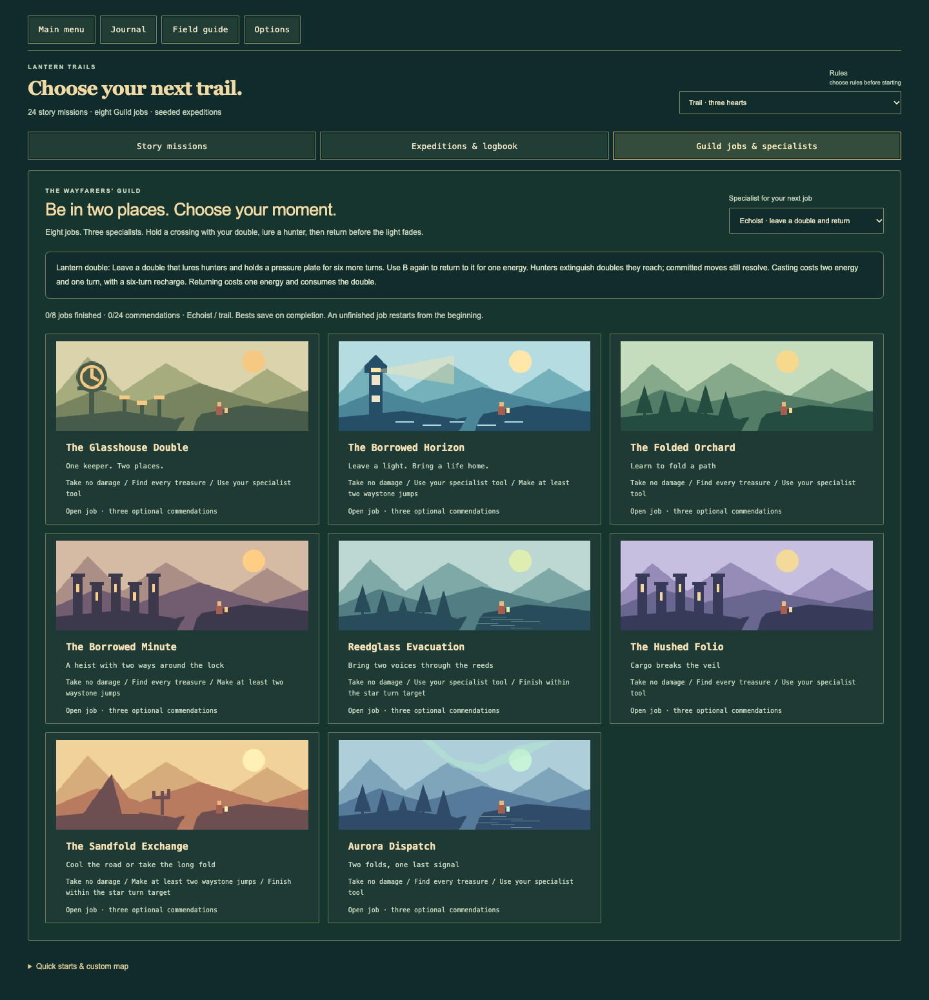

## Atlas expansion — v0.7.0

**158 Node tests pass**, JavaScript syntax checks pass, and the static build
contains **34 files** including release metadata. Switchback’s independent
42-test verification and build also pass. The new atlas soak adds 36,000
inputs to the retained 42,000: **78,000 deterministic exploratory inputs** in
all, alongside 2,304 generated-map connectivity variants and all 256 upgrade
combinations.

The nine new authored maps have **28 clean public-action playthroughs / 2,795
turns**. Every new keeper choice is covered on Trail and Nemesis. These fixtures
never change positions, inventory, health, puzzle flags, or enemy state to win.
Their independent Node replay verifies all required coins, rescues, switches,
relays, deliveries, restrictions, and three-star results.

| Mission | Trail turns: branch A / B | Nemesis turns: branch A / B |
| --- | --- | --- |
| Whispering Stacks | 64 / 64 | 64 / 64 |
| The Ink Market | 137 | 138 |
| Archivist’s Observatory | 127 | 131 |
| Cinder Caravan | 53 / 54 | 53 / 54 |
| The Sunken Bazaar | 82 / 82 | 84 / 84 |
| The Furnace Choir | 127 | 126 |
| Frostline Post | 101 / 101 | 100 / 101 |
| Mirror Reservoir | 96 | 96 |
| The Aurora Engine | 145 / 162 | 144 / 161 |

All **six optional browser suites pass on Chrome 155.0.8059.82**. The atlas
suite replays all 28 variants through real movement keys, interaction targets,
dialogue buttons, valves, relays, rescue, and cargo actions. It checks open
chapter starts, progression after reload, separate rule-set bests, chapter
stars, rule banners, disabled dash/shield controls, portrait dialogs, retained
editor saves, the final library return, and all three new Nemesis invitations.
The optional weight bridge appears among field goals, rather than the required
quest checklist; both built and unused routes win cleanly.

Each of the nine new missions also finishes with three stars through touch
buttons at **320, 390, 768, and 1024 × 844 CSS pixels**. Checks cover forecast
bounds, visible tactical controls at entry, mission constraints, chapter-jump
focus, reduced motion, and no horizontal overflow. The first 320-pixel run
caught a rule banner pushing action buttons below the screen. Constraint
missions now use a shorter phone board; all four widths pass. A fresh phone
render and the latest desktop finale were visually inspected after adding
worn paths, snow palettes, and optional-bridge labeling.

The retained five browser suites pass editor pan/zoom/scroll/export/history,
all earlier story missions, hard finales, 33 expedition configurations, five
complete multi-leg journeys, camp and loss recovery, quota/blocked storage,
backup import/export, six genuine 0.5 migrations, and modal navigation. Package
v0.7.0 retains expedition rules 0.6.0; generation and simulation are unchanged.
All 36 campaign best identities survive custom-record eviction.

No Safari, Firefox, physical-device, full screen-reader, or human enjoyment
study was performed. The checked routes and invariants pass; this is not a
claim that every possible play history or device is bug-free.

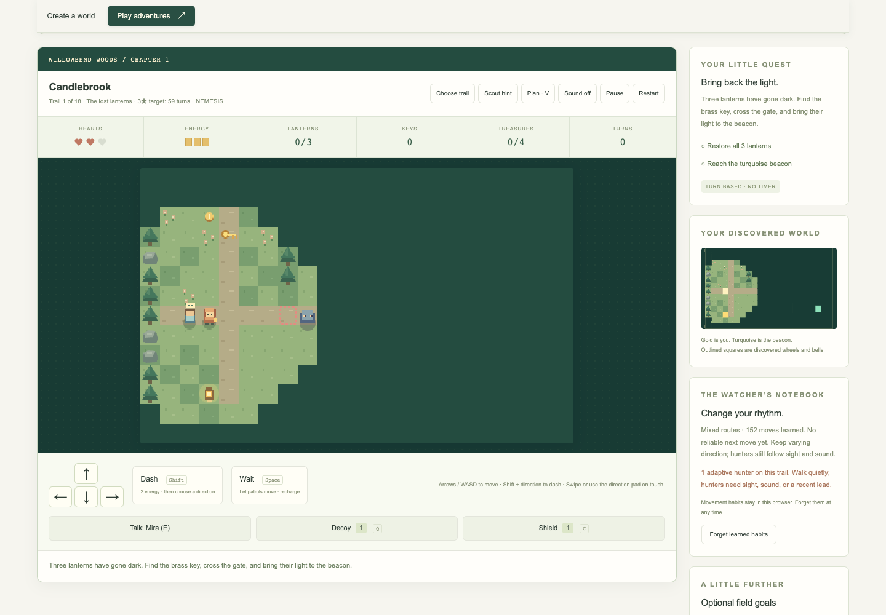
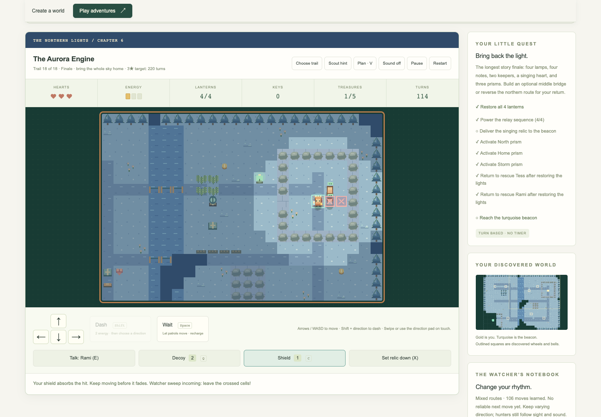

## Gameplay audit and sluice saga — v0.6.0

**127 Node tests pass** (36 additions), syntax checks pass, and the static build
contains 32 public files. The retained 30,000-input expedition soak and a new
12,000-input exploration test total **42,000 deterministic exploratory inputs**.
The 2,304 generated-map connectivity variants and all 256 upgrade combinations
remain green. None of these checks establishes that every possible play history
or device is bug-free.

The new public-action fixtures complete **14 clean runs / 1,222 turns** without
changing positions, health, inventory, flags, or enemy state. Both dialogue
branches are tested on Trail and Nemesis, plus Glasshouse declining both trades.

| New mission | Trail turns: branch A / B | Nemesis turns: branch A / B | Result |
| --- | --- | --- | --- |
| Rainmoss Sluice | 68 / 56 | 72 / 60 | No damage, three stars; both route choices and required pumps |
| Glasshouse Concord | 83 / 67 | 86 / 68 | No damage, three stars; both trades and shutter routes |
| The Last Ferry | 136 / 139 | 137 / 137 | No damage, three stars; both keepers, delivered relic, signal and ferry |

Glasshouse without buying a parcel also finishes cleanly in **55 Trail / 58
Nemesis turns**. Unit checks cover all four shutter combinations, hazard
suppression on the valve’s own turn, reversal, occupied player/crate/companion/
hunter/patrol guards, required final settings, malformed control references,
affordable/unaffordable/full-stock trades, retained treasure credit, one-time
choices, free forecasts, and reachable-control hints. A regression prevents
Luma’s exclusive ferry route being opened manually after choosing supplies.

The audit reproduced a native-modal trap: leaving Play through URL navigation
while speaking left a dialogue above the editor; Escape could not close it.
The fix closes game modals on leave while retaining conversation/camp state.
Five repeated browser leave/return cycles now pass. Additional fixes record
keepers without choices, expose competing adjacent interactions, and stop
expired individual leg tokens being credited again while a finish token remains.
Campaign-record protection now covers all nine normal/Nemesis mission bests.

Six genuine **0.5.0 checkpoints**, captured before rule changes, verify migration
of playing, mid-dialogue, camp, lost, carried-relic, and finished runs. Their old
fingerprints are checked during replay before new 0.6.0 saves are written.
Continued play and new save/reload round trips preserve their state. Existing
maps, campaign bests, and learned profiles remain separate.

The optional **Chrome 155.0.8059.82** sluice suite passes all 14 variants through
actual movement keys, dashes, dialogue buttons, valves, relays, and cargo/rescue
interactions. It checks both Nemesis invitations, unlocks after reload, declined/
unaffordable trades, free Plan dialogs, journal advice without a choice, editor
retention, camp navigation, six legacy file imports, and selecting a relic with
keyboard E while companions are also adjacent. No runtime, console, or asset
errors occur in the desktop flow.

At **320, 390, 768, and 1024 × 844 CSS pixels**, each new mission is completed
with three stars. Emulated touch checks cover dialogue, forecast bounds, reset,
visible controls at entry, competing interactions, reduced motion, and no
horizontal overflow. The phone valve preview and desktop finale were visually
inspected. All earlier editor, introductory, hard-contract, and expedition
browser suites also pass, including full long journeys, backups, actual loss/
retry, blocked/full storage, scrolling, PNG export, and real CDP swipes.

Run `npm run test:browser` for all **five** suites, or
`node scripts/browser/sluice-browser-checks.mjs` for the new act. Playwright and Chrome
are independently installed; default verification still has no npm dependencies.
Contexts are disposable and never clear the user’s actual saves. Browser checks
are not part of the default GitHub Actions matrix.

[Phone valve preview](screenshots/sluice-mobile.png), [desktop finale](screenshots/sluice-finale.png),
[mission guide](MISSIONS.md), and [design references](DESIGN_NOTES.md) document
the result. Safari, Firefox, physical devices, screen readers, and extended
human difficulty/enjoyment studies remain untested.

## Replayable expeditions — v0.5.0

**91 Node tests pass**, including 28 new tests. Syntax checks and the static
build pass; the package contains 29 public files. Generated-map prerequisites
and objectives are reachable across **2,304 seed/leg/branch combinations**,
including all six mission families and four regions. All **256 upgrade subsets**
preserve resource bounds and oath restrictions. A deterministic **30,000-input**
soak covers varied seeds, movement, tactics, interactions, retries, both rule
sets, oaths, bounded state, and checkpoint replay.

Thirteen independent ordinary-action fixtures complete **34 legs / 3,534 turns**.
They cover all four oath choices on both rule sets in single contracts, plus:

| Completed expedition | Legs | Turns |
| --- | ---: | ---: |
| Trail long voyage | 9 | 887 |
| Unwarded Nemesis journey | 6 | 474 |
| UTC daily trail (2026-10-18) | 5 | 406 |
| Measured steps Nemesis journey | 3 | 422 |
| Treasure oath Nemesis journey | 3 | 408 |

No health, position, inventory, puzzle, or completion flags are overridden in
these playthroughs. Full runs exercise all eight camp upgrades, both branches,
all mission families, and all twelve attainable badges. Each offered camp
upgrade/restock × route combination is separately replay-checked. Tests verify
courier pickup/drop/distraction/reclaim/delivery, oath exit requirements,
permanent resource caps, exact save/replay, corrupt/oversized/future/tampered
backup rejection, lost-state reload/retry, independent campaign/map saves, and
no duplicate credit after camp/finish resume or a post-win learning reset.
Audio tests cover opt-in/off, unavailable/denied/closed contexts, synthesis
failure, and disconnecting completed oscillators/gains during long play.

The optional **Chrome 155.0.8059.82** expedition suite passes using disposable
contexts. It exercises all **33 form configurations** (24 journey combinations,
eight single contracts, one fixed daily), daily UTC rules and custom-setting
restoration, surprise seeds, invalid input, and canceling replacement. It
completes all five multi-leg runs above through real keyboard movement, dashes,
E interactions, dialogue choice clicks, and camp forms. It verifies camp cancel,
Escape and reload, all upgrade pickups in the nine-leg run, final resume with
unchanged logbook credit, and unchanged editor/campaign/movement saves.

Recovery checks include mid-dialogue resume, actual later-leg death and exact
reload, retry retaining earlier wins/upgrades, pause input suppression, story/
Create switching, downloaded JSON matching the checkpoint, valid import in a
new context, cancellation, and malformed/oversized/future/tampered rejection.
Blocked storage and quota failures still allow a complete contract and backup
export, with a visible warning. No runtime, console, or failed-asset errors are
observed in the desktop options/full-run flows.

At **320, 390, and 768 × 844 CSS pixels**, emulated touch/reduced-motion checks
complete a courier contract, exercise relic drop/reclaim and held-cargo import,
verify visible tactical controls, and choose restock/perilous at a bounded,
scrollable camp. Departure buttons stay visible while choices scroll. Testing
caught and corrected an oversized tablet board. All prior editor, six-story,
Nemesis, scrolling, swipe, resize, layer, export, and failed-startup suites also
pass. Run `npm run test:browser` for all four suites, or
`node scripts/browser/expedition-browser-checks.mjs` for expeditions, with independently
installed Playwright and Chrome. Browser checks remain separate from default CI.

[Generated expedition](screenshots/expedition.png), [hub/logbook](screenshots/expedition-hub.png), and
[phone camp](screenshots/expedition-camp-mobile.png) show real UI after ordinary inputs.
The [expedition guide](EXPEDITIONS.md) documents controls, goals, scores,
checkpoint compatibility and bounds. Coverage is evidence for tested inputs;
it cannot guarantee every possible seed, device, or strategy is bug-free.

## Adaptive missions and Nemesis — v0.4.0

The Node suite has **63 passing tests** (18 additions). New coverage verifies
movement-transition learning, decay, normalization, corrupt/blocked storage,
changed interception routes under different learned patterns, committed enemy
steps, visibility/cover/noise, fading awareness, decoy lifetime, shield lifetime,
ember timing, dialogue/one-time choices, following rescue companions, ordered
relays/alarms/gates, supply limits, required objectives, boss phases/sweeps,
Nemesis reinforcements/hazard windows, separate bests, and objective-aware hints.
Existing editor, map-format, build, and server checks remain green.

Complete input fixtures verify all second-act missions on both rule sets,
starting with fresh learned counts. Ordinary in-game moves then train opponents
throughout each run; no completion flags, inventory, health, puzzle state, or
positions are overridden in these playthroughs.

| Mission | Trail turns | Nemesis turns | Result |
| --- | ---: | ---: | --- |
| Briarwatch Rescue | 78 | 78 | All required lanterns/rescue, no damage, three stars |
| Bellforge Heist | 77 | 78 | Correct relay sequence and gate, no damage, three stars |
| The Watcher’s Crown | 97 | 104 | Crates, key, relays, Sola, signal gate, no damage, three stars |

Fixtures prove solvability for those action histories; adaptation means another
history can change enemy decisions. Different trained profiles are separately
tested to produce different interception routes. No psychological inference,
external model training, remote AI call, or broad difficulty study is claimed.

The optional Chrome 155.0.8059.82 browser checks pass at **390 and 1440 CSS
pixels** through actual keyboard movement, dashes, E interactions, dialogue
choice clicks, and tactical inputs. They finish the three harder contracts,
rescue/following objectives, and the Nemesis finale with three stars; verify
memory across reload, independent reset and bests, the final Nemesis invitation,
retained editor data, and absence of runtime/asset errors. A dialogue visibility
change regression verifies that tab visibility events cannot trap the player
inside a paused conversation.

At **320 × 844** with emulated touch and reduced motion, dialogue stays within
the screen, loadout choices and tactical actions work, controls remain visible,
and the page does not overflow sideways. Prior editor, introductory-adventure,
scrolling, resize/layer, PNG, failed-startup, and storage-failure suites also pass.

At v0.4.0, `npm run test:browser` covered the three existing suites; use
`node scripts/browser/contract-browser-checks.mjs` for the new mission checks, with
Playwright separately installed and Chrome available. Browser tests use isolated
contexts and never clear existing user saves. Default Node verification still
needs no installed packages.

[Desktop Watcher](screenshots/watcher.png), [phone Watcher](screenshots/watcher-mobile.png), and
[phone dialogue](screenshots/dialogue-mobile.png) screenshots are captured after real input,
including the Nemesis shield and incoming marked sweep. Existing fictional
editor and introductory campaign screenshots remain as historical records.

## Lantern Trails — v0.3.0

The Node suite has **45 passing tests**. Seventeen adventure/persistence tests
cover keys and permanent gates, crates and linked pressure plates, closed/open
river crossings, blocked pushes, dash pickup paths and energy, predictable
patrol intent, damage and two-turn recovery, loss, healing, beacon requirements,
scoring, visible-layer collision, exploration, reachable custom objectives,
minimum/disconnected maps, malformed markers, safe storage, bounded records,
and best-result ordering. Existing editor/server/build tests remain green.

Ordinary move fixtures complete Candlebrook in **54 turns**, Copper Crossing in
**50**, and The Ember Vault in **73**, all with three hearts and three stars.
They use real key collection, gate unlocking, crate pushes, bridge crossings,
and patrol timing; no state overrides unlock or complete these quests.

The combined optional browser suite passes in isolated Chrome 155.0.8059.82.
The adventure checks cover:

- All three quests completed through actual keyboard input at **390 and 1440
  CSS pixels**, including wait turns, result screens, and Next adventure.
- Locked/unlocked quest cards, three-star bests, and progression after reload.
- Dash energy, recharge, pause input suppression, restart, and scout hints.
- Custom expeditions using the current editor snapshot, unchanged editor saves,
  and preserved undo history after playing and switching modes.
- Useful rejection of an unplayable 1 × 1 map while the current game survives.
- **320, 768, and 1024 CSS pixel** layouts with reduced motion, touch direction
  buttons, actual CDP touch swipes, and no arrow-key page jump.
- Bounded camera/canvas geometry, no sideways page overflow, and mobile dash/
  wait controls staying on the same row and visible when entering play.
- A win and session unlock with localStorage blocked, plus an expedition on a
  maximum **64 × 64** map without stretching the board or page.
- No runtime errors or failed asset responses in the campaign completion flows.

The existing five-width editor, scrolling, layer/resize, touch, keyboard, PNG,
and startup-failure checks also pass. Run `npm run test:browser` with an
independently installed Playwright and Chrome; game-only checks are available
through `node scripts/browser/adventure-browser-checks.mjs`. The application and Node
checks still require no npm packages. All browser contexts are disposable.

[Desktop adventure](screenshots/adventure.png) and [phone adventure](screenshots/adventure-mobile.png)
screenshots show Copper Crossing reached through normal keyboard play.
Synthesized sound is opt-in; audible quality and physical-device audio playback
have not been assessed by automation.

## Structural editing — v0.2.0

The Node suite has **28 passing tests**. Nine new operation tests cover safe
layer names, independent copies and unique IDs, compositing order, layer
limits, every resize anchor, new-cell fill, hidden-layer crop counts, odd center
offsets, extreme sizes, immutable source data, undo/redo, and version-1 JSON
round trips.

The browser suite additionally exercises structural editing at **390 and
1440 CSS pixels** in isolated Chrome 155.0.8059.82 contexts. Rename, duplication,
reordering, cancellation/confirmation of deletion, six-layer and final-layer
limits, and undo/redo pass. Opening settings and adding layers do not stretch
the canvas. Resize checks cover live preview, cancellation without an edit,
centered growth, fill only in new back-layer cells, fitting after resize,
crop warnings/previews, complete undo restoration, and invalid-size rejection.
The previous five-width scrolling, touch, keyboard, PNG, and loading checks
continue to pass. No runtime errors were observed in the added flows.

## Scrolling and rendering corrections — v0.1.1

The original checks confirmed page overflow and editing, but did not verify
that every map edge was initially visible or that touch users could pan a
zoomed map. The initial fixed 100% zoom clipped the map on small screens.
This revision adds Fit mode, bounded scrolling, pan controls, and a full-width
phone canvas, with regression checks for the actual navigation behavior.

The Node suite now has **19 passing tests**, including fit geometry at multiple
document/view sizes and coordinate mapping at every supported zoom. Server
tests verify successful loading of every public asset, including startup modules.

The reusable `scripts/browser/checks.mjs` suite passed in isolated headless
Chrome 155.0.8059.82 at **320, 390, 768, 1024, and 1440 CSS pixels**. It verifies:

- All four map edges are visible on initial load and after resizing.
- Every zoom from 25% to 200% changes only canvas scale, without growing the
  viewport or the page and without sideways page overflow.
- Both scrollbars reach the final row/column, and clicks at the far corner
  paint the correct tile after zooming and scrolling.
- Mouse and touch pan gestures move both axes without changing map data.
- Clicking the canvas does not jump the outer page; wheel gestures over a
  fitted map continue scrolling the document.
- Keyboard navigation scrolls the last cell into view and paints it correctly.
- PNG dimensions stay 672 × 480 when the editor is zoomed to 200%.
- Minimum (1 × 1) and maximum (64 × 64) maps open fully fitted.
- Every tool has its SVG icon, all public assets load, and no browser runtime
  errors occur during the normal navigation flows.
- An intentionally failed application-module request displays startup guidance
  instead of leaving an empty map with no explanation.

Updated [desktop](screenshots/tilewright.png) and [phone](screenshots/tilewright-mobile.png) screenshots
show the untouched fictional map. Browser checks remain separate from default
Node verification and CI. They use disposable contexts, not existing user saves.

## Initial implementation — October 18, 2026

Automated verification used Node.js 26.0.0 on macOS. The 16 `node:test` cases
cover immutable edits, unchanged layers, boundary-safe flood fill, maximum-size
fill, continuous brush lines, reversed rectangles, undo/redo branching and
bounds, JSON round trips, maximum export/import compatibility, malformed data,
storage failures, build output/rebuild safety, and HTTP asset restrictions.
Run them with `npm run verify` from the repository root.
The HTTP test needs permission to bind to loopback in restricted sandboxes.

Browser checks used Chrome 155.0.8059.82 through Playwright in a separate
headless browser with disposable contexts, leaving existing browser saves
untouched. The following checks passed:

- A five-cell brush drag fills intermediate cells and is one undo/redo step.
- Rectangle fills all nine cells of a three-by-three region.
- Object painting and erasing affect the selected layer.
- Fill covers a connected empty layer; hidden layers reject painting.
- Layer visibility persists, and eyedropper samples the selected layer.
- Renames and map edits survive a reload.
- Arrow-key cursor drawing with Space and keyboard undo work.
- Downloaded JSON matches every field of the saved document.
- Downloaded PNG has a valid PNG signature and the expected 672 × 480 size.
- Invalid JSON leaves the current map intact; valid JSON imports successfully.
- The new-map dialog creates an 8 × 6 map with two layers.
- Shortcut help opens and closes; no runtime errors or automatic external
  requests were observed during the desktop flow.
- Widths of 390, 768, and 1280 CSS pixels do not overflow the page; large maps
  scroll inside the canvas viewport.
- Emulated touch at 390 pixels paints the selected layer.
- Blocked localStorage still permits editing and displays an export warning.

The desktop screenshot in this folder shows the untouched fictional sample at
a 1440-pixel viewport. Browser checks are separate from the dependency-free
Node suite; CI currently runs the Node suite and build, not browser automation.

## Repeatable manual checklist

1. Start on a disposable browser profile; retain any real work with Export JSON.
2. Drag a terrain tile across the map and undo/redo the whole stroke. Try a
   reversed rectangle, boundary fill, erase, and eyedropper.
3. Add a detail layer, paint objects, hide it, and verify hidden-layer painting
   is rejected. Undo its visibility change and layer addition.
4. Make a keyboard rectangle with Space, arrows, Space. Cancel another stroke
   with Escape and verify the map is unchanged.
5. Rename, reload, and compare the map. Export JSON and PNG; verify JSON can be
   reimported and PNG excludes hidden layers and editor overlays.
6. Import malformed, oversized, and future-version JSON; verify the original
   document survives. Cancel a replacement confirmation and retain the map.
7. Create a maximum-sized map, add six layers, paint, and export/reimport.
8. Test Tab order, visible focus, status announcements, phone-width layout,
   touch painting, zoom scrolling, and unavailable/full browser storage.

## Limits and follow-up

No Safari, Firefox, physical phone/tablet, screen-reader, or extended user
playtest is claimed. Native download/file-picker behavior, maximum-size
interactive performance, and cross-browser pointer cancellation need further
device coverage. New maps currently have a fixed tile size; selections, multiple local projects,
custom tilesets, custom puzzle authoring, richer multi-mission dialogue consequences, and
additional authored campaign content remain unfinished ideas. Nine story missions,
seeded branching journeys, daily trails, camps/upgrades, courier missions, oaths,
checkpoints, reversible sluices, trades, forecasts, adaptive hunters, dialogue/
rescues, and Nemesis are implemented.
No physical-device or extended player difficulty/enjoyment study is claimed.
