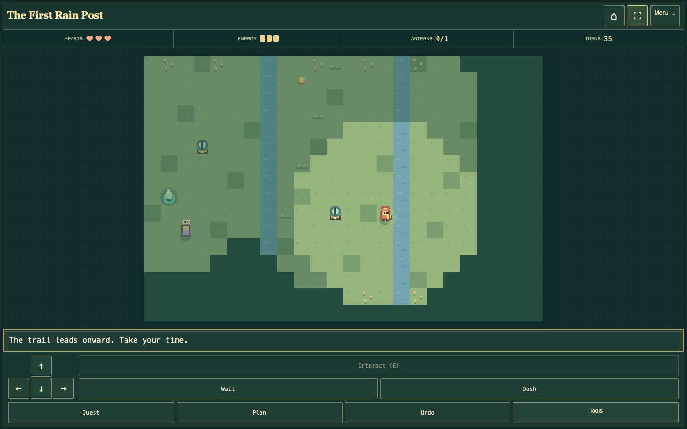
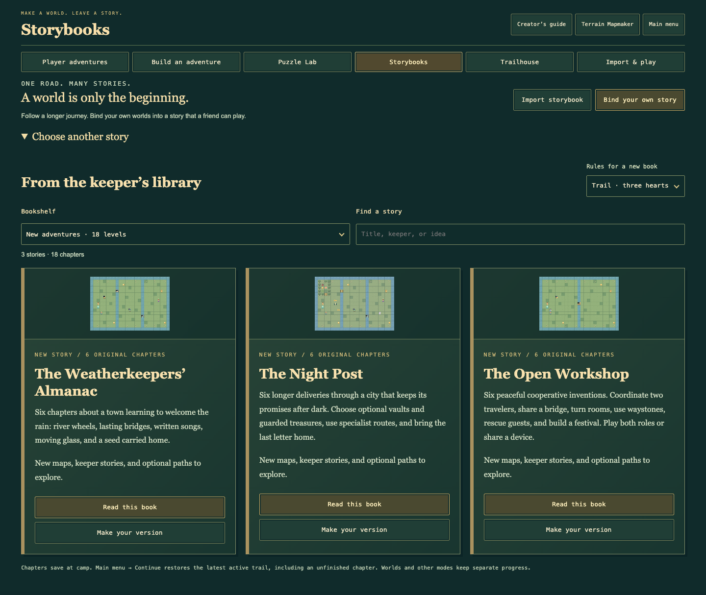
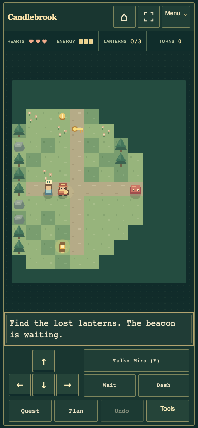
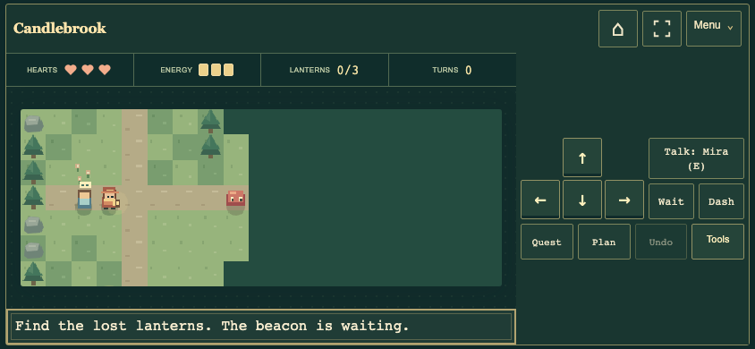

# More room for the road

Version 0.30 makes the board the center of play and adds eighteen original
adventures. Open [Lantern Trails](https://youknowjp.github.io/Tilewright/)
to play without installing developer tools.

## Find the action

The header keeps the chapter name, Main menu house, fullscreen icon, and Menu.
Hearts, energy, lantern progress, and turns remain above the board. The dock
holds movement, Interact, Wait, Dash, and the current specialist/partner action.

- **Quest:** opening story, objectives, linked puzzles, and written bell order.
- **Plan:** a free preview before committing to an action.
- **Undo:** try a different answer without restarting.
- **Tools:** keys, treasure, shields, decoys, cargo, controls, and Options.

When several actions are nearby, Tools shows their number. Choose the intended
action there; confirming even the current choice closes the panel. Optional
vaults retain a visible reward/security Details button. Long feedback offers
Read more, with the complete text in its own reading window. Reading, menus,
and settings do not spend turns. Portrait uses a bottom dock; short landscape
screens place controls beside the map. Large controls and large text still work.

## Fullscreen and Home Screen

Choose the corner icon, press **F** on the board, or use **Options → Display →
Enter full screen**. Native browser fullscreen is used when supported and
allowed. Expanded view fills the available browser space when the API is
missing or refused. The same button leaves screen view. Browser Escape/Back
also exits native fullscreen; Escape leaves expanded view before pausing.
The main menu keeps a visible Leave screen view control.

Add the website to your Home Screen from the browser’s menu or Share sheet
for a separate game window where supported. The manifest supplies a name,
original icons, and fullscreen/standalone display preferences. Browser support
varies, especially on mobile. The launcher needs a network connection; it does
not add offline caching. A browser window and its Home Screen app can use
separate storage: download a game backup before switching. Rotation and screen
mode changes preserve the active run.

## Eighteen more worlds

Choose **Adventure Workshop → Storybooks → New adventures** for three complete
six-chapter books. Each supports Trail/Nemesis, optional chapter promises,
saved camps, exact Continue, Undo, and completed-route reviews.

| Book | Chapters | What changes along the road |
| --- | --- | --- |
| The Weatherkeepers’ Almanac | The First Rain Post; Reed Counterpoint; The Orchard’s Forecast; The Wind-Glass Room; The Sleeping Pier; The Eye of the Rain | River wheels, lasting crate crossings, written songs, forecast embers, rotating glass, keeper choices, and a rainseed rescue. |
| The Night Post | The Last Stamp; The Whispering Market; The Lantern Express; An Address Below the Stars; The Midnight Exchange; A Letter Called Home | Longer deliveries, specialist routes, moving rooms, returned companions, optional guarded gardens, and up to three announced vault tiers. |
| The Open Workshop | The Two Chairs; The Moving Classroom; Counterpoint for Two; A Room for a Guest; The Paper Theatre; The Founders’ Festival | Peaceful two-traveler cooperation: hold crossings, turn rooms, leave crates, share waystones, rescue guests, and bring both roles home. |

Play both travelers yourself with **Switch traveler · T**, or share one device.
Lantern keeper restores lights; Pathfinder turns rooms. No network multiplayer
or account is required. The Open Workshop has no hunters, patrols, Watchers,
embers, or security vaults. The ordinary courier routes leave the dangerous
side gardens and vaults optional. All eighteen chapters have verified clean
routes on both rules; optional side trips offer additional difficulty.

## Explore and create

The Storybook shelf has twelve books. Search titles, summaries, and chapter
scenes, or filter new, peaceful, and more demanding journeys. Player adventures
has twenty-seven featured worlds and six cards per page. Search/filter resets
to page one; Previous/Next moves keyboard focus to the first new card. Your
personal shelf continues to hold 32 worlds.

Every new chapter is separately available under **Player adventures → New
adventures**. Preview its checked creator route, play it, or Remix to change
terrain, keepers, puzzles, and story cards. Add chapters to your own book and
share a file/code or a supported play link. Existing world formats, save
journeys, and downloaded backups remain compatible.

