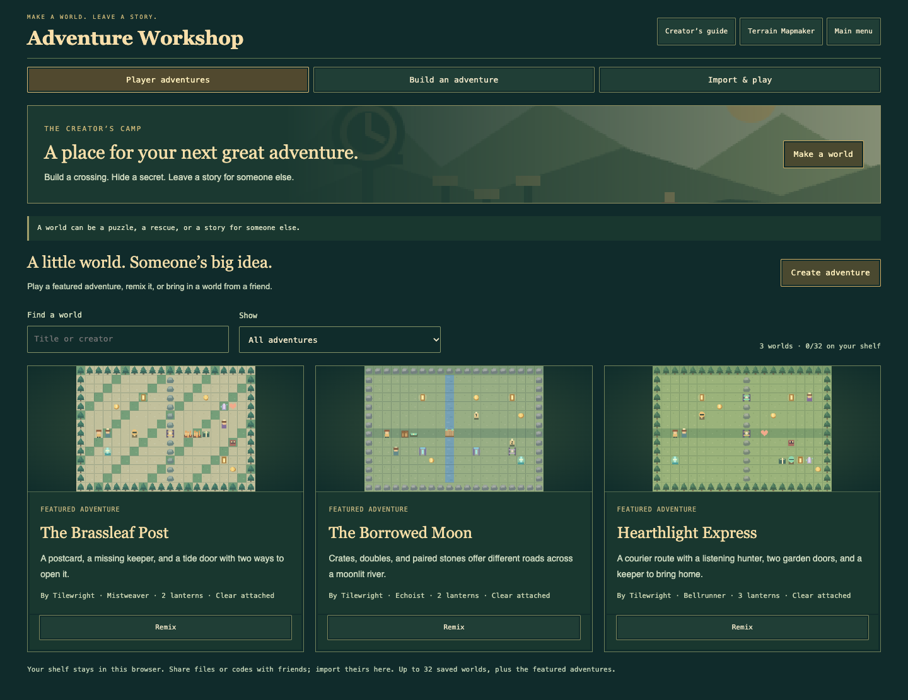
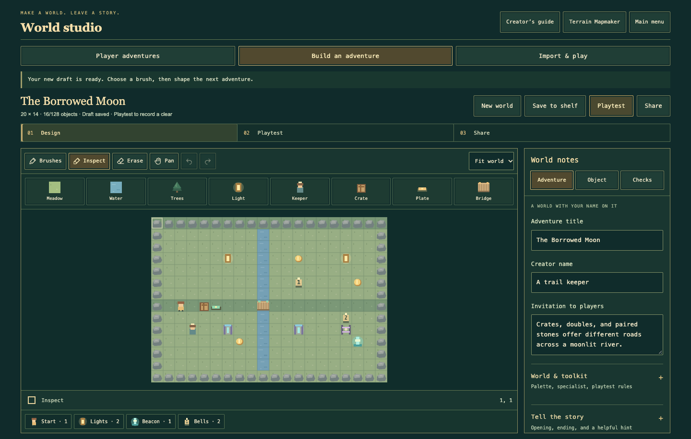

# Adventure Workshop

Open **Adventure Workshop** from the title screen, Mapmaker mode preview, or
in-game Menu. **Player adventures** holds three featured worlds and up to 32
worlds saved in this browser. Search by title or creator; preview before playing.
Trail and Nemesis bests are separate for each version of a world.

**Puzzle Lab** adds twelve playable rooms with verified clear replays and a
different building idea for each one. Choose one room at a time, play it, or
remix it. The twelve originals are separate from your saved shelf. **Design sparks**
pair creative goals with twists; an idea seed makes a prompt reproducible.
[The Lab guide](PUZZLE_LAB.md) explains its rooms and experiment tools.

**Storybooks** links two to six worlds into a portable journey. Play the three
earlier books or two new four-chapter original stories, choose optional
chapter challenges, or bind your own snapshots
with written interludes and an ending. Import/export a whole book in one file;
its draft and chapter checkpoints are separate from this world shelf.
[The Storybooks guide](STORYBOOKS.md) explains authoring, honors, and camp saves.

**Undo · Z** revisits recent gameplay actions during a world or playtest.
**Continue trail** restores your latest attempt exactly after reload. Creator
clears record the surviving route after Undo. Restoring an earlier playtest never
overwrites a newer draft or attaches that earlier clear to it. Cursor-practice
recovery stays unscored. [Undo and Continue](CONTINUE.md).

**Creator’s guide** is available in both Mapmaker and the Workshop. Its three
illustrated chapters introduce a first trail, a linked crossing, and sharing a
playtested adventure. The Workshop’s Main menu and section tabs stay reachable
while browsing a longer shelf.

## Make a world

Choose **Create adventure**, then start from:

- A blank world, from 8×8 to 64×64 cells.
- A seeded adventure: four regions × five mission recipes, with sheltered or
  perilous starting threats. The same seed and recipe reproduce the same map.
- An independent copy of the current terrain editor map. **Build adventure**
  in Mapmaker opens this choice directly.

Remix any featured or saved world. The original creator/title are credited in
the remix's origin text. Creator names are editable credits, not authenticated
accounts. Replacing an existing draft asks you to save or export it first. An untouched
first canvas does not need a replacement confirmation.

**Brushes** opens the full palette, grouped into terrain, goals, puzzles, story, threats, and stamps.
Terrain supports brush strokes, flood fill, and rectangles on the selected layer.
The palette also controls layer visibility, including hidden layers copied from
the terrain editor.
Objects replace another primary object on their cell; ferns and embers can
coexist with objects. Placing a new start, beacon, or relic moves the unique one.
Lantern-grove, supply-camp, and pressure-crossing stamps build small editable
encounters. Stamps replace their footprint; Undo restores it.

**Remix tools** rotates a quarter turn or mirrors the complete world east/west
or north/south, including every layer and patrol route. Channels, bell order,
and object IDs remain connected. The changed version needs a new clear; Undo
restores its previous layout and attached clear. Review directional hints after
turning a world. This transforms the whole map, rather than a selected area.

Move the cursor onto open land, then choose **Remix tools → Practise from
cursor** to test one area. It uses fresh goals, supplies, and local learning.
Closed gates, crates, keepers, water, and blocked ground cannot be starting
points. Practice wins and restarts never write bests or creator clears. Return
to the designer and choose full **Playtest** to verify the real starting route.

**Inspect** selects an object. Select the same cell again to cycle through
coexisting objects. Give keepers dialogue, change puzzle channels, set bell order,
or draw a threat route. Patrol waypoints must touch edge to edge and retrace at
the ends; hunters path between their waypoints. Routes have 2–24 waypoints.

**World notes → World** sets the title, creator, opening, ending, hint, eight world
palettes, three-star target, specialist kit, and optional walking-only,
no-shield, or all-treasure rules. Changes apply on **Apply**, Save, Playtest,
Share, switching sections, or Main menu. Invalid fields explain what to fix.
Draft edits autosave separately from the original terrain map. **World &
toolkit**, **Tell the story**, and **Set the challenge** fold less frequent
settings away. The quick brush row paints common objects immediately; the goal
strip shows object counts and selects goal brushes. **Design → Playtest → Share**
provides the main route through creation. Checks reports map structure and an
attached creator clear separately; an attached clear is verified before sharing.

The map has Fit/100/150/200% zoom, Pan, and 30-step session Undo/Redo. Arrows move
the canvas cursor; Space/Enter paints. For rectangles, press Space at each corner.
Escape cancels a stroke/rectangle or ends route drawing. Delete removes the
selected object. Ctrl/Command Z, Shift Z/Y, and S undo, redo, and save to shelf
outside text fields/dialogs. On smaller screens, world notes open separately.

## Build an encounter

| Objects | What they do |
| --- | --- |
| Start, beacon, lanterns | One start and beacon; restore every lantern before leaving. |
| Treasure, hearts, supplies | Optional points, healing, and one-use tactical refills. Treasure can become mandatory. |
| Key, key gate | Each closed key gate consumes one key. |
| Crate, plate, pressure bridge | Hold every plate on the bridge's channel using crates, the player, or a lantern double. |
| Lever, lever door, embers | One lever per channel opens doors and disables linked cycling embers. A lever can start on or become a required goal. |
| Bells, signal gate | Number bells from 1 without gaps; ring the whole sequence to open signal gates. |
| Paired waystones | Exactly two endpoints per channel; requires a specialist kit. Travel costs energy. |
| Talking keeper | Dialogue, a decoy/shield choice, or a choice to open a linked lever instead of taking supplies. |
| Rescue keeper | Return after restoring every lantern, then escort the keeper to the beacon. |
| Singing relic | Pick it up nearby and deliver it to the beacon. Hunters can hear it; setting it down can mislead them. |
| Ferns, embers | Quiet cover and four-turn cycling hazards with editable offsets. |
| Patrol, hunter, Watcher | Fixed patrols, hunters that learn during the run, and charging sweep bosses. Hunters can appear only on Nemesis. |

**Checks** finds missing goals, overlapping objects, invalid routes/channels,
and disconnected objectives. It is an optimistic connectivity check, not a
complete puzzle solver. Test your outward and return routes, key use, crate
placement, dialogue choices, and alternate rules.

## Playtest and share

**Playtest** starts with fresh learned habits on the rules selected in Adventure
notes → World & toolkit: Trail or Nemesis. Finish the actual adventure to
attach a **creator clear** containing up to 2,000 actions. Editing the world
removes the old clear. Restarts and player adventures each get fresh habits;
hunters still learn during the run. Campaign habits and expedition checkpoints
are retained separately. Unfinished player runs restart after a reload.

**Share** offers a `.trail.json` file and an `LT1` adventure code. Send either
through your usual messaging/file service. A friend opens **Workshop → Import &
play**, chooses the file, or pastes the code. Imports preview before playing or
adding to the shelf, and never replace an open draft or terrain map.

On [the public website](https://youknowjp.github.io/Tilewright/#play), smaller adventures also support
**Copy play link**. The map travels in the URL fragment and opens a preview.
Local/private copies use codes/files because a localhost link cannot open your
computer's game on a friend's device. Detailed worlds may exceed the link or
code limit; use the file instead. Files are limited to 400 KB; unusually dense
worlds may need shorter dialogue, simpler terrain, or a shorter clear journal. There is no public gallery, automatic
upload, account, online rating, or live multiplayer service in this release.

Attached clears are replayed through the engine before being called verified.
The solution viewer supports Play/Pause, Step, Next 20, Restart, and speed;
watching it changes no scores, supplies, habits, or saved run. Verification proves
one recorded route on its stated rules, not every possible choice. Checksums
catch damaged codes; they do not authenticate authorship.

Keep downloaded backups. Browser storage can be cleared or unavailable. Draft,
shelf, and bests have separate stores; failed writes retain session data and
show a warning. Up to 32 saved worlds are kept without silently evicting an old
world. Export before removing one to make room.

## Living maps and reactive stories — v0.29

The full palette now includes **Rotating room dial**, **Optional security vault**,
**Two-Lantern partner**, and **Story rune**. Inspect a dial to choose a 3 × 3,
5 × 5, or 7 × 7 room. The dashed square previews the whole moving area.

**Adventure notes → Story moments & playable clues** opens a separate editor.
Connect up to six events to outcomes, or add a gentle clue, a focused clue,
a helpful object, and a miniature practice lesson. These settings share the
world’s Undo/Redo, draft save, portable files/codes, and creator-clear invalidation.
Choose **Apply story & clues**, then complete a fresh playtest.

New-rule worlds use adventure version 2. Existing worlds remain version 1;
current Lantern Trails reads both. Story moments cannot be silently copied into
a puzzle assembly: remove their cards first, or remix/share the complete world.
Assemblies containing a dial must include its whole room. See the
[mechanics, limits, and example workflow](LOST_CARTOGRAPHER.md).

## A larger, browsable shelf — v0.30

Player adventures now includes 27 featured worlds. **New adventures** shows
18 chapters from the three new books. Search title, author, and description;
six worlds appear per page, with Previous/Next navigation. A search or filter
starts at page one, and paging places keyboard focus on the first new card.
Your personal shelf still holds up to 32 worlds. Preview, play, remix, checked
creator clears, and file/code/link sharing use the existing portable format.
See [the new adventures](SCREEN_AND_SAGAS.md).

## Clockwork companion — v0.31

Paint **Clockwork companion** from the Puzzles palette, inspect it, and choose
three direction/Wait cards. One companion is supported in a peaceful solo world;
remove enemies, burning tiles and Two-Lantern partners. It starts paused. It can
hold pressure plates, shares paths with you, and stops against crates or locked
doors. Apply, Start/Pause and Return to dock spend one turn while holding Pip
still; ordinary turns advance one card. Blocked cards still advance. Return to dock recovers a
stranded helper when its dock is clear. Turning rooms carry its dock too.

Remix any Clockwork Post chapter to begin. Whole-map and assembly rotations
transform its compass directions. Gameplay room rotations leave its compass
cards unchanged. Version-3 exports include programs and verified action journals;
versions 1 and 2 keep their rules. Full playtests, Undo, Continue, sharing and
route reviews use the same deterministic companion state. Always playtest a
custom loop and the return crossing; structural checks are not a puzzle solver.

## Pip’s instruments and rehearsal — v0.32

The companion inspector offers **Use** along with directions and Wait. Place
an ordinary lever or sequence bell along Pip’s path. Use acts only on Pip’s
current tile. Start Pip beside the instrument and program its approach: one
non-overlay object fits per tile. Bell order and switch channels use the
existing controls. Use cannot operate keepers, runes, room dials or key gates.
Remote switches preserve occupied crossings for travelers and Pip.

Remix any of the six Pocket Orchestra worlds. Try East/Use/East for a spaced
bell line, East/East/Use for a latch, or a shuttle that returns to a plate.
Combine your own movement with paused **Advance one card**, or leave a loop
running. Every control action costs one turn; recipes and rehearsals are free.
Rehearsal holds the player still and starts at card 1. Later player movement
can change which bridges remain open, so playtest the whole return journey.
World/assembly transforms rotate directions while preserving Use and Wait.

Worlds with Use cards or single-step creator proofs export as version 4.
Earlier version-1/2/3 maps retain their identities. Use/stepping are recorded in
Continue, Undo and route reviews. Share a proved adventure file, code, link or
Storybook for friends to play in the public game. No code editing is required.

## Courier routes and program pockets — v0.33

Paint **Pip delivery stop** from Puzzles and number up to eight flags once each
from 1. Flags can share tiles with bells, levers, plates or Pip’s starting dock.
A flag is credited when Pip executes a card on it after all earlier flags; a
later flag passed early needs another visit. Inspect the last flag to require
Pip to finish paused there. Earlier flags cannot require final parking.

Inspect Pip to choose **Program rewrites** (0 means unlimited; otherwise 1–8)
and **Seal Return to dock**. Every Apply spends a rewrite. Undo restores the
counter, while an allowed dock return clears deliveries without refilling it.
These constraints are optional: older worlds keep unlimited rewrites and dock
returns. Remix any Brassbound Atlas trial to begin a harder adventure.

Flags and their labels follow map/room rotations. Puzzle assemblies append
flag numbers in order. Clear an earlier final parking requirement before
extending its route; no route can exceed eight stops. Structural checks allow
possible gate openings and remote instruments reached by Pip, so a full
playtest remains necessary. Version-5 files/codes/links and Storybooks carry
these rules, proofs, exact Continue, Undo and route-review histories.

The workbench’s eight-slot **program satchel** stores card arrangements for
reuse. It has its own Undo, import/export and journey-backed save key. Loading
or saving a pocket never applies a program or consumes a rewrite. Programs
are data, with no scripts or external assets.

## Courier tubes and program remixing — v0.34

Paint **Pip courier tube** from Puzzles. The first two endpoints use amber, the
next two jade, then violet and blue. Inspect an endpoint for its partner’s
coordinates; repainting preserves its channel/name. Set both endpoints to the
same channel if pairing by hand. Each used tube channel needs exactly two
endpoints, clear walkable land and a Clockwork companion. Tubes need no
specialist kit. Their pairing is independent of plates/levers on that channel.

Pip executes **Use** on a tube to travel. Movement/Wait do not trigger it. One
card makes one journey; it never chains or bounces on arrival. Crates or blocked
landings refuse travel while consuming the card. The keeper walks over tubes
without travelling. Tube exits can carry delivery-flag overlays. Numeric U1–U4
labels, the workbench directory and Surroundings explain the pair without color.

Tube endpoints follow whole-map and rotating-room transforms. Assembly capture
must include the entire linked pair; pasting safely remaps tube channels independently of plate/lever channels. Structural
connectivity checks trace tube travel for Pip only. They do not prove timing or
that the keeper can collect a remote lantern; finish a real playtest to attach
an exportable clear. Version-6 files, codes, links and Storybooks preserve the
network and proof. Older world formats, identities and saved routes remain valid.

**Remix the cards · free** rotates direction cards clockwise, mirrors East/West,
or reverses card order. Use/Wait retain their meaning. These tools only change
the draft; the usual Apply action spends the world’s rewrite allowance. Save
useful variations in the program satchel and download it to share them.

## Program stamps and engraved routes — v0.35

Paint **Pip program stamp** in Puzzles. Up to eight stamps can hold three direction,
Wait or Use cards each. They require Pip and clear land; flag overlays are allowed.
Inspect a stamp to name it, engrave its cards, or require loading it before a win.
Use starts the engraving at card 1 on the next turn. It spends a normal Pip turn
and holds position; keeper rewrite allowances do not change. Merely passing over
one does not load it. Repeated loading is allowed and records a station only once.

**Borrow from your program satchel** copies saved cards into the object draft;
**Rotate engraved directions** turns compass cards clockwise. Neither operation
changes the trail or the saved satchel. Apply object saves the engraving. If the
satchel is unavailable or damaged, manual engraving still works and the old data
is retained. Keep the first card useful for leaving a press; an engraving starting
with Use can repeatedly reload itself. Free rehearsal, Undo and Restart help test
these routes without trapping a player permanently.

Whole-map/assembly rotations also turn engraved directions; a rotating room during
play moves its press while compass cards retain their directions. Capturing and
pasting stamps preserves programs and required goals, gives copies fresh IDs and
refuses more than eight stamps. Include flag overlays deliberately: extending a
route requires clearing an earlier final-parking requirement.

Version-7 files/codes/links omit only canonical object defaults, reducing link size
without changing world identities, proofs or imported data. Earlier versions keep
their original serialization. Large or dialogue-heavy worlds can still exceed the
play-link limit; share their adventure file or code instead. The six Loom maps are
available to remix, and the final chapter combines four presses with three tube
pairs, eight deliveries, wheels, plates and a two-note melody.

## Signal stamps and two-route adventures — v0.36

Paint **Pip signal stamp** in Puzzles. It shares the eight-stamp limit and M
numbering with ordinary program stamps. Link at least one plate or lever using
its channel; Checks rejects missing sources. Engrave a Quiet program and a
Powered program. Power means any linked lever is on, or every linked plate is
held. Pip samples it only when executing Use on the stamp, after the keeper’s
move. The selected cards stay loaded even if power changes later.

Choose which program receives Rotate or a saved-satchel copy. Apply object
saves both engravings. Repainting preserves both routes and the channel. A
required stamp needs a Use; **Must load both Quiet and Powered routes** instead
requires both distinct samples before a win. Both-route goals imply required.

Capture every mechanism on the same channel with its signal stamp. Pasting
remaps the channel and keeps both programs and goals. Whole-map and assembly
rotation/mirroring transforms both engravings; in-play rotating rooms carry the
hardware while both programs keep compass directions. Undo, Continue, rehearsal
and completed route reviews retain the chosen program and visited modes.

Version-8 adventures preserve the two programs, sources and verified clear in
files, codes and play links. Versions 1–7 keep their previous format and world
identity. Storybooks can combine new and older chapters. Large worlds may need
file/code sharing instead of a link. The six Signal Orchard maps are available
to remix individually; no account or public map-hosting service is required.

## Compass prisms and portable puzzle pieces — v0.37

Paint **Pip compass prism** in Puzzles and inspect it. Choose Turn right, Turn
left, Mirror East / West, Mirror North / South, or Reverse card order. Up to
eight prisms can coexist with stamps and tubes. They need Pip and clear land;
flag overlays are allowed. Set one-to-four credited activations, optionally
required before a win. Use transforms the current loop and starts card 1 next
turn. Merely crossing a prism does nothing. Repainting preserves its settings.

The operation repeats on every Use even after its credit target is reached.
Reverse moves Use along with the other cards, which can cause an immediate
second activation. Leave an escape route and test both departures. Free
rehearsal follows transformations; Undo, Continue and route reviews preserve
the resulting cards and credits. An allowed dock return clears the credits.

Whole-map/assembly quarter turns swap mirror axes. Map reflections swap left
and right turn operations. Reverse is unchanged. A rotating room during play
moves a prism without changing its compass rule. New adventures emit format 9;
older world identities, exports and checkpoints retain their earlier behavior.

In **Puzzle assemblies**, every saved piece has **Download puzzle**. The portable
`tilewright-assembly` version-1 file contains its name, terrain, objects and kit.
**Import puzzle** validates it before appending a slot, up to twelve pieces;
matching names do not overwrite old pieces. Malformed/future files, oversized
files over 150 KB, incomplete signal sources and partial rotating rooms are
refused. Existing storage failures keep old bytes; imports remain usable for
this visit. A damaged saved shelf is retained while imported pieces work in
memory. Journey backups continue to include saved assemblies.

Place and test imported pieces as part of a whole adventure. Assemblies need
no starting point or beacon; they are building parts, not complete playable
missions. Use normal verified world export/code/link or a Storybook to share
an adventure players can immediately play. No upload service is involved.

## Power parcels and mirrored assembly previews — v0.38

Paint Q sources, N receivers and parcel crossings in Puzzles. Set matching
linked channels. A world supports up to eight sources and eight receivers;
each channel needs at least one source and receiver. Receivers need 1–3 parcels
and may be required for the mission. Pip carries one parcel. Use collects or
delivers; movement alone does neither. Sources are reusable. Wrong receivers
and already-full hands leave the parcel untouched, and a powered receiver
consumes nothing.

All receivers on a channel must reach their full targets before parcel
crossings open or linked signal stamps read Powered. Such crossings remain
open when Pip leaves the receiver. Return to dock clears parcel state and
receiver counts, keeps the current cards and never refills rewrites. Occupied
parcel crossings refuse a return until clear. Undo, Continue and completed
route reviews preserve inventory and counts. Free rehearsal simulates them.
Numeric Q/N/link cues and written descriptions support colour-independent play.

Capture the whole linked parcel network for an assembly. Placement gives it
fresh IDs and an independent channel. Portable puzzle files refuse missing
source/receiver partners and oversized networks. New adventure format 10
preserves parcel settings and creator clears; older world files and saves keep
their original identities and behavior.

The assembly drawer now shows the current reflection and quarter turn in every
card preview. Mirrors transform terrain, paths, both program banks and compass
prism handedness. Reflection happens before rotation. **Place at cursor** and
**Download puzzle** use that displayed orientation without changing the saved
piece or current world. An imported preview is already transformed; choose
No reflection and Original to place it unchanged. Long titles and the new
controls retain enlarged-text wrapping and phone layouts.

## Cargo questions and builder notes — v0.39

A **Pip parcel junction** reads the parcel in Pip’s hands. Its linked channel
is the parcel to test. Use selects Matching for that parcel and Otherwise for
empty hands or a different colour. It never consumes the parcel or spends a
keeper rewrite. Both three-card programs can be borrowed/rotated separately;
Swap the two programs exchanges the draft banks. Apply object keeps changes.
The optional both-results goal requires at least one reading of each answer.

A world needs a source for every junction’s tested parcel, matching receivers,
and Pip. Program stamps, signal stamps and parcel junctions share an eight-
station limit. J and M have separate numbered cues. Cargo decisions do not
read pressure-plate power; signal stamps retain their existing power rules.
Combine them to build refill loops and delivery counters. Include the whole
linked network when capturing a junction assembly. Pasted copies use fresh
IDs and independent channels. New junction worlds use adventure format 11;
older worlds retain their existing format and export identity.

A captured puzzle can include a printable **Builder note** of up to 240
characters. Open Builder note to read it as plain text, including line breaks.
Notes start folded to keep the drawer compact. They survive puzzle files, local storage, mirrors and turns. A note belongs
to the building piece; placing it adds terrain and objects to the adventure.
Use normal world story/dialogue tools for in-game instructions. Empty notes
add no property to legacy puzzle data. Invalid notes or incomplete junction
files are refused without replacing saved pieces. Twelve slots and damaged-
storage protections remain unchanged.
