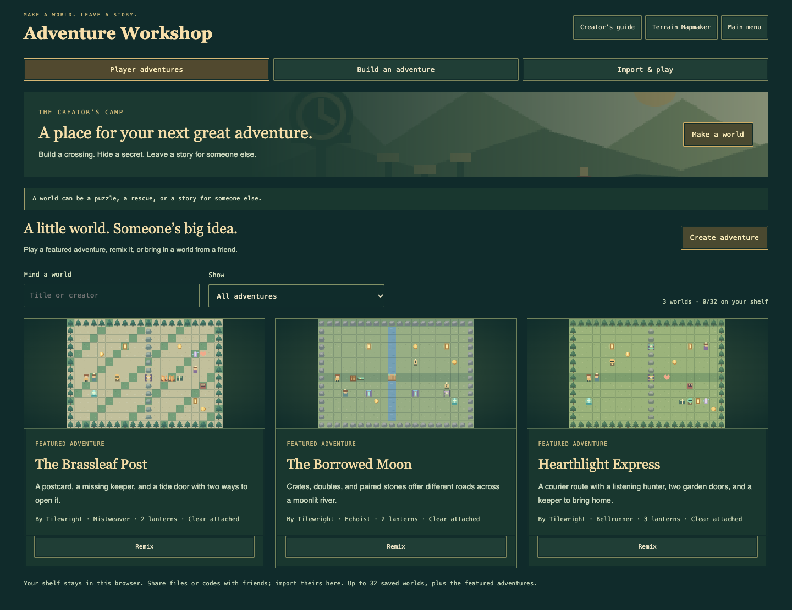
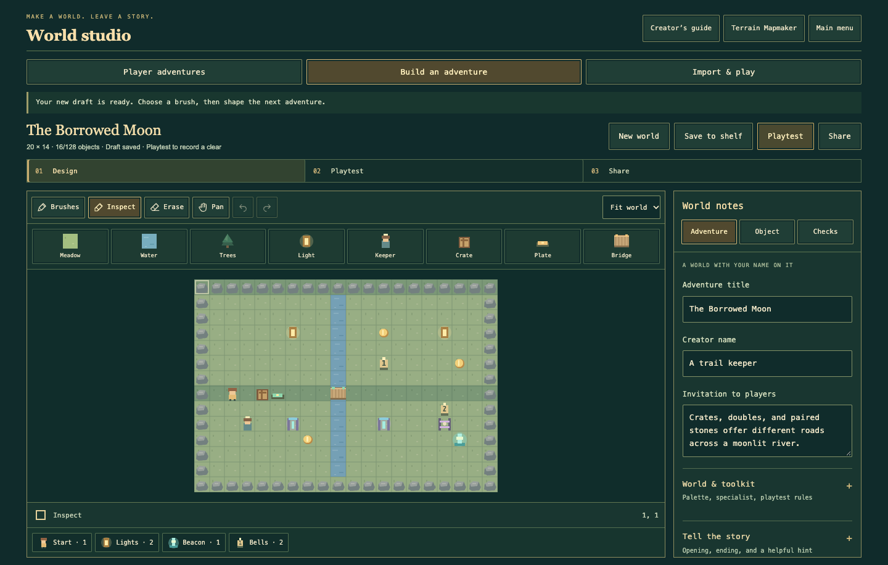

# Adventure Workshop

Open **Adventure Workshop** from the title screen, Mapmaker mode preview, or
in-game Menu. **Player adventures** holds three featured worlds and up to 32
worlds saved in this browser. Search by title or creator; preview before playing.
Trail and Nemesis bests are separate for each version of a world.

**Creator’s guide** is available in both Mapmaker and the Workshop. Its three
illustrated chapters introduce a first trail, a linked crossing, and sharing a
playtested adventure. The Workshop’s Main menu and section tabs stay reachable
while browsing a longer shelf.

## Make a world

Choose **Create adventure**, then start from:

- A blank world, from 8×8 to 64×64 cells.
- A seeded adventure: four regions × five mission recipes, with sheltered or
  perilous starting threats. The same seed and recipe reproduce the same map.
- An independent copy of the current terrain editor map. **Build adventure**
  in Mapmaker opens this choice directly.

Remix any featured or saved world. The original creator/title are credited in
the remix's origin text. Creator names are editable credits, not authenticated
accounts. Replacing an existing draft asks you to save or export it first. An untouched
first canvas does not need a replacement confirmation.

**Brushes** opens the full palette, grouped into terrain, goals, puzzles, story, threats, and stamps.
Terrain supports brush strokes, flood fill, and rectangles on the selected layer.
The palette also controls layer visibility, including hidden layers copied from
the terrain editor.
Objects replace another primary object on their cell; ferns and embers can
coexist with objects. Placing a new start, beacon, or relic moves the unique one.
Lantern-grove, supply-camp, and pressure-crossing stamps build small editable
encounters. Stamps replace their footprint; Undo restores it.

**Inspect** selects an object. Select the same cell again to cycle through
coexisting objects. Give keepers dialogue, change puzzle channels, set bell order,
or draw a threat route. Patrol waypoints must touch edge to edge and retrace at
the ends; hunters path between their waypoints. Routes have 2–24 waypoints.

**World notes → Adventure** sets the title, creator, opening, ending, hint, eight world
palettes, three-star target, specialist kit, and optional walking-only,
no-shield, or all-treasure rules. Changes apply on **Apply**, Save, Playtest,
Share, switching sections, or Main menu. Invalid fields explain what to fix.
Draft edits autosave separately from the original terrain map. **World &
toolkit**, **Tell the story**, and **Set the challenge** fold less frequent
settings away. The quick brush row paints common objects immediately; the goal
strip shows object counts and selects goal brushes. **Design → Playtest → Share**
provides the main route through creation. Checks reports map structure and an
attached creator clear separately; an attached clear is verified before sharing.

The map has Fit/100/150/200% zoom, Pan, and 30-step session Undo/Redo. Arrows move
the canvas cursor; Space/Enter paints. For rectangles, press Space at each corner.
Escape cancels a stroke/rectangle or ends route drawing. Delete removes the
selected object. Ctrl/Command Z, Shift Z/Y, and S undo, redo, and save to shelf
outside text fields/dialogs. On smaller screens, world notes open separately.

## Build an encounter

| Objects | What they do |
| --- | --- |
| Start, beacon, lanterns | One start and beacon; restore every lantern before leaving. |
| Treasure, hearts, supplies | Optional points, healing, and one-use tactical refills. Treasure can become mandatory. |
| Key, key gate | Each closed key gate consumes one key. |
| Crate, plate, pressure bridge | Hold every plate on the bridge's channel using crates, the player, or a lantern double. |
| Lever, lever door, embers | One lever per channel opens doors and disables linked cycling embers. A lever can start on or become a required goal. |
| Bells, signal gate | Number bells from 1 without gaps; ring the whole sequence to open signal gates. |
| Paired waystones | Exactly two endpoints per channel; requires a specialist kit. Travel costs energy. |
| Talking keeper | Dialogue, a decoy/shield choice, or a choice to open a linked lever instead of taking supplies. |
| Rescue keeper | Return after restoring every lantern, then escort the keeper to the beacon. |
| Singing relic | Pick it up nearby and deliver it to the beacon. Hunters can hear it; setting it down can mislead them. |
| Ferns, embers | Quiet cover and four-turn cycling hazards with editable offsets. |
| Patrol, hunter, Watcher | Fixed patrols, hunters that learn during the run, and charging sweep bosses. Hunters can appear only on Nemesis. |

**Checks** finds missing goals, overlapping objects, invalid routes/channels,
and disconnected objectives. It is an optimistic connectivity check, not a
complete puzzle solver. Test your outward and return routes, key use, crate
placement, dialogue choices, and alternate rules.

## Playtest and share

**Playtest** starts with fresh learned habits on the rules selected in Adventure
notes → World & toolkit: Trail or Nemesis. Finish the actual adventure to
attach a **creator clear** containing up to 2,000 actions. Editing the world
removes the old clear. Restarts and player adventures each get fresh habits;
hunters still learn during the run. Campaign habits and expedition checkpoints
are retained separately. Unfinished player runs restart after a reload.

**Share** offers a `.trail.json` file and an `LT1` adventure code. Send either
through your usual messaging/file service. A friend opens **Workshop → Import &
play**, chooses the file, or pastes the code. Imports preview before playing or
adding to the shelf, and never replace an open draft or terrain map.

On a publicly hosted HTTP(S) copy of the game, smaller adventures also support
**Copy play link**. The map travels in the URL fragment and opens a preview.
Local/private copies use codes/files because a localhost link cannot open your
computer's game on a friend's device. Detailed worlds may exceed the link or
code limit; use the file instead. Files are limited to 400 KB; unusually dense
worlds may need shorter dialogue, simpler terrain, or a shorter clear journal. There is no public gallery, automatic
upload, account, online rating, or live multiplayer service in this release.

Attached clears are replayed through the engine before being called verified.
The solution viewer supports Play/Pause, Step, Next 20, Restart, and speed;
watching it changes no scores, supplies, habits, or saved run. Verification proves
one recorded route on its stated rules, not every possible choice. Checksums
catch damaged codes; they do not authenticate authorship.

Keep downloaded backups. Browser storage can be cleared or unavailable. Draft,
shelf, and bests have separate stores; failed writes retain session data and
show a warning. Up to 32 saved worlds are kept without silently evicting an old
world. Export before removing one to make room.
