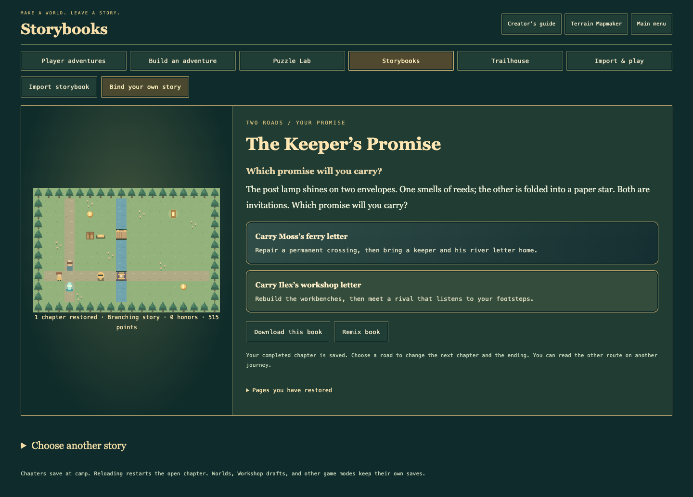

# The Keeper’s Promise — v0.25.0 verification

Date: 2026-10-23. Scope: the seven requested additions, their interaction with
existing modes, save compatibility, responsive rendering, and release packaging.

## Automated rules and storage checks

- Final test run: **564 passed, 0 failed**. Syntax checks passed; the static build
  contains **87 public assets plus two release/manifest files**.
- Five new worlds have ordinary-action clean clears on both Trail and Nemesis.
  Both book routes visit their intended three chapters and reach distinct endings.
- Branch decisions, pending crossroads, playing chapters, terminal choices,
  custom endings, and exported books restore correctly. Reject backward links,
  missing chapters, invalid choices, and forged path receipts. Keep v1 books and
  legacy game/Expedition checkpoint fixtures compatible.
- Exercise all six specialist relics, their combinations, actual costs, cooldowns,
  durations, carried supplies, matching-kit offers, retries, exact replay, and
  real multi-leg finishes. Daily runs retain the shared Wayfarer kit.
- Verify Vesper’s learned counters and committed attacks without changing ordinary
  hunter predictions. Decoys still redirect it; reading Plan spends no turn.
- Check assembly rotations, terrain/object coordinates, unique IDs, independent
  channels, paired waystones, bounds, partial links, patrol routes, occupied
  placement, slot limits, storage failure, and complete Undo/Redo snapshots.
- Verify exact completed-route replay, original fog, fastest versus last attempts,
  important moments, corrupted/oversized journals, UTF-8 archive limits, and
  unchanged live progress. Review playback cannot award rewards.
- Check curated creator clears, bookmarks, real-rescue/road memories, decoration
  eligibility, and in-session village behavior when storage is blocked or full.

## Live browser checks

Chrome **156.0.8078.47** runs the twenty-five existing browser families plus the
new activity and detailed-interaction families. Coverage includes the existing
24 story missions, Guild specialists/rules/alternate routes, generated runs,
training, all creative modes, imports/exports, settings, controls, profiles,
full backup/reset/restore, and exact Continue/Undo.

The new activity family completes both promise routes at **320, 390, 768, and
1440 px**, including native touch and keyboard input. It also exercises visible
route reviews, unchanged progress during playback, earned village decorations,
curated filters/bookmarks/verified previews, rotated assemblies with Undo/Redo,
all three Expedition powers, the daily-kit lock, and portable book authoring.

WebKit **26.6** repeats the new activity family at 320 and 1440 px. Firefox
**156.0** repeats it at 768 px. All finish successfully. Initial Firefox automation
and one Guild tablet tap timed out at inconsistent controls during concurrent
runs; the complete Firefox rerun and isolated Guild tablet/touch continuation
pass. No game-state or rendering failure was reproduced from those timeouts.

Detailed native interactions also verify a slower second run compared with its
fastest first finish, Vesper’s visible learned cutoff, a generated leg followed
by a real camp relic and changed power cast, exact reload midway through a
branching page, drag/keyboard assembly selection, and Escape cancellation.

Visual inspection covers the desktop crossroads and narrow phone views of its
choices, route review, and assembly shelf. Hide inactive discovery controls,
keep dialogs within the viewport, reduce crossroads scrolling, and collapse a
completed capture form so saved assemblies remain easy to find. The usual
local address, `127.0.0.1:4174`, is restarted with the new asset allowlist and
passes an actual chapter clear and crossroads capture.

## Practical limits

These are browser tests and viewport/touch emulation, not new physical-device,
hardware-controller, or screen-reader certification. Testing cannot establish
that a game has no possible bugs. The Trailboard is a shipped curated catalogue;
open community uploads, accounts, cloud saves, and moderation are future work.
Saves remain local to a named journey and browser, with explicit backups.

The existing GitHub Pages workflow requires all five Node/OS jobs to pass before
publishing the built game. Public deployment is checked against the release
assets and with a fresh browser playthrough before delivery.
