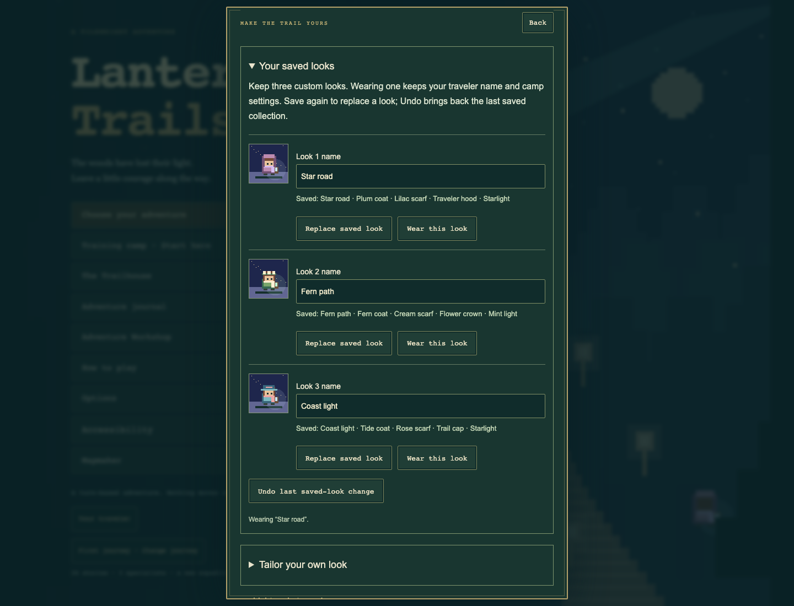

# Saved looks and release hardening — 0.28.0

## Corrections and completion

- Fixed non-idempotent name truncation: a space at the 24-character boundary
  could change the visible name again after saving/reloading. Names now normalize
  accents, retain whole graphemes, discard malformed/control text, and remain
  within the existing preferences record bound.
- Added a frame/timer yield for checkpoint and training recovery, creator proofs,
  and route review. Suspended animation frames no longer hold replay indefinitely;
  the first completion cancels both pending handles. Existing stale-result guards
  still control whether asynchronous results can be applied.
- Added three named personal looks per journey, with save/wear/replacement Undo,
  full-game backup/restore ownership, and honest session-only status for failed
  or silently refused writes. Wearing a look preserves name and camp settings.
- Added a development-only Playwright lockfile and a built-site browser job.
  Pages now requires both the Node matrix and the Chromium release suite.
- Made the repository index use tracked/staged files, excluding unfinished
  untracked work and generated test reports from reproducibility checks.

## Verification

**633 Node tests pass**, plus syntax and static-build checks. New coverage includes:

- 72 seeded mixed-action streams, capped at 64 steps, across eight campaign
  stages and all four Lanternfair worlds on both rule sets. Checks cover input
  interleavings, immutable prior states, health/energy/history bounds, Undo, and
  exact save/replay fingerprints.
- Unicode/boundary name regression cases and 200 deterministic cosmetic
  combinations through the real preferences save/load path.
- Independent wardrobe snapshots, replacement rollback, malformed/foreign/large
  data, blocked/quota/silent storage, invalid slots, journey isolation, complete
  backups, restoration, and fresh starts.
- Both scheduler completion orders, unavailable frame APIs, synchronous callbacks,
  and handle cleanup. Release serving is checked against a real generated package;
  deleting a packaged module returns 404 instead of reading development source.

The static package contains **97 public assets and two metadata files**. Test
tools, dependencies, screenshots, reports, and route generators are excluded.

Six browser scenarios pass in bundled Chromium, Firefox, and WebKit:

1. Phone saved looks and exact Continue, after a longer real action journal,
   while animation-frame callbacks are deliberately suspended.
2. The same wardrobe/recovery/game completion flow on desktop.
3. Both hands-on training lessons, actual building/history, a native playtest win,
   and downloading a world with a valid creator proof.
4. Two journeys with distinct wardrobes; actual backup download, current-journey
   fresh start, restoration, and preservation of the other journey.
5. A failed wardrobe write that retains working session looks and Undo, including
   long names and extra-large text without horizontal overflow.
6. All four Lanternfair chapters completed through real touch controls, with
   treasure, keeper dialogue, clean honors, and saved camps across reloads.

The existing saved-data, journey-profile, settings, and review browser families
also passed. The multi-tab restore test again runs without focusing the restored
tab first, exercising the recovery fix instead of working around frame suspension.

The harness was observed failing with a screenshot, console/error JSON, trace,
and nonzero exit when an initial assertion used the wrong journey namespace.
The test helper was corrected to read the active journey; the actual UI remained
isolated. Subsequent full runs passed. Outputs are separated by browser engine,
and successful reruns remove matching stale failure artifacts. Unknown case
selectors cannot produce a successful empty run.

The saved-look UI was inspected in the in-app browser, and a separate disposable
browser saved and wore all three looks for the screenshot below. These checks do
not certify every physical device or every possible future input. No remaining
failures were found in the tested scenarios.

