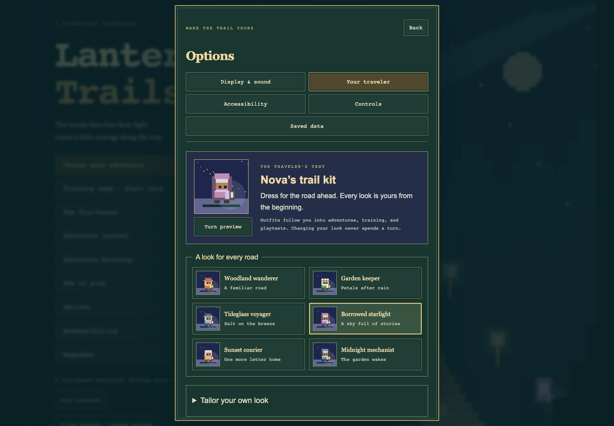
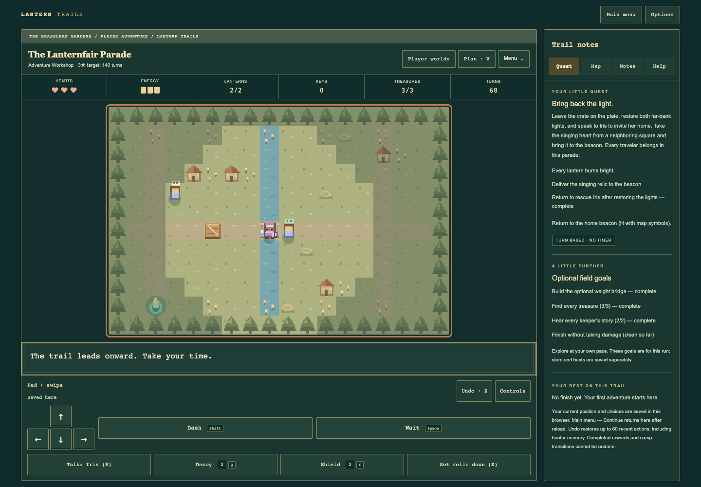

# Traveler’s Tent and Lanternfair — 0.27.0

## Delivered

- Six outfit presets and bounded custom name, coat, scarf, skin, hair color,
  hairstyle, headwear, and lantern choices, with a turning pixel-art preview.
- Three static camp backdrops, an optional steady lantern halo, shuffle/reset,
  journey-owned preferences, and the existing complete-backup path.
- One shared character renderer for adventure, training, playtest, and review
  boards. High contrast removes the halo and retains the existing white player
  outline and map cues. Appearance stays outside run state and fingerprints.
- The Lanternfair Letters: four original peaceful worlds, recurring keepers,
  three treasures per chapter, key/weight/bell crossings, and a rescue/delivery
  finale. Worlds appear in Storybooks, Discover, remixing, and book authoring.

## Verification

**598 Node tests pass**, including old preferences, every cosmetic value,
bounded Unicode names, portable worlds/books, and all four actual chapter
clears on Trail and Nemesis. The recorded walking/interaction routes take 61,
73, 92, and 78 turns, gather every treasure, hear the guides, and return without
damage. Waiting before a chapter does not introduce a timed failure.

Syntax and static packaging checks pass. The package has 94 public assets plus
release metadata and the ownership manifest; developer tools and evidence are
excluded. Existing engine/save rule versions and prior book identities remain
unchanged.

The new browser family checks every option and all six presets, themed dropdowns,
Unicode names, preview turns, shuffle/reset, reload persistence, blocked storage,
in-game clothing changes, and the festival shortcut. It compares saved progress
before/after changing clothes and confirms that typing movement letters in the
name field cannot move the player. Extra-large text and high contrast are checked
in the tent before returning to ordinary play.

- Chrome layouts: 320×568, 390×844, 768×1000, 844×390, and 1440×1000.
- Firefox and WebKit: phone/tablet settings and complete four-chapter phone
  playthroughs through real touch buttons, keeper dialogue, puzzles, and camps.
- Chrome: complete four-chapter Trail play through touch and Nemesis play through
  keyboard, including all treasure, clean honors, and reloads between chapters.
- Existing Chrome families repeated: journey profiles, saved-data management,
  dropdowns, settings, front menus, training, and route reviews. The multi-tab
  backup harness now focuses the restored tab before Continue, matching a player
  returning to it instead of relying on background animation-frame scheduling.
- A separate fresh browser chose Nova’s outfit, captured the tent, and actually
  played and finished the parade world. The in-app tent was inspected on screen.

Browser engine/emulation checks do not certify every physical device or assistive
technology. No remaining failures were found in these tested scenarios.

## Visual evidence

