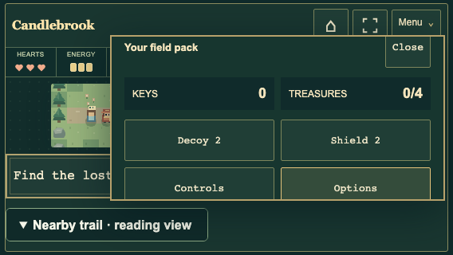
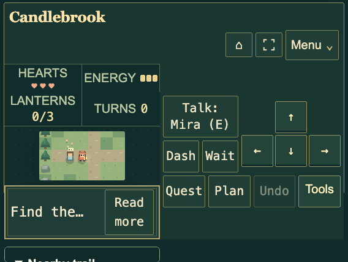

# Complete game recheck — v0.30.1

October 25, 2026. This audit checks the current game and editors, rather than
adding another content expansion.

## Findings and corrections

- Tools could open above a 568×320 landscape window. Its heading and Close
  button now remain in the viewport, with scrolling inside the pack.
- Extra-large text could make header/HUD content overflow its grid tracks and
  overlap the action dock. Text now determines those track sizes; Menu is
  anchored to its summary and bounded by the available viewport height.
- Results covered the ordinary Quest button. A visible **Quest & notes** action
  now opens the same reading dialog after a win or while paused. Closing it
  returns focus to its actual opener without changing the run or checkpoint.
- Pause did not focus Resume, and Tab could move behind the panel. Focus now
  starts on Resume and cycles through the visible result buttons. Explicit
  button-to-button movement also handles WebKit's native button-skipping behavior.
- Quest now stays in one dialog across all viewport sizes, retaining its selected
  tab while resizing and avoiding obsolete desktop reparenting logic.

## Automated and full-family browser checks

**778 Node tests pass**, together with syntax checks and the **114-file** static
build. No engine or save-format changes were needed.

All **30 extended Chromium browser families pass**, with **483 reported cases**.
Cases can contain multiple real playthroughs or option combinations; this count
is the families' result entries, not a count of every assertion or key press.
Failures were diagnosed and affected cases rerun after correction.

| Family | Reported cases |
| --- | ---: |
| accessibility | 5 |
| adventures | 7 |
| atlas | 32 |
| checkpoints | 22 |
| contracts | 3 |
| controls | 19 |
| creators | 7 |
| dropdowns | 12 |
| editor | 10 |
| expansion | 13 |
| expansionDetails | 5 |
| expeditions | 13 |
| front | 13 |
| guild | 75 |
| horizon | 27 |
| interface | 11 |
| journal | 9 |
| lab | 32 |
| layout | 7 |
| mastery | 22 |
| profiles | 10 |
| reviews | 4 |
| savedData | 12 |
| settings | 4 |
| sluices | 20 |
| storybooks | 44 |
| trailhouse | 12 |
| training | 8 |
| traveler | 8 |
| workshop | 17 |

Coverage includes complete campaign/Guild routes, seeded expeditions and camp
choices, all featured linear books on Trail/Nemesis, alternate solutions,
Storybook authoring and portable exports, Lab seals, village restoration,
world creation, terrain editing, every dropdown, every movement style,
controller input, all preference values, Undo, exact Continue, full backups,
fresh starts, isolated journeys, cross-tab changes, and unavailable storage.

The final controller/interface regression is repeated after the focus fix.
The deployment workflow independently repeats all 23 release scenarios against
the built game and runs Node tests on five OS/Node combinations before Pages
can publish.

## Cross-browser and visual checks

Chromium 156.0.8078.4, Firefox 156.0, and WebKit 26.6 exercise popup alignment,
resizing, native/external fullscreen exit, rejected-request fallback, Home
Screen assets, safe areas, large controls, extra-large text, readable messages,
real wins, pause/result focus, and library navigation. A WebKit keyboard failure
was reproduced, corrected, and passed again in all three engines.

A separate live visual pass checks twelve combinations: standard and extra-large
reading at 320×568, 390×844, 568×320, 844×390, 768×1024, and 1440×900, with large
right-side controls and the nearby reading view enabled. It inspects board and
popup bounds, clipped button labels, document width, and runtime errors.
The release regressions also cover eight ordinary sizes and simulated safe areas.
No horizontal overflow or clipped action labels remains in those checks.
Creator, settings, portrait, landscape, and popup screenshots were reviewed.

## Test maintenance

Older checks expected the pre-v0.30 dock, permanent desktop notes, unpaged
world cards, and banners outside Quest. They now navigate the real visible
Tools, result-note, Quest, and Main menu controls. Portable input journals also
handle cooperative switching and cargo. Menu navigation, route completion,
state comparisons, and actual backup files remain real browser operations;
tests do not bypass hidden controls or inject completed runs.

The published-site check compares all 112 public asset hashes with the built
package, then repeats presentation/navigation scenarios and full new-book runs
on the public website.

## Limits

These are browser-engine and emulated-viewport checks, not certification of every
physical phone, branded Safari build, extension, or controller. Safe-area and
controller tests include simulations. Very short screens with extra-large text
can use vertical scrolling to preserve readable labels and reachable actions.
Native fullscreen remains browser/device dependent, with expanded view as the
fallback. Successful tests establish the checked behavior; they do not prove
that no possible bug exists.
